# Báo cáo tiểu luận Hệ thống quản lí và khai thác thư viện LAMS

**Tác giả:** Nguyễn Trọng Tuấn — Mã sinh viên 23010690.

Báo cáo được thực hiện trong học phần Thiết kế Web nâng cao. Các chương 1–8 trình bày bài toán, thiết kế và kết quả xây dựng LAMS của nhóm. Chương 9 trình bày phần việc tôi phụ trách, cách triển khai và những vấn đề rút ra trong quá trình tích hợp. Chương 10 đánh giá kết quả chung và hướng phát triển. Phạm vi đóng góp của thành viên còn lại được giới thiệu ở mục 1.3 để làm rõ cách phối hợp trong nhóm.

# Tóm tắt

LAMS hỗ trợ tìm tài liệu và quản lý bản sách vật lý tại thư viện. Người đọc tra cứu tác phẩm, xem ấn bản, lưu sách yêu thích, đánh giá và theo dõi mượn, giữ chỗ. Nhân viên biên mục, xử lý giao dịch tại quầy, kiểm kê và xem báo cáo. Quản trị viên quản lý tài khoản và các quyết định cần thẩm quyền cao hơn. Hệ thống tách tác phẩm (`Book`), ấn bản (`Edition`) và bản vật lý (`BookCopy`), vì một nhan đề không tương đương một mã vạch hoặc một số lượng tồn kho.

Giao diện React/TypeScript chạy trên trình duyệt và trong ứng dụng Tauri/WebView2 Windows. Core Service dùng Spring Boot, JDBC và Flyway để quản lý danh tính, Catalog, lưu thông và kiểm kê. Insight Service dùng NestJS/Prisma cho lịch sử tra ISBN, thông báo và đề xuất bổ sung. Mỗi dịch vụ sở hữu một database PostgreSQL.

Mốc hệ thống chung là `d0ba015` trên main ngày 29/10/2026, đã tích hợp PR #31, #32 và #33. Đợt giao diện ngày 30/10 tại `011eb53` bổ sung dashboard theo dữ liệu thật, màn báo cáo giữ chỗ, thông báo và thiết lập cá nhân; các thay đổi được review trong PR #35, chưa merge vào main. API báo cáo giữ chỗ do Toàn bàn giao, phần tích hợp giao diện do tôi thực hiện. Kết quả kiểm thử được trình bày theo từng commit ở Chương 7 và hồ sơ minh chứng, không gán kết quả EXE cũ cho phiên bản mới.

Các chương 1–8 phân tích hệ thống chung; Chương 9 trình bày phần việc cá nhân của tôi; Chương 10 đánh giá kết quả và giới hạn. LAMS đã có các luồng nghiệp vụ chính và kiểm thử tự động, nhưng chưa nghiệm thu vận hành production, trợ năng đầy đủ hoặc cài đặt trên máy thứ hai.

**Từ khóa:** thư viện; PostgreSQL; JDBC; Prisma; Tauri; kiểm kê; giữ chỗ.

# Mục lục

<!--TOC-->

# Danh mục hình

<!--LISTFIG-->

# Danh mục bảng

<!--LISTTAB-->

# Từ viết tắt

Bảng 1. Thuật ngữ sử dụng trong báo cáo.

| Thuật ngữ | Nghĩa trong LAMS |
|---|---|
| API | Giao diện lập trình giữa frontend, Core và Insight. |
| AC | Điều kiện chấp nhận của câu chuyện người dùng. |
| Core | Dịch vụ Spring Boot sở hữu dữ liệu thư viện có thẩm quyền. |
| Insight | Dịch vụ NestJS/Prisma phục vụ metadata, thông báo và đề xuất. |
| JWT | Access token ký số, được giữ trong bộ nhớ trình duyệt. |
| ORM | Ánh xạ qua Prisma Client ở Insight; Core dùng JDBC thay vì ORM entity. |
| PR | Pull request để review trước khi tích hợp vào `main`. |
| WebView2 | Bộ máy hiển thị web trong ứng dụng Tauri trên Windows. |

# Chương 1. Tổng quan đề tài

## 1.1. Bối cảnh và bài toán

Ở thư viện có nhiều chi nhánh, cùng một tác phẩm có thể tồn tại dưới nhiều ấn bản, và mỗi ấn bản có nhiều bản sách với mã vạch, kệ và trạng thái riêng. Một bảng sách duy nhất không thể trả lời đồng thời “tác phẩm này nói về gì?”, “ấn bản nào có ISBN này?” và “bản vật lý nào còn cho mượn tại chi nhánh A?”. LAMS tách ba cấp dữ liệu đó và đặt thay đổi trạng thái bản sách trong giao dịch có kiểm tra cạnh tranh. Người đọc chỉ xem thông tin công khai và dữ liệu của mình; nhân viên cần màn hình nghiệp vụ và bằng chứng để xử lý sai lệch.

Tra cứu ISBN và ảnh từ bên ngoài có thể hỗ trợ biên mục, nhưng nguồn ngoài không tự trở thành dữ liệu chính thức của thư viện và không mặc nhiên cấp quyền sao chép. Ảnh theo tác giả/ấn bản vì vậy cần đối chiếu và duyệt; metadata chỉ là ứng viên. Bộ 10.000 định danh từ Project Gutenberg phục vụ diễn tập tìm kiếm, không chứng minh có 10.000 bản sách vật lý [1].

## 1.2. Mục tiêu và phạm vi

Mục tiêu đã triển khai là tra cứu Catalog có phân trang, thao tác tài khoản an toàn, mượn/trả/gia hạn và giữ chỗ nhất quán, kiểm kê có bằng chứng, báo cáo lưu thông, thông báo và đề xuất nội bộ. Giao diện web và Tauri dùng chung React. Thao tác thất bại không được hiển thị là thành công.

LAMS chưa có thanh toán, đơn mua gửi nhà cung cấp, ngân sách phê duyệt, xếp hạng vector/semantic search hoặc triển khai HTTPS nhiều máy đã nghiệm thu. `APPROVED` trong đề xuất bổ sung chỉ là quyết định nội bộ. Bộ cài Windows đóng gói giao diện, không chứa hai backend hay database. Những giới hạn này ảnh hưởng trực tiếp đến cách trình diễn và kết luận ở Chương 10.

Bảng 2. Thành phần runtime và trách nhiệm.

| Thành phần | Công nghệ | Trách nhiệm và giới hạn |
|---|---|---|
| Web và desktop | React, TypeScript, Vite, Tauri/WebView2 | Cùng route/component; desktop vẫn gọi API đang chạy. |
| Core | Java 21, Spring Boot, Security, JDBC, Flyway | Identity, Catalog, Copy, Loan, Hold, Inventory, read projection và outbox. |
| Insight | Node 22, NestJS, Prisma | Metadata/history, Inbox, đề xuất; xác minh actor qua Core. |
| Dữ liệu | Hai database PostgreSQL | Không có FK xuyên dịch vụ; migration theo owner. |
| Hạ tầng tùy chọn | Kafka, Redis, MinIO | Kafka phục vụ outbox/consumer khi bật; MinIO không phục vụ ảnh Catalog hiện tại. |

[Hình 1](#fig-1) tách ranh giới người dùng, ứng dụng và hai database. Kênh sự kiện là tùy chọn, không thay giao dịch đồng bộ của mượn/trả.

## 1.3. Phân công và nguồn xác nhận

Nhóm gồm Nguyễn Trọng Tuấn (23010690) và Vũ Đức Toàn (23010062). Tôi phụ trách nền tảng ứng dụng, giao diện, triển khai desktop và tích hợp các dịch vụ. Toàn phụ trách những module backend được giao theo từng giai đoạn, trong đó có Favorites/Reviews/Rating, truy vấn kiểm kê và taxonomy/alias. Khi tiếp nhận một module, tôi kiểm tra hợp đồng API, nối giao diện và chạy hồi quy trên luồng liên quan. Phần backend được bàn giao vẫn được ghi nhận theo lịch sử commit và PR của người thực hiện.

Phạm vi công việc thay đổi trong quá trình phát triển. Một số phần tích hợp và phần việc còn lại được tiếp tục trên nhánh DEV1 khi nhóm áp dụng phương án dự phòng. Vì vậy, báo cáo trình bày đóng góp theo đầu việc và sản phẩm cụ thể, không tính tỷ lệ từ số commit hoặc số dòng mã. Phần chi tiết của tôi nằm ở Chương 9; lịch sử PR là nguồn để đối chiếu quá trình bàn giao [2].

## 1.4. Cách tổ chức phát triển và kiểm soát thay đổi

Nhóm triển khai theo từng phần tăng dần, dựa vào user story, task map và hợp đồng API trong repository. Phase 1 xây nền tảng, danh tính và môi trường; Phase 2 tập trung Catalog, metadata và media. Phần bổ sung 2.5 làm rõ persistence lịch sử ISBN và đường chạy desktop. Phase 3 nối Favorites/Reviews/Rating; Phase 4 hoàn thiện lưu thông và giữ chỗ; Phase 5 kiểm kê; Phase 6 tìm kiếm và taxonomy/alias; Phase 7 báo cáo, tín hiệu bổ sung; Phase 8 kiểm thử phát hành, an toàn và phục hồi. Đây là cách phân kỳ công việc thực tế, không phải bằng chứng nhóm áp dụng đầy đủ Scrum hay một quy trình chứng nhận.

Yêu cầu được phân tích từ bài toán thư viện, tiêu chí học phần và phản hồi khi tác giả thử ứng dụng. Nhóm chuyển yêu cầu thành actor, quyền, dữ liệu đầu vào, bất biến và đầu ra API trước khi nối màn hình. Với thay đổi liên quan nhiều module, chẳng hạn Edition tùy chọn trong Hold hoặc alias thể loại, hợp đồng và migration cần thống nhất trước; tên bảng và quy tắc không được suy ra chỉ từ giao diện.

DEV1 dùng nhánh `Tuan/core-platform`, DEV2 dùng `Toan/common-modules`; phần tích hợp đi qua PR vào `main`. Lịch sử PR phân biệt module bàn giao, sửa lỗi và phần nối UI. Một nhóm chức năng chỉ được xem là tích hợp khi có mã thực thi, migration/hợp đồng tương ứng, kiểm quyền và đường lỗi, các bài kiểm liên quan đạt, cùng hướng dẫn chạy có thể tái lập. Job CI đạt là điều kiện kỹ thuật, không đồng nghĩa người dùng đã nghiệm thu tất cả tình huống [2], [21].

Khi yêu cầu đổi, nhóm rà tác động tới dữ liệu, API, giao diện và bằng chứng; sửa test hồi quy cùng phần bị ảnh hưởng, rồi cập nhật tài liệu trong cùng đợt bàn giao. Phần chưa có căn cứ triển khai được giữ trong giới hạn thay vì mô tả như tính năng hoàn thành. Nợ kỹ thuật còn lại gồm hạn mức theo process, vận hành HTTPS, kiểm Windows trên máy khác và retention xuyên dịch vụ; chúng được nối với rủi ro ở mục 4.6 và điều kiện pilot ở Chương 10.

# Chương 2. Phân tích yêu cầu

## 2.1. Tác nhân, use case và quyền

`READER` tra cứu công khai, quản lý đóng góp và giao dịch của mình. `LIBRARIAN` biên mục, thao tác ở quầy, kiểm kê và xem báo cáo. `ADMIN` có các quyền nhân viên cùng chức năng quản lý tài khoản, xử lý báo cáo đánh giá và quyết định no-show. Nguồn metadata và email là hệ thống ngoài, không có quyền ghi Catalog. Quyền phải được Core/Insight kiểm tại request; ẩn nút trong UI chỉ giảm thao tác nhầm. [Hình 2](#fig-2) dùng actor, ellipse, association và biên hệ thống để biểu diễn phần Khách/Người đọc. Phần Thủ thư/Quản trị viên ở [Hình 20](#fig-20).

## 2.2. Câu chuyện người dùng

US01–US22 đối chiếu với `tai-lieu/01-yeu-cau/user-stories.md`. US23–US29 tổng hợp từ mã PR #31 và tài liệu nghiệp vụ, chưa thay mã số trong task map gốc. Một story có mặt ở đây khi có màn hình hoặc API thật; điều kiện chấp nhận là tiêu chí kiểm chứng, không tự chứng minh đã PASS.

Bảng 3. Câu chuyện người dùng US01–US15.

| Mã | Câu chuyện người dùng | Điều kiện chấp nhận ngắn |
|---|---|---|
| US01 | Là người đọc mới, tôi muốn đăng ký để dùng dịch vụ thư viện. | Email trùng bị từ chối; tài khoản mới có vai trò READER. |
| US02 | Là thành viên, tôi muốn đăng nhập bằng email hoặc mã thành viên. | Sai mật khẩu hoặc tài khoản khóa không được cấp phiên. |
| US03 | Là thành viên, tôi muốn đăng xuất để kết thúc phiên. | Refresh token bị thu hồi; UI xóa dữ liệu phiên. |
| US04 | Là thành viên, tôi muốn xem hồ sơ của mình. | Principal chỉ đọc dữ liệu thuộc mình. |
| US05 | Là thủ thư, tôi muốn tìm thành viên tại quầy. | Có lọc/phân trang; READER nhận 403. |
| US06 | Là người đọc, tôi muốn tìm sách theo từ khóa, tác giả và thể loại. | Kết quả, tổng và trang nhất quán trong một request. |
| US07 | Là người đọc, tôi muốn xem các ấn bản của tác phẩm. | Book và Edition tách; ID sai trả 404. |
| US08 | Là người đọc, tôi muốn xem tác giả và sách liên quan. | Truy vấn đúng tác giả; ảnh thiếu có fallback rõ. |
| US09 | Là thủ thư, tôi muốn sửa Catalog để biên mục chính xác. | CRUD kiểm quyền, ràng buộc và xung đột. |
| US10 | Là thủ thư, tôi muốn quản lý chi nhánh, kệ và mã vạch. | Barcode duy nhất; kệ thuộc đúng chi nhánh. |
| US11 | Là thủ thư, tôi muốn tra ISBN để hỗ trợ biên mục. | ISBN hợp lệ; provider không tự ghi Core. |
| US12 | Là thủ thư, tôi muốn duyệt ảnh và nguồn sử dụng. | Cần nguồn, giấy phép, bằng chứng và xác nhận. |
| US13 | Là thủ thư, tôi muốn quản lý lịch sử tra ISBN của mình. | Lưu sau reload; bản ghi người khác trả 404. |
| US14 | Là người đọc, tôi muốn lưu sách yêu thích. | Danh sách gắn tài khoản, tồn tại sau reload. |
| US15 | Là người đọc, tôi muốn viết và sửa đánh giá. | Chỉ chủ sở hữu sửa; input sai bị từ chối. |

Bảng 4. Câu chuyện người dùng US16–US29.

| Mã | Câu chuyện người dùng | Điều kiện chấp nhận ngắn |
|---|---|---|
| US16 | Là người đọc, tôi muốn chấm điểm sách từ một đến năm. | Tổng và trung bình lấy từ review đang hiển thị. |
| US17 | Là thủ thư, tôi muốn ghi nhận một lượt mượn. | Chỉ bản sẵn có được mượn; retry cùng request không nhân đôi. |
| US18 | Là thủ thư, tôi muốn nhận trả đúng lượt mượn. | Loan/Copy/Hold đổi cùng giao dịch; retry không nhân đôi. |
| US19 | Là người mượn hoặc thủ thư, tôi muốn gia hạn lượt mượn hợp lệ. | Chặn khi quá hạn, hết lượt hoặc có người chờ phù hợp. |
| US20 | Là người đọc, tôi muốn giữ chỗ tác phẩm tại chi nhánh nhận. | Hàng chờ và hạn nhận do server quyết định. |
| US21 | Là người đọc, tôi muốn xem lượt mượn của mình. | Không đọc lịch sử của người khác; staff có bộ lọc riêng. |
| US22 | Là nhân viên, tôi muốn xem và xuất báo cáo lưu thông. | Khoảng ngày hợp lệ; CSV không lộ danh tính và chống formula. |
| US23 | Là thành viên, tôi muốn chọn giao diện dễ đọc và lưu lựa chọn. | Khách lưu local; tài khoản lưu Core, revision ngăn ghi đè. |
| US24 | Là người đọc, tôi muốn báo cáo đánh giá không phù hợp. | Mỗi người một báo cáo/review; ADMIN quyết định có lý do. |
| US25 | Là quản trị viên, tôi muốn khóa tài khoản hoặc đổi vai trò. | Kiểm quyền và version; quyết định được lưu. |
| US26 | Là người đọc, tôi muốn xem thông báo giữ chỗ. | Chỉ xem/đánh dấu mục của mình; cần outbox/consumer bật. |
| US27 | Là nhân viên, tôi muốn xem tín hiệu bổ sung sách. | Số liệu/confidence có nguồn; phê duyệt nội bộ cần lý do. |
| US28 | Là quản trị viên, tôi muốn rà trường hợp không nhận sách giữ chỗ. | Xác nhận/miễn trừ có lý do; không tự phạt. |
| US29 | Là thủ thư, tôi muốn dùng camera hoặc hàng đợi tạm để quét mã. | Camera chỉ điền ô; offline tối đa 20 mã trong bộ nhớ. |

## 2.3. Yêu cầu phi chức năng và ma trận truy vết

Các yêu cầu quan trọng là quyền ở server, bất biến khi hai người thao tác cùng Copy, giới hạn payload/phân trang, xử lý lỗi mạng trung thực, giao diện dùng bàn phím và alt text cho ảnh. Hệ thống lưu ISBN, review và quyết định quản trị nên phải xét truy cập chéo tài khoản, SQL injection, CSV formula injection và SSRF. Số đo local không thay SLA của pilot. [Bảng 6](#tbl-6) nối story với nơi thực thi và bài kiểm chứng; AC chi tiết của US01–US22 ở tài liệu gốc [3].

Bảng 5. Tiêu chí phi chức năng và mức kiểm chứng.

| ID | Nhóm | Yêu cầu | Tiêu chí chấp nhận | Cách kiểm | Bằng chứng | Trạng thái |
|---|---|---|---|---|---|---|
| N01 | Hiệu năng | Tìm kiếm và kiểm kê có chi phí kiểm soát | Phân trang có giới hạn; chưa chốt p95 pilot | Benchmark có fixture; xem query plan | Mục 7.3, tài liệu [7] | Đã đo local; chưa nghiệm thu SLA |
| N02 | An toàn | Quyền và owner kiểm tại server | 401/403/404 theo contract; input không thành SQL | HTTP và PostgreSQL test | AUTH/SEC ở mục 7.2 | Có kiểm soát; chưa chứng nhận không có lỗ hổng |
| N03 | Tin cậy | Retry không nhân đôi giao dịch | Cùng request trả receipt cũ | Test retry và tranh chấp | LoanCommand, InventorySession tests | Đạt các ca tự động |
| N04 | Toàn vẹn | Không mượn kép hoặc ghi nửa giao dịch | Tối đa một Loan mở/Copy; rollback đầy đủ | Testcontainers, constraint | LOAN-01, TX-01 | Đạt các ca tự động |
| N05 | Sẵn sàng | Lỗi phụ trợ không báo thành công sai | Core không chờ Kafka; Insight lỗi có phản hồi | Test outage/health | OutboxPublisher, history HTTP | Có cơ chế suy giảm; chưa có SLA uptime |
| N06 | Bảo trì | Đổi schema/API có đường kiểm | Migration và contract validation đạt | Pipeline từ checkout sạch | Core, api-contracts CI | Đạt gate tự động tại baseline |
| N07 | Dễ dùng | Người dùng biết trạng thái và đường phục hồi | Lỗi có thông báo; giữ chỗ có điểm truy cập | E2E, thử các vai trò | 22 Web E2E; ảnh có SHA | Có kiểm kỹ thuật; chưa khảo sát người dùng |
| N08 | Trợ năng | Đọc/điều hướng được khi giảm hiệu ứng | Focus, nhãn, alt và reduced motion | Component test, review UI | Chương 5, WCAG [19] | Một phần; chưa audit WCAG đầy đủ |
| N09 | Mở rộng | Giới hạn tải và tránh scan không chặn | Page/row cap; chưa chốt tải đồng thời pilot | Query/test giới hạn | Catalog, report row-cap tests | Giới hạn đã có; scale-out chưa nghiệm thu |
| N10 | Khả chuyển | React chạy web và WebView2 | Build Windows và luồng EXE chạy với API | CI build; E2E local riêng | T09–T10, tài liệu desktop | Chưa thử cài/gỡ trên máy thứ hai |
| N11 | Phục hồi | Khôi phục được cả hai database | Restore cô lập và smoke; chưa chốt RPO/RTO | Diễn tập theo runbook | Tài liệu [10] | Có diễn tập cũ; pilot cần chạy lại |
| N12 | Quan sát | Phát hiện lỗi mà không lộ secret | Health phản ánh phụ thuộc; log lỗi có giới hạn | Health/outbox tests, kiểm log | PilotAuthSecurityTest, health tests | Có kiểm; chưa có giám sát tập trung |

“Đạt các ca tự động” chỉ áp dụng đầu vào mà test bao phủ. Những ngưỡng chưa xác lập không được đổi thành con số cam kết. Mốc của từng phép đo nằm ở Chương 7; bảng này không lấy thời gian local làm hiệu năng production.

Bảng 6. Truy vết US01–US29: mã nguồn đối chiếu `d0ba015`, kết quả suite theo Chương 7.

| Mã / UC / ưu tiên | API, service và UI | Dữ liệu, bài kiểm chứng và kết quả |
|---|---|---|
| US01 / UC01 / P1 | POST `/auth/register`; Core `AuthService`; RegisterPage. | `users`, `user_roles`; AuthIntegrationTest; Core CI PASS. |
| US02 / UC02 / P1 | POST `/auth/login`, `/auth/refresh`; Core `AuthService`; LoginPage. | `users`, `refresh_tokens`; AuthIntegrationTest, AuthFlow; Core/Web E2E CI PASS. |
| US03 / UC03 / P1 | POST `/auth/logout`; Core `AuthService`; AuthProvider. | `refresh_tokens`; AuthIntegrationTest, client test; Core/frontend CI PASS. |
| US04 / UC04 / P1 | GET `/me/profile`; Core `MemberService`; ProfilePage. | `users`; MemberIntegrationTest; Core CI PASS. |
| US05 / UC05 / P1 | GET `/members`; Core `MemberService`; MemberListPage. | `users`; MemberIntegrationTest, MemberFlow; Core CI PASS. |
| US06 / UC06 / P1 | GET `/public/catalog/books`; Core `PublicCatalogService`; CatalogPage. | `books`, `book_authors`, `book_categories`; PublicCatalogIntegrationTest; Core CI PASS. |
| US07 / UC07 / P1 | GET `/public/catalog/books/{id}`, `/public/catalog/books/{id}/editions`; Core `PublicCatalogService`; BookDetailPage. | `books`, `editions`; EditionIntegrationTest, CatalogFlow; Core CI PASS. |
| US08 / UC08 / P2 | GET `/public/catalog/authors/{id}`, `/public/catalog/books?authorId`; Core `PublicCatalogService`; AuthorDetailPage. | `authors`, `book_authors`; AuthorIntegrationTest; Core CI PASS. |
| US09 / UC09 / P1 | Catalog CRUD; Core `BookService`, `EditionService`; StaffCatalogPage. | `authors`, `categories`, `books`, `editions`; Catalog integration; Core CI PASS. |
| US10 / UC10 / P1 | Branch/Shelf/Copy APIs; Core `BranchService`, `ShelfService`, `BookCopyService`; StaffCatalogPage. | `branches`, `shelves`, `book_copies`; InventoryCatalogIntegrationTest; Core CI PASS. |
| US11 / UC11 / P2 | GET `/metadata/books/{isbn13}`; Insight `MetadataService`; MediaEditor. | Không lưu payload provider; metadata.spec, metadata-guard.spec; Node CI PASS. |
| US12 / UC12 / P2 | `/catalog-media/{kind}/{id}`; Core `MediaService`; MediaEditor. | `catalog_media_references`; MediaIntegrationTest; Core CI PASS. |
| US13 / UC13 / P1 | `/metadata/history`; Insight `HistoryService`; MetadataHistory. | `metadata_lookups`; history.integration và history.spec; Node CI PASS. |
| US14 / UC14 / P1 | `/me/favorites`; Core `FavoriteService`; MyLibraryPage. | `favorites`; FavoriteIntegrationTest, LibraryFlow; Core/Web E2E CI PASS. |
| US15 / UC15 / P1 | `/books/{id}/reviews`; Core `ReviewService`; ReviewSection. | `reviews`; ReviewIntegrationTest, ReviewConcurrencyTest; Core CI PASS. |
| US16 / UC16 / P1 | Review mutation/summary; Core `RatingService`; RatingInput. | Rating nằm trong `reviews`; ReviewIntegrationTest; Core CI PASS. |
| US17 / UC17 / P1 | POST `/loans`; Core `LoanCommandService`; StaffCirculationPage. | `loans`, `circulation_requests`; LoanCommandIntegrationTest; Core CI PASS. |
| US18 / UC18 / P1 | POST `/loans/{id}/return`; Core `LoanCommandService`, `HoldAllocationService`; StaffCirculationPage. | `loans`, `book_copies`, `holds`; LoanCommand/HoldIntegrationTest; Core CI PASS. |
| US19 / UC19 / P1 | POST `/loans/{id}/renew`; Core `LoanRenewalService`; Reader/Staff circulation. | `loan_extensions`; HoldIntegrationTest; Core CI PASS. |
| US20 / UC20 / P1 | `/holds`, `/holds/{id}/cancel`; Core `HoldService`, `HoldAllocationService`; HoldCreatePage. | `holds`, `hold_changes`; HoldIntegrationTest; Core CI PASS. |
| US21 / UC21 / P1 | GET `/me/loans`, `/loans`; Core `LoanHistoryService`; ReaderLoansPage. | `loans`; LoanHistoryIntegrationTest; Core CI PASS. |
| US22 / UC22 / P1 | GET `/reports/circulation(.csv)`; Core `CirculationReportService`, `LoanCsvExporter`; CirculationReportPage. | `loans`; LoanHistoryIntegrationTest, LoanCsvExporterTest; Core CI PASS. |
| US23 / UC23 / P1 | GET/PUT `/me/ui-preferences`; Core UiPreferencesController; AppearancePage. | `user_ui_preferences`; UiPreferencesIntegrationTest, AppearanceProvider.test; Core/frontend CI PASS. |
| US24 / UC24 / P1 | Review report/moderation API; Core `ReviewModerationService`; ReviewSection/Admin moderation. | `review_reports`, `review_moderation_audit`; ReviewModerationIntegrationTest; Core CI PASS. |
| US25 / UC25 / P1 | Admin account API; Core `AdminAccountService`; AdminAccountsPage. | `users`, `account_admin_audit`; AdminAccountIntegrationTest; Core CI PASS. |
| US26 / UC26 / P1 | Insight Inbox API; `NotificationProcessor`; NotificationsPage. | `reader_notifications`, Core outbox; notification integration; Node CI PASS. |
| US27 / UC27 / P2 | Core facts/Insight recommendation API; `AcquisitionFactsService`, workflow Insight; AcquisitionPage. | `acquisition_recommendations`, `acquisition_decisions`; recommendation integration; Node CI PASS. |
| US28 / UC28 / P2 | No-show decision API; Core `HoldNoShowService`; HoldReliabilityPanel. | `hold_no_show_decisions`; HoldIntegrationTest; Core CI PASS. |
| US29 / UC29 / P2 | Inventory scan API; Core `InventorySessionService`; InventorySessionPage camera/queue. | `inventory_scans`; InventorySessionIntegrationTest, E2E; Core/Web E2E CI PASS. |

Trong bảng, đường Core được viết gọn sau `/api/v1`; metadata/history thuộc API Insight. API đầy đủ và schema nằm trong OpenAPI [3]. Actor, nội dung và điều kiện chấp nhận của từng mã nằm ở Bảng 3–4; P1/P2 là thứ tự ưu tiên của báo cáo, UC01–UC22 theo tài liệu yêu cầu gốc, UC23–UC29 là chỉ mục bổ sung của báo cáo. Cột kết quả chỉ khẳng định suite chứa bài kiểm liên quan đã đạt; kết quả mới nhất đối chiếu run `40880637621`, còn số liệu cũ vẫn ghi riêng tại Bảng 14. Mã TC ở mục 7.2 nối đầu vào và assertion cụ thể với requirement, giúp tránh suy từ PASS của cả job sang từng AC. US29 tập trung hỗ trợ quét; UC29 mở rộng ngữ cảnh phiên kiểm kê để giải thích snapshot, chốt và xử lý sai lệch, không coi camera là toàn bộ nghiệp vụ.

# Chương 3. Phân tích đối tượng và dữ liệu

## 3.1. Thực thể và bất biến

`Book` là tác phẩm logic, `Edition` là lần xuất bản có ISBN/ngôn ngữ/nhà xuất bản khi biết, `BookCopy` là tài sản có barcode, trạng thái, kệ và version. Bảng nối liên kết Book với Author/Category. Một Loan mở chỉ trỏ tới một Copy; unique partial index ngăn hai Loan chưa trả trên cùng Copy. Hold gắn Book, có thể chọn đúng Edition hoặc chấp nhận ấn bản phù hợp tại chi nhánh nhận. Một người có tối đa một Hold WAITING/READY cho cùng Book; một Copy chỉ có một assignment READY. Những điều kiện này không thể bảo đảm bằng nút UI và được kiểm trong transaction/constraint.

`InventorySession` chụp snapshot trước khi nhận scan; bảng `inventory_scans` giữ `client_scan_id` để retry, các record `InventoryEvidence.Scan/Anomaly` biểu diễn bằng chứng và `InventoryResolution` ghi quyết định. Không xóa snapshot khi sửa kệ, vì nếu không sẽ mất căn cứ đối chiếu. `Review` là nhận xét của một user trên một Book, rating 1–5; điểm hiển thị chỉ lấy review VISIBLE. `MetadataLookup` ở Insight lưu UUID owner, ISBN, dấu vết provider/status trong `attempts` và thời gian, không lưu response của nhà cung cấp. UUID liên dịch vụ không phải khóa ngoại xuyên database.

## 3.2. Cấu trúc lớp UML

[Hình 3](#fig-3) thể hiện các Java record miền quan trọng bằng lớp UML, thuộc tính thật và các phương thức `Loan.active/overdueAt`, `Hold.active`. Các đường quan hệ miền có bội số đối chiếu schema; service/repository giải quyết tham chiếu UUID, không phải JPA association hoặc liên kết đối tượng được ORM nạp tự động. `Book` chứa `RelatedItem`, không chứa đối tượng `Author` hay `Category`; các bảng nối ở ERD mới thể hiện quan hệ nhiều-nhiều. `HoldAllocationService` và `InventorySessionService` là lớp xử lý bên ngoài hình. Ký pháp lớp/tham chiếu theo cách đọc UML [13]. Core dùng `JdbcTemplate` ánh xạ dòng vào record/DTO; Insight dùng Prisma model và Client. DTO kiểm biên HTTP, service giữ bất biến, repository thực hiện SQL trong transaction.

## 3.3. ERD và vòng đời schema

Flyway Core có V1–V31; V31 tạo `user_ui_preferences` với khóa người dùng, revision và JSONB preset. Prisma Insight có migration độc lập cho `metadata_lookups`, `acquisition_recommendations`/`acquisition_decisions`, notices và Inbox. [Hình 4](#fig-4) là ERD có khóa và Crow's Foot của đường Book–Edition–Copy–Loan/Hold. Chỉ vẽ các bảng cần giải thích luồng lưu thông để đọc được khi in A4; khóa/constraint khác xem migration và data dictionary. Các bảng dự kiến `search_documents`, `media_assets` hay `system_policies` không có trong ERD thực thi. [Hình 5](#fig-5) tách Insight; chỉ `acquisition_decisions.recommendation_id` là FK vật lý trong các quan hệ được vẽ. UUID Book/Branch/User chỉ là tham chiếu logic tới Core.

Với ảnh, `catalog_media_references` trỏ đúng một Author hoặc Edition, lưu URL, giấy phép, ghi công, bằng chứng và quyết định duyệt. Favorite có khóa ghép user/book; Review có thể cần giữ bằng chứng khi có báo cáo. Xóa User không đồng nghĩa xóa sạch dữ liệu ở Insight; vòng đời thông báo, lịch sử ISBN và quyết định cần chính sách, công cụ riêng trước pilot. Bảng 7 phân biệt quan hệ vật lý với tham chiếu logic.

Bảng 7. Quan hệ và ràng buộc dữ liệu tiêu biểu.

| Quan hệ | Ràng buộc đang dùng | Hệ quả nghiệp vụ |
|---|---|---|
| Book → Edition → BookCopy | FK và barcode unique | Không suy số bản từ Book; Copy là tài sản cụ thể. |
| Branch → Shelf → BookCopy | FK, kiểm cùng chi nhánh | Không chuyển Copy sang kệ của chi nhánh khác. |
| User/Copy → Loan | FK và unique partial Loan mở | Hai giao dịch không cùng mượn một bản. |
| User/Book → Hold | Unique active theo người/Book; READY theo Copy | Chặn yêu cầu trùng và phân bổ kép. |
| Session → Snapshot/Scan/Anomaly/Resolution | FK và khóa retry scan | Có thể giải thích kiểm kê sau khi Copy thay đổi. |
| User → Preferences | FK ON DELETE CASCADE, revision | Preset theo tài khoản, tránh ghi đè giữa hai thiết bị. |
| Core UUID ↔ Insight owner/book | Không có FK xuyên database | Cần xác minh actor và xử lý mồ côi/retention. |

## 3.4. Từ dữ liệu đến truy vấn

Core dùng Spring JDBC. Ví dụ truy vấn danh mục chuẩn hóa từ khóa, áp dụng bộ lọc, sort từ allowlist rồi bind giá trị qua `?`; count và trang kết quả được đọc trong transaction `REPEATABLE READ`. Tập ID của trang được mở rộng thành thẻ sách gồm tác giả, bìa đã duyệt và điểm đánh giá hiển thị. Một request có snapshot nhất quán không có nghĩa trang 1 và trang 2 gọi ở hai thời điểm có chung snapshot. Truy vấn kiểm kê vì thế đọc bảng snapshot đã lưu, không ghép các trang `book_copies` đang sống rồi coi là cùng một ảnh chụp.

Insight dùng Prisma Client với điều kiện `ownerId` lấy từ guard, không từ body. Danh sách history có count/findMany trong transaction `RepeatableRead` và thứ tự `createdAt, id`. Provider HTTP chạy ngoài transaction để không giữ kết nối và khóa khi chờ mạng. Khi xóa lịch sử, điều kiện ID và owner đi cùng nhau; bản ghi của người khác không được tiết lộ. Đây là khác biệt quan trọng giữa ORM (giảm thao tác ghép SQL) và authorization (vẫn phải tự thiết kế, kiểm thử).

Bảng 8. Hai đường truy vấn dữ liệu chính.

| Luồng | Đầu vào → xử lý → đầu ra | Kiểm soát lỗi |
|---|---|---|
| Catalog | Query/UUID/page → chuẩn hóa, bind JDBC, count/page, enrich card → DTO | 400/422 cho tham số sai; 404 chi tiết; sort allowlist. |
| History | JWT → Core xác minh owner → Prisma where/transaction → DTO | 401/403/404; 503 khi DB/provider lỗi; không false success. |
| Report CSV | Khoảng ngày/chi nhánh → aggregate JDBC → UTF-8 CSV | Tối đa 366 ngày/10.000 nhóm; chống formula, không xuất người mượn. |

# Chương 4. Kiến trúc và luồng thông tin

## 4.1. Thành phần và đường đi request

Trong web, trình duyệt tải tài nguyên tĩnh do Vite phục vụ khi phát triển. Trong desktop, Tauri chứa cùng bundle và hiển thị bằng WebView2. Cả hai gọi Core cho dữ liệu thư viện và Insight cho chức năng metadata, Inbox hoặc Acquisition. Access JWT ở memory; refresh token dùng cookie HttpOnly. Insight kiểm actor và quyền hiện tại với Core; một JWT cũ không tự trao quyền staff nếu vai trò đã bị thu hồi. Core và Insight chỉ ghi database của mình. [Hình 6](#fig-6) tách đường request đồng bộ, database và kênh sự kiện.

Kiến trúc hai dịch vụ tăng độ rõ ownership nhưng đổi lại phải xử lý mạng lỗi, xác minh actor xuyên dịch vụ và dữ liệu tham chiếu không có FK. Catalog, Loan và Hold được giữ tại Core để tránh giao dịch phân tán ở đường mượn/trả. Insight có thể chậm hoặc tắt mà không làm mất giao dịch lưu thông đã commit trong Core. Cơ chế thông báo dựa trên outbox, Kafka và consumer, mặc định chưa bật cho môi trường không cấu hình broker.

## 4.2. Sequence giữ chỗ và nhất quán

Người đọc gửi Hold qua Core. Service kiểm tài khoản, Book/Edition/chi nhánh, khóa theo Book và kiểm hàng chờ; PostgreSQL ghi Hold, thay đổi và outbox trong cùng transaction. Khi Copy trở lại AVAILABLE, bộ phân bổ chọn Hold WAITING tương thích theo `queuedAt, id`, kiểm lại điều kiện và chuyển một Hold sang READY. Kết quả có deadline nhận. Không dùng `SKIP LOCKED` làm bỏ qua người đứng trước trong cùng Book. [Hình 7](#fig-7) nhấn mạnh ranh giới transaction và thông báo sau commit; màn hình ETA chỉ là mô phỏng điều kiện, không quyết định phân bổ.

Khi worker chạy lại, constraint và kiểm trạng thái ngăn phân bổ kép. Khi người dùng hủy hoặc quá hạn, hệ thống kiểm lại status/version/deadline rồi phân bổ tiếp. Nếu gửi request xong mất response, client phải dùng cùng khóa idempotency ở nghiệp vụ hỗ trợ hoặc tra cứu trạng thái; gửi request mới mù quáng có thể tạo xung đột hoặc thông báo sai.

## 4.3. Triển khai local và giới hạn production

Compose local dùng PostgreSQL, Redis, Kafka; MinIO nằm trong profile tùy chọn, mặc định không chạy. Core và Insight chạy trên host Windows qua script; desktop mở cửa sổ riêng nhưng cần API/backend đang hoạt động. Pilot HTTPS chỉ có cấu hình chuẩn bị, chưa có tài khoản Render/Neon hay chứng nhận vận hành nhiều máy. [Hình 8](#fig-8) phân biệt host, container và máy người dùng. Cổng database trong Compose chỉ bind loopback; không dùng sơ đồ local như sơ đồ production.

## 4.4. Hợp đồng API và sự kiện

`contracts/openapi/core-api.yaml` và `insight-api.yaml` mô tả đường `/api/v1`. Login trả phiên; Catalog public trả trang sách; loan/hold/inventory nhận khóa retry hoặc version khi cần; Insight history không cho nhập owner tùy ý. Lỗi theo ngữ cảnh: 400/422 cho input, 401 thiếu phiên, 403 thiếu quyền, 404 không thấy hoặc không là chủ sở hữu, 409 xung đột, 429 quá hạn mức, 503 dependency không sẵn sàng. Frontend không báo lưu thành công trước response. Riêng API giao diện `GET/PUT /me/ui-preferences` chỉ nhận preset allowlist, schema version và revision; người dùng khác không thể đọc hàng của nhau.

Core ghi outbox cùng Loan/Hold rồi publisher gửi sự kiện tới Kafka sau commit. Consumer Insight dùng ID sự kiện để chống lặp và tạo read model thông báo/Inbox khi bật. Cách này chấp nhận thông báo tới muộn nhưng không đánh đổi tính đúng đắn của giao dịch mượn sách. Nếu Kafka tắt, fact trong Core vẫn tồn tại; không được nói Inbox có thông báo mới. Hợp đồng sự kiện và retry nằm ở tài liệu outbox [4].

Bảng 9. Lỗi được diễn giải cho người dùng và nhân viên.

| Trường hợp | HTTP/biểu hiện | Hành vi đúng |
|---|---|---|
| Mật khẩu sai hoặc tài khoản khóa | 401/403 | Không cấp phiên; giữ form và thông báo ngắn. |
| ISBN sai checksum | 400 | Không gọi provider, không lưu history. |
| Reader gọi màn staff | 403 | Không thực hiện thao tác; UI quay về vùng được phép. |
| Stale version Copy/Preferences | 409 | Yêu cầu tải lại; không ghi đè quyết định mới. |
| Provider/Insight DB lỗi | 503 | Không báo đã lưu; cho thử lại có kiểm soát. |
| Quá hạn mức provider | 429 và Retry-After | Chờ đúng thời hạn, không retry vòng lặp. |

## 4.5. Đánh giá các lựa chọn kiến trúc

Bảng sau là phân tích bổ sung từ cấu trúc đang chạy, không khẳng định nhóm đã thử nghiệm mọi phương án hoặc có biên bản so sánh từ đầu dự án. Các phương án đối chiếu nhằm làm rõ chi phí của lựa chọn hiện tại.

Bảng 10. Quyết định thiết kế và đánh đổi.

| Bài toán | Phương án đối chiếu | Lựa chọn hiện có | Lý do phù hợp | Đánh đổi | Giới hạn |
|---|---|---|---|---|---|
| Nghiệp vụ giao dịch | Gom vào NestJS hoặc tách Core | Spring Boot Core | Service/transaction và mô hình Java tập trung bất biến | Duy trì hai runtime | Chưa có số đo chứng minh framework nào nhanh hơn |
| Truy vấn Core | ORM entity hoặc SQL tường minh | JDBC/Flyway | Thể hiện lock, index, migration rõ | Tự viết SQL và ánh xạ record | Không có lazy loading/change tracking của JPA |
| Dữ liệu Insight | SQL thủ công hoặc client sinh mã | Prisma | Typed query phù hợp history/inbox/workflow | Phải quản lý schema và sinh Client | ORM không tự kiểm quyền owner |
| Quyền sở hữu dữ liệu | Database chung hoặc riêng | Hai database PostgreSQL | Module có migration và vòng đời độc lập | Không có transaction/FK xuyên dịch vụ | UUID liên dịch vụ phải xác thực qua API/event |
| Phát sự kiện | Gửi Kafka ngay trong command hoặc outbox | Transactional Outbox | Fact cùng commit nghiệp vụ, gửi lại được | Thêm publisher/consumer và độ trễ | Cần idempotency; không tuyên bố exactly-once |
| Tìm kiếm | FTS/trigram hoặc vector | PostgreSQL FTS/pg_trgm | Tận dụng dữ liệu văn bản và index hiện có | Ranking cần hiệu chỉnh theo dữ liệu | Chưa có semantic search hoặc đánh giá relevance người dùng |
| Desktop | UI riêng hoặc chia sẻ web | React trong Tauri | Một route/component cho web và EXE | Vẫn cần API và WebView2 | Build được không bảo đảm cài đặt trên mọi máy |
| Cá nhân hóa | Chỉ local hoặc lưu theo tài khoản | Core settings + revision | Theo tài khoản; phát hiện ghi đè cũ | Phải xử lý conflict và chuyển phiên | Chưa có sắp xếp widget kéo thả |

JDBC và Prisma đều cần transaction đúng phạm vi, nhưng hai cách ánh xạ không tương đương nhau [15], [16]. Tauri đưa frontend vào webview hệ điều hành [20]; kiến trúc này giải thích vì sao đóng gói EXE không đồng thời đóng gói backend.

## 4.6. Rủi ro và cách theo dõi

Mức khả năng/ảnh hưởng dưới đây là đánh giá định tính của báo cáo, không phải xác suất đo. “Có kiểm soát” nghĩa là đã có cơ chế và bài kiểm liên quan; không có nghĩa rủi ro đã biến mất.

Bảng 11. Ma trận rủi ro của bản trình diễn và bước pilot.

| ID | Rủi ro | Khả năng | Ảnh hưởng | Phòng ngừa | Phát hiện | Xử lý | Trạng thái |
|---|---|---|---|---|---|---|---|
| R01 | Hai lệnh cùng đổi Copy | Vừa | Cao | Lock, version, unique index | Test race/409 | Rollback; đọc lại trạng thái | Có kiểm soát |
| R02 | Dữ liệu lệch giữa hai dịch vụ | Vừa | Cao | Owner rõ, outbox/idempotency | Event version, đối chiếu fact | Retry, đối soát; không ghi đè mù | Còn độ trễ hợp lệ |
| R03 | Kafka/Insight gián đoạn | Vừa | Vừa | Outbox, timeout | Health, backlog, 503 | Khôi phục dịch vụ; gửi lại | Có test outage; vận hành cần theo dõi |
| R04 | Quyền bị thu hồi hoặc truy cập chéo | Vừa | Cao | Current role/owner ở server | 401/403/404 tests | Từ chối; thu hồi phiên | Có kiểm soát |
| R05 | Provider trả sai metadata | Vừa | Vừa | Kiểm ISBN/định danh; duyệt | Timeout, ambiguous/no-match | Không ghi Catalog; nhập tay | Phụ thuộc nguồn ngoài |
| R06 | Ảnh thiếu quyền hoặc đổi nội dung | Vừa | Cao | License/attribution, allowlist | Review media, lỗi tải | Thu hồi tham chiếu; fallback | Cần tái rà nguồn |
| R07 | Database mất kết nối | Vừa | Cao | Transaction, health | Lỗi 503/log/health | Khôi phục DB; retry có receipt | Chưa có HA pilot |
| R08 | Migration lỗi hoặc mất dữ liệu | Thấp | Cao | Version/checksum, test nâng cấp | CI migration, backup verify | Dừng triển khai; phục hồi có kiểm | Đã test; cần diễn tập pilot |
| R09 | Installer lỗi trên máy khác | Vừa | Vừa | Windows build, cấu hình API | Cài/gỡ và smoke máy sạch | Hướng dẫn phụ thuộc; build sửa | Chưa nghiệm thu máy thứ hai |
| R10 | Lưu dữ liệu cá nhân quá lâu | Vừa | Cao | Giảm payload; quyền owner | Rà retention/backup | Quy trình xóa/xuất được duyệt | Chính sách còn phải chốt |
| R11 | Test bỏ sót trạng thái thực | Vừa | Cao | Traceability, test lỗi và race | Review, test vai trò thật | Bổ sung regression trước phát hành | Chưa thay thế nghiệm thu người dùng |

# Chương 5. Thiết kế giao diện và hình ảnh

## 5.1. Design system và bố cục

Giao diện theo hướng sáng, với sidebar/topbar tách khỏi workspace, bề mặt trắng xanh trong vừa phải, viền mảnh và bóng mềm. `appearance.css` đặt các token màu nhấn, độ kính, blur, khoảng cách, bo góc, bề rộng sidebar và chiều cao topbar. `PublicLayout`, `ReaderLayout`, `StaffLayout` dùng cùng lớp nền và navigation; các trang nghiệp vụ vẫn giữ bảng, form và thông báo phù hợp tác vụ. Độ trong không được làm chữ khó đọc; khi người dùng giảm chuyển động hoặc hệ điều hành yêu cầu, animation được rút ngắn/tắt.

Thiết lập `/cai-dat/giao-dien` cho chọn màu, kính, blur, kiểu/trạng thái sidebar, mật độ, bo góc, cỡ chữ, chuyển động, lưới/danh sách sách và ẩn/hiện widget. Khách lưu localStorage; người đăng nhập dùng hàng `user_ui_preferences` của Core. `revision` ngăn ghi đè giữa hai thiết bị, preset allowlist ngăn CSS tùy ý. Khi đổi tài khoản, provider che giao diện trong lúc tải và bỏ phản hồi save của chủ cũ đến muộn. Widget chưa có kéo thả đổi thứ tự. [Hình 9](#fig-9) là screenshot local của trang cài đặt, không phải mockup.

## 5.2. Hành trình theo vai trò và wireframe

Public có landing, Catalog, tác giả/thể loại, chi tiết sách, login/register và 404. Reader có hồ sơ, My Library, mượn/giữ chỗ, Inbox và đóng góp. Staff có dashboard, thành viên, Catalog, quầy lưu thông, báo cáo, kiểm kê và đề xuất. Admin còn có quản lý tài khoản và xử lý báo cáo đánh giá. `AppRouter` đặt guard theo vai trò, còn server kiểm lại ở endpoint. Wireframe [Hình 10](#fig-10) thể hiện vị trí thanh điều hướng, tìm kiếm, bộ lọc và vùng làm việc; nó là hình thiết kế, khác screenshot runtime ở [Hình 11](#fig-11) và [Hình 12](#fig-12).

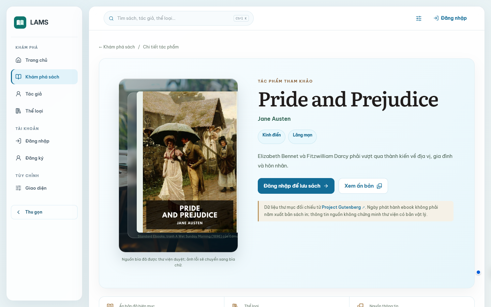

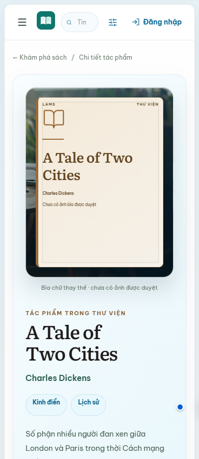

[Hình 11](#fig-11) và [Hình 12](#fig-12) là viewport chụp web local trên UI commit `23b90ba`: một Book có tham chiếu bìa đã duyệt, một Book chưa có ảnh và dùng bìa chữ. Core/Insight/PostgreSQL demo đang chạy, không mock API. [Hình 13](#fig-13) là màn người đọc từ Web E2E tại `d0ba015`. [Hình 14](#fig-14) và [Hình 15](#fig-15) được chụp trong WebView2 của EXE local với database test cô lập; nội dung ảnh không gồm khung Windows. Bộ 50 ảnh web mới cho 25 route có manifest riêng; một ảnh chỉ chứng minh trạng thái đã chụp, không thay kiểm toàn bộ CRUD.

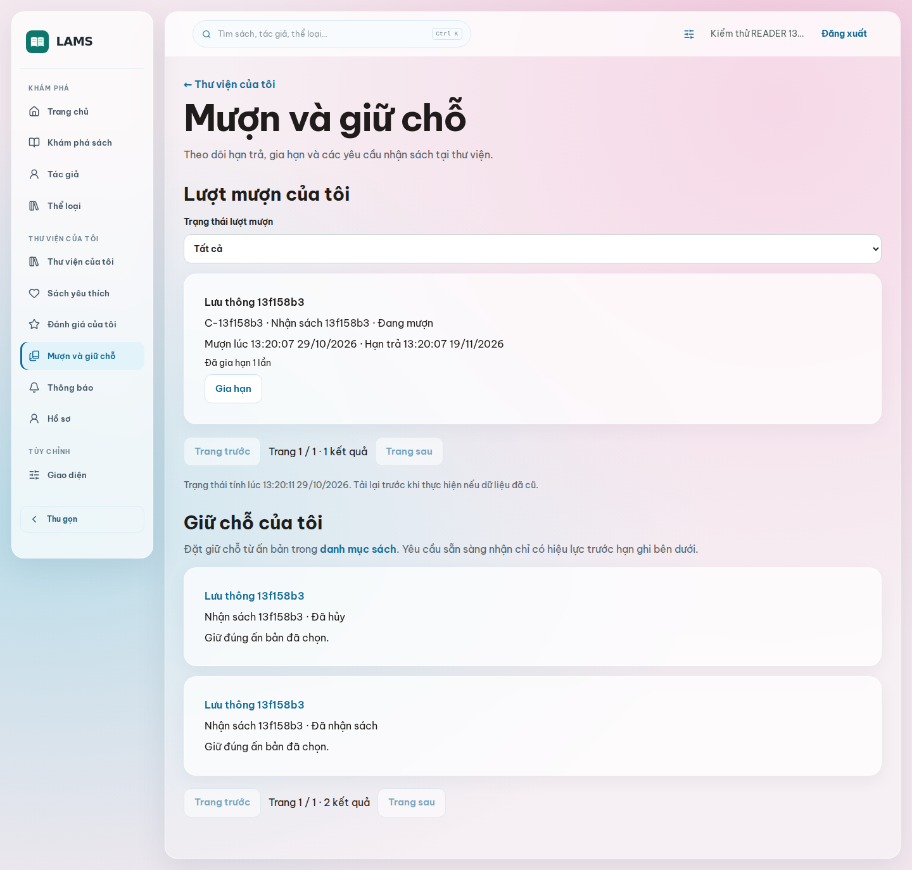

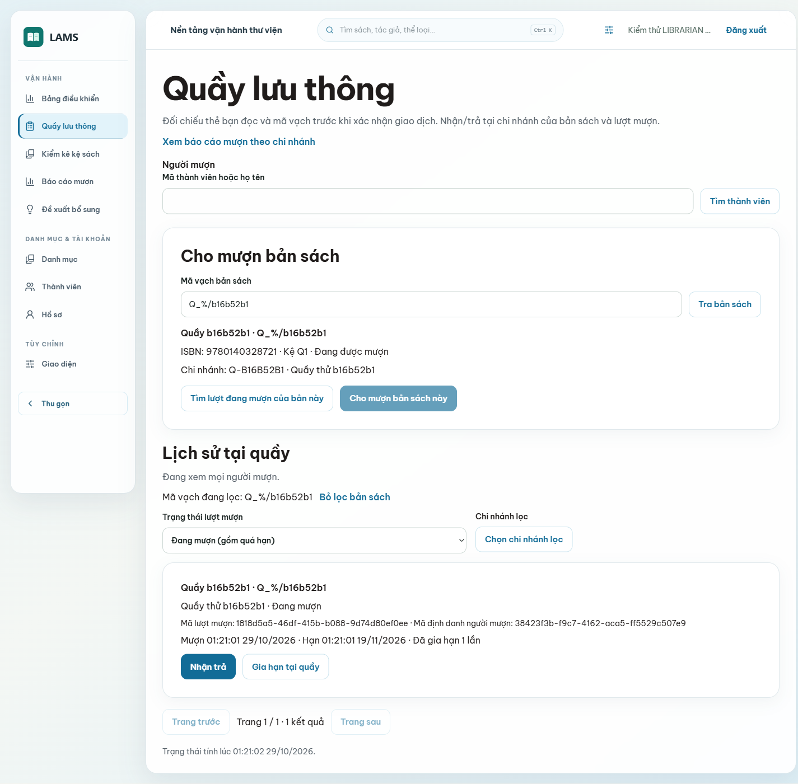

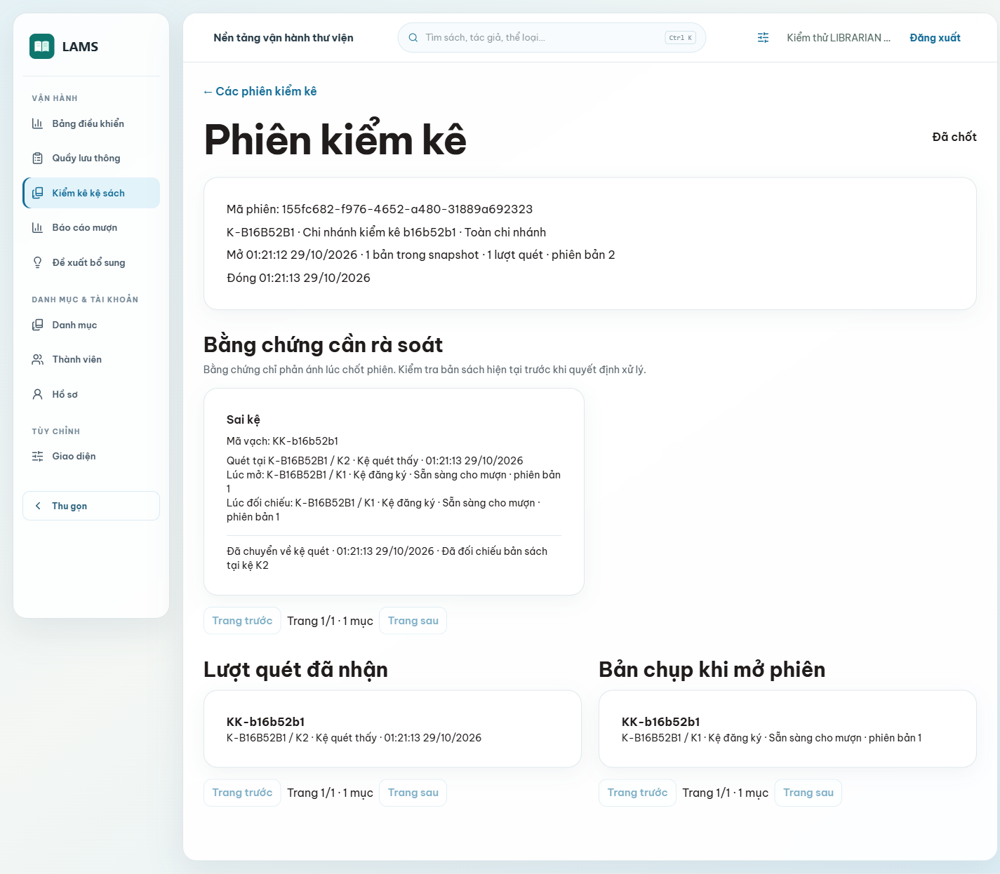

Ở bản `011eb53`, dashboard có các số đếm danh mục, bản sách, phiên kiểm kê, lượt đang mượn/quá hạn và đề xuất DRAFT. Biểu đồ giữ chỗ tổng hợp sự kiện 30 ngày; không diễn giải thành số Hold đang chờ. Các nguồn đọc độc lập nên màn hình không có tính chất một snapshot toàn hệ thống. Chuông kiểm số chưa đọc mỗi phút khi ở foreground, mở hộp thoại mới tải danh sách; đây là polling, không phải push thời gian thực.

My Library bổ sung tối đa ba lượt mượn và ba yêu cầu gần đây, có hạn trả hoặc hạn nhận sách và liên kết tới danh sách đầy đủ. Appearance giữ bản xem thử khi chuyển route, xử lý phản hồi lưu của phiên cũ và thông báo khi tab khác thay đổi thiết lập. Các nhóm widget có thể ẩn/hiện; chưa có kéo thả thứ tự. Tìm kiếm trên điện thoại dùng hộp thoại riêng, giữ focus và khóa nền trong lúc mở.

## 5.3. Chiến lược media, fallback và trợ năng

Ảnh biên tập Pexels minh họa landing, Catalog, directory và các nhóm thể loại. Nguồn, tác giả và giấy phép ở `tai-lieu/06-giao-dien/nguon-anh.md` [5]. Chúng là ảnh chủ đề, không phải bìa của từng Book hoặc chân dung tác giả. Ảnh tác giả/ấn bản chỉ được xem là media của bản ghi khi có tham chiếu đã duyệt; khi thiếu hoặc URL hỏng, UI dùng bìa chữ/visual có nhãn. Bộ demo có 12/32 bìa Standard Ebooks đã đối chiếu và được ghi qua API duyệt trên máy trình diễn ngày 30/10/2026; máy khác cần chạy script duyệt có kiểm ID/Edition. Danh sách ứng viên không đồng nghĩa database đã duyệt. Ba ảnh minh họa âm nhạc, thiên văn và thể thao được bổ sung có nguồn Pexels; tổng bộ ảnh JPG là 15 ảnh, gồm 12 ảnh chủ đề và ba cảnh đọc. Dữ liệu tác giả vẫn chưa có chân dung được duyệt. Không đưa ảnh ngẫu nhiên vào bản ghi để trang trông đầy.

Ảnh cục bộ có alt text theo nội dung; card có focus visible, trạng thái tải/rỗng/lỗi và thao tác bàn phím. Lượt chụp local trên `23b90ba` đã mở 25 route theo vai trò ở 390, 768, 1024, 1366, 1440, 1536 và 1920 px: 175 lượt trả HTTP 200, không phát hiện tràn ngang; 50 ảnh lưu ở 390 và 1440 px. Script chỉ kiểm status, chiều rộng và ảnh trạng thái; kết quả không phải audit WCAG, kiểm mọi chức năng hay nghiệm thu WebView2.

Bảng 12. Phân biệt loại hình trong báo cáo và nguồn kiểm chứng.

| Loại hình | Ví dụ | Có thể kết luận | Không thể kết luận |
|---|---|---|---|
| Wireframe | Hình 10, sinh từ bố cục thiết kế | Vị trí và thứ bậc thao tác dự kiến | Dữ liệu/API chạy đúng. |
| Screenshot CI | Hình 13 và 19, artifact run 40880637621 | UI ở trạng thái test trên SHA `d0ba015` | Runtime WebView2 hoặc mọi trạng thái nghiệp vụ. |
| Screenshot local | Hình 11–12 và 50 ảnh kèm manifest tại `23b90ba` | Giao diện và dữ liệu demo qua Core/Insight ở các route, viewport đã chụp | Runtime EXE hoặc mọi chuyển trạng thái. |
| Screenshot EXE E2E | Hình 14, 15, 18, 25; database test cô lập | Trạng thái test trong WebView2 với giao dịch thật | Cài/gỡ installer hoặc vận hành production. |
| Ảnh biên tập | Pexels trong UI | Minh họa không gian/chủ đề theo license | Danh tính tác giả hoặc bìa ấn bản. |

# Chương 6. Cài đặt, thuật toán và xử lý lỗi

## 6.1. JDBC, Flyway và Prisma trong một request

Flyway áp dụng các migration Core theo thứ tự và lưu lịch sử checksum. V31 thêm bảng settings, không sửa dữ liệu thư viện cũ. `BookRepository` dùng `JdbcTemplate` với tham số bind; service đặt transaction và kiểm bất biến trước khi gọi repository. Với thay đổi Copy, lệnh cập nhật kiểm `version` hoặc khóa dòng để tránh ghi đè. Nếu một bước của Loan/Hold thất bại, transaction rollback dữ liệu liên quan; response lỗi không được biến thành thành công ở frontend. Bộ test migration kiểm database mới và nâng cấp từ version cũ.

Prisma Client sinh truy vấn từ schema Insight, nhưng `ownerId` vẫn phải lấy từ guard. History dùng `create`, `findMany`, `count`, `deleteMany` với điều kiện chủ sở hữu; count và page trong `RepeatableRead`. Transaction Prisma cần được giữ ngắn và không tự thay kiểm quyền [16]. Provider chỉ được gọi trước/sau transaction phù hợp, không giữ transaction chờ HTTP. Insight trả lỗi 503 khi không lưu được history, nhờ đó giao diện không nói “đã lưu” sai. Sơ đồ [Hình 16](#fig-16) thể hiện hai nhánh truy vấn và ranh giới database.

## 6.2. Phân bổ Hold và vòng đời Loan

`HoldAllocationService.allocateBook` chọn WAITING tương thích với Copy theo thời điểm xếp hàng rồi ID để giải hòa. Nó kiểm reader còn đủ điều kiện, Edition/chi nhánh phù hợp, claim Copy, đặt READY và deadline trong cùng giao dịch. Hủy, nhận, hết hạn và trả Copy đều phải đối chiếu trạng thái hiện tại. ETA ở `HoldEtaModel` là phép mô phỏng có giả định, không phải cam kết giao sách; khi thiếu dữ liệu hoặc quá hạn, UI phải nói rõ không thể ước tính. Test cạnh tranh hai Copy trả gần nhau và retry worker kiểm không phân bổ kép [6].

Quầy mượn/trả nhận khóa request để lần gửi lại sau mất mạng có thể trả biên nhận cũ. Loan mở có unique partial index trên Copy; Copy được cập nhật trạng thái/version trong transaction. Gia hạn phải kiểm người mượn, chính sách và hàng Hold đang chờ. Các quy tắc này nằm ở Core, không dựa trên nút disabled của UI.

**Ví dụ mượn cạnh tranh (mô phỏng theo test):** Copy C đang AVAILABLE, version 4; hai thủ thư gửi hai request khác nhau cho người đọc A và B. Transaction T1 lấy khóa nghiệp vụ/Copy trước, kiểm quota và version, tạo Loan L1, tăng version và commit. T2 chờ khóa; sau khi T1 commit, T2 đọc lại thấy Copy không còn sẵn có hoặc version không khớp, trả 409 và không ghi Loan L2. Database cuối có một Loan mở, một thay đổi trạng thái hợp lệ. Nếu T1 rollback, T2 có thể tiếp tục theo dữ liệu còn hiệu lực. Unique partial index bảo vệ thêm khi có đường ghi bỏ qua service. Test `twoReadersRaceForLastCopyOneCreatedOneConflict` và `borrowReallyWaitsForCopyLockAndRechecksTheCommittedVersion` kiểm hai khía cạnh này; không giả định thứ tự đến HTTP quyết định ai thắng [14].

**Ví dụ hàng chờ (mô phỏng):** cùng Book và chi nhánh, A xếp 09:00 chọn Edition E1, B xếp 09:01 chấp nhận bất kỳ Edition, C xếp 09:02 chọn E2; cả ba đang WAITING và đủ tư cách. Khi bản E2 được trả, A chưa tương thích nên vẫn WAITING, B được READY, C tiếp tục chờ. Đây là FIFO trong tập yêu cầu tương thích, không phải A bị mất quyền. Nếu B đã mất tư cách, thuật toán bỏ qua B và xét C; trạng thái B không được tự suy là CANCELLED. Khi A chủ động hủy qua API, yêu cầu mới chuyển CANCELLED và ghi dấu vết. Khi READY hết hạn nhận, worker xử lý trạng thái theo policy rồi xét người kế tiếp. `queuedAt,id` giải hòa ổn định; khóa theo Book ngăn hai worker cùng phân bổ một Copy [6].

## 6.3. Kiểm kê và sáu loại bất thường

Khi mở phiên, hệ thống chụp bản sách theo phạm vi vào snapshot. Mỗi scan có `clientScanId`; gửi lại cùng ID trả kết quả cũ thay vì nhân đôi. Khi chốt, service đối chiếu snapshot, scan và Copy hiện tại để tạo bằng chứng sai kệ, thiếu trong snapshot, trạng thái không khớp, sai chi nhánh, barcode không tồn tại và quét trùng. Nhân viên xem bằng chứng và xác nhận quyết định; version Copy cũ gây 409, không tự chuyển kệ. [Hình 17](#fig-17) là flowchart của hành vi này, khác sơ đồ lớp.

Camera trên thiết bị hỗ trợ `BarcodeDetector` chỉ điền mã vào ô; người dùng vẫn gửi/kiểm lại. Offline ở trang kiểm kê giữ tối đa 20 mã trong memory, đồng bộ tuần tự khi có kết nối và khóa chốt khi còn mã chờ. Đóng trang làm mất hàng đợi này; không nên mô tả nó là bộ lưu offline bền vững. Benchmark Testcontainers tại mốc 5.000 Copy/100 scan từng ghi open 489 ms, scan p95 17,7 ms, finalize 689 ms, nhưng đó là lượt đo local có fixture và môi trường riêng, không phải p95 sản xuất hoặc số đo của head PR #31 [7].

**Ví dụ đối chiếu kiểm kê (mô phỏng):** snapshot ở chi nhánh A ghi C1 tại kệ S1/AVAILABLE/version 2 và C2 tại S1/AVAILABLE. Nhân viên quét C1 ở S2 hai lần, không quét C2; trong lúc đó quầy đã cho mượn C1, làm tăng version. Kết quả có bằng chứng sai kệ, quét trùng, thiếu C2 và trạng thái C1 không khớp. Quét thêm C3 thuộc chi nhánh B tạo sai chi nhánh; mã X không có trong Catalog tạo barcode không tồn tại. Sáu loại này có thể cùng xuất hiện trong một phiên, không bắt buộc mỗi mã chỉ có một anomaly.

Nhân viên đọc snapshot, scan và trạng thái hiện tại trước khi xác nhận resolution. Một đề nghị sửa C1 dựa trên version 2 phải bị từ chối nếu Copy đã đổi; không được đưa sách đang mượn về AVAILABLE chỉ để “khớp snapshot”. Quét lại cùng `clientScanId` là retry và không sinh scan mới, còn hai lần quét thật có ID khác nhau có thể sinh quét trùng. Đây là khác biệt giữa lặp do mạng và bằng chứng hiện trường.

## 6.4. Tìm kiếm và đề xuất bổ sung

Catalog V22 chuẩn hóa chữ với `unaccent`, dùng `tsvector`/GIN và `pg_trgm` để tìm tên, mô tả, tác giả, ISBN. Điểm ưu tiên theo điều kiện đầu tiên khớp: ISBN đúng 150, tên đúng 120, tiền tố 80, full text 50 cộng rank giới hạn, tên tác giả 45, tên chứa 35, gần đúng bằng similarity nhân 20. Khi bằng điểm, ID quyết định thứ tự. Bộ lọc tác giả/thể loại, gồm alias đã chuẩn hóa, áp trước phân trang. Gợi ý tối đa năm nhan đề khi tìm rỗng là khớp chữ, không phải semantic search [8].

Insight `acquisition-v1` lấy Hold đang chờ (50%), Loan bắt đầu trong cửa sổ (35%) và Favorite mới nếu có dữ liệu (15%). Nếu một tín hiệu thiếu, giá trị là `null`, đóng góp 0 và confidence giảm; không điền số giả. Kết quả lưu nguồn, khoảng UTC `[from,to)`, snapshot, phiên bản công thức và evidence để nhân viên kiểm. Quyết định duyệt/từ chối cần lý do và version, chỉ xác nhận đề xuất nội bộ. Không có dữ liệu ngân sách, đơn đặt mua hoặc zero-result search để đưa vào công thức [9].

**Ví dụ tính điểm từ fixture thật:** `acquisition-score.spec.ts` dùng 2 bản sở hữu, cửa sổ 30 ngày, 2 Hold chờ, 8 Loan mới và 8 Favorite mới. Mỗi tín hiệu chuẩn hóa tới 1: Hold = min(1, 2/2), Loan = min(1, 8/(2 × 1 × 4)), Favorite = min(1, 8/(2 × 4)). Tổng = 50 + 35 + 15 = 100; confidence = 1. Đây là đầu vào kiểm thử, không phải số liệu vận hành của thư viện.

Trong ca thứ hai của cùng file, Hold = 1, Loan và Favorite là `null`: điểm bằng 50 × (1/2) = 25, confidence = 0,5. Điểm không được chia lại theo trọng số còn lại để thành 50 hoặc 100. Với cửa sổ khác 30 ngày, mẫu số Loan dùng max(1, số ngày/30); số bản dùng max(1, copiesOwned). Confidence đo tỷ trọng tín hiệu có dữ liệu, không phải xác suất dự báo đúng. Dù điểm 100, `manualReviewRequired` vẫn đúng và `purchaseDecisionAllowed` vẫn sai; nhân viên phải đọc evidence trước quyết định [9].

## 6.5. Outbox, retry và giới hạn lỗi

Outbox ghi fact cùng transaction Core. Publisher đọc hàng đã commit rồi gửi Kafka; Insight consumer tạo thông báo sau khi xác nhận sự kiện, có thể nhận lại nên cần idempotency. API mượn/trả không chờ broker. Khi `OUTBOX_ENABLED=false`, fact còn trong Core nhưng Inbox không có thông báo mới từ kênh này. Đây là đánh đổi giữa tính đúng đắn giao dịch và độ trễ thông báo, không phải đảm bảo giao hàng đồng thời tuyệt đối.

Bảng 13. Các trường hợp thành công và thất bại ở ranh giới nghiệp vụ.

| Tình huống | Kết quả mong đợi | Nơi kiểm |
|---|---|---|
| Đăng nhập đúng | JWT/cookie hợp lệ, vào route theo vai trò | Auth integration, Web E2E. |
| Sai mật khẩu/tài khoản khóa | Không cấp phiên | Auth integration. |
| Reader gọi API nhân viên | 403, không ghi dữ liệu | Integration quyền. |
| ISBN sai | 400, không gọi provider/ghi history | Metadata unit/HTTP. |
| History khác owner | 404 cho đọc/xóa/replay | Insight integration. |
| Scan gửi lại cùng clientScanId | Cùng biên nhận, không tạo scan thứ hai | Inventory integration. |
| Copy/version thay trước resolution | 409, không đổi kệ một phần | PostgreSQL integration. |
| Insight DB lỗi khi lưu | 503, không hiển thị đã lưu | History HTTP/frontend. |
| CSV chứa công thức | Nội dung được escape và vẫn là UTF-8 | LoanCsvExporterTest. |

# Chương 7. Kiểm thử và đánh giá

## 7.1. Phương pháp và phân biệt bằng chứng

Unit kiểm quy tắc thuần hoặc service với dependency giả. PostgreSQL/Testcontainers kiểm migration, ràng buộc, transaction, quyền và tranh chấp thật. Contract validator đối chiếu OpenAPI. React/Vitest kiểm state, form, error và chuyển phiên. Playwright Web E2E chạy trình duyệt, hai API và dữ liệu tạm; build Windows chỉ chứng minh bundle/installer tạo được, không tự chứng minh thao tác WebView2. Mỗi kết quả dưới đây ghi môi trường và SHA để không gộp số của những lần khác nhau.

Bản đối chiếu chính là `d0ba015` sau khi PR #32 merge; [run 40880637621](https://github.com/Shuuma4869/He-thong-quan-ly-va-khai-thac-thu-vien/actions/runs/40880637621) ghi Core 317/317 (0 fail/error/skip), Insight 121/121 và 17/17, frontend 193/193, Web E2E 22/22. Môi trường CI là Ubuntu cho các job dịch vụ/web, Windows cho build Tauri. Bảng dưới giữ kết quả lịch sử để các ảnh và EXE cũ vẫn có đường truy nguyên, không thay số cũ bằng số mới trên cùng dòng.

PR #33 bổ sung API `GET /api/v1/reports/hold-activity` và bản `.csv`, chỉ dành cho LIBRARIAN/ADMIN có quyền hiện hành. Service đọc `hold_changes` nối `holds` trong REPEATABLE READ; nhóm theo ngày Asia/Ho_Chi_Minh, chi nhánh và loại sự kiện, lọc `[from,to)`, tối đa sáu tháng lịch và 10.000 hàng. Mười ba bài integration và ba bài exporter của module đạt trong job Core nêu trên. Đây là báo cáo sự kiện, không phải số Hold đang chờ hoặc dự báo mua. Tại bản mở rộng `011eb53`, API đã có màn `/nhan-vien/bao-cao-giu-cho` với bộ lọc ngày, chi nhánh, tác phẩm, bảng chia 50 nhóm/trang và tải CSV. Tổng số trên màn hình là số sự kiện, không phải số yêu cầu duy nhất; CSV đọc lại dữ liệu khi tải nên có thể khác bảng vừa xem. Vì các chiều Book/Branch đọc từ Hold hiện tại, sửa trực tiếp những chiều này bằng SQL có thể phân loại lại lịch sử; test đã ghi nhận giới hạn đó.

Đợt kiểm tra local cho `011eb53` chạy lại Core 317 bài, Insight 121 bài unit/HTTP và 17 integration, frontend 214 bài; typecheck, lint, build và hai hợp đồng OpenAPI đạt. Web và EXE/WebView2 mỗi loại đạt 25/25 hành trình trên database PostgreSQL tạm, gồm báo cáo giữ chỗ với sự kiện tạo qua API, quyền Reader bị chặn, CSV và thao tác tìm kiếm ở 11 độ rộng. Bộ ảnh mới nằm trong [minh chứng 011eb53](../minh-chung-giao-dien/011eb53/README.md). Sửa vòng Tab tiếp theo tại `e5c238d` được kiểm riêng bằng bàn phím cho ba vai trò. Kết quả CI của PR #35 cần đọc theo đúng head trong manifest đi kèm; không dùng trạng thái CI cũ để thay cho lần này.

Về hiệu năng, tách lazy các màn phụ giảm JS đầu vào từ 552,29 xuống 499,36 kB, gzip từ 168,52 xuống 154,60 kB. Số này là kết quả build, không phải thời gian tải mạng hay P95. Với báo cáo giữ chỗ, database demo chưa có sự kiện. Phép đo riêng bằng bảng TEMP gồm 100.000 sự kiện tổng hợp cho kỳ bảy ngày ghi nhận 16,571 ms trước index ngày và 3,602 ms sau index; cache và dữ liệu rút gọn giới hạn khả năng suy rộng. Chưa thêm migration index: cần đo thêm kỳ dài, các bộ lọc và chi phí ghi trên dữ liệu đại diện.

Lượt npm audit ngày 30/10/2026 không có advisory frontend; Insight có tám kết quả LOW trong chuỗi tooling chứa deepmerge, còn omit=dev không có advisory. Chưa có bản vá upstream được công bố ở thời điểm kiểm tra; không ép hạ Nest CLI xuống major cũ để xóa cảnh báo. Chi tiết điều kiện áp dụng và giới hạn nằm trong tài liệu nợ kỹ thuật của dự án.

Bảng 14. Bằng chứng tại merge commit `8169ac75629306db8a12d1f2667abb1b81991d82` và phần chưa kiểm.

| Mã | Kiểm tra | Kỳ vọng | Kết quả quan sát và nguồn |
|---|---|---|---|
| T01 | Frontend Vitest | Không có bài hỏng | 191/191 PASS, 33 file; log job `node-apps` của run 40707553547. |
| T02 | Frontend lint/typecheck/build | Không có lỗi | Các bước trong job `node-apps` PASS; build có cảnh báo kích thước chunk. |
| T03 | Responsive theo vai trò | 25 route × 7 độ rộng, HTTP 200 và không tràn ngang | 175/175 PASS local ở UI commit `23b90ba`; manifest của bộ 50 ảnh ghi kết quả, chưa phải kiểm chức năng từng route. |
| T04 | Appearance/account switch | Không áp phản hồi cũ sang tài khoản mới | File test nằm trong 191 bài frontend PASS; chưa kiểm nhiều tab thủ công ở merge commit. |
| T05 | Core PostgreSQL/migration | Test suite đạt trên database CI | 300/300 PASS, 0 fail/skip; log job `core` của run 40707553547. |
| T06 | Insight/Prisma | Unit/HTTP và integration đạt | 121/121 và 17/17 PASS; log job `node-apps` của run 40707553547. |
| T07 | API contract | OpenAPI hợp lệ | Job `api-contracts` PASS trong cùng run. |
| T08 | Web E2E | Hành trình chính không hồi quy | 18/18 PASS; log job `web-e2e` trong cùng run. |
| T09 | Desktop Windows | Build/packaging thành công | Job `desktop-windows` PASS; chưa đủ để kết luận runtime EXE. |
| T10 | EXE/WebView2 E2E local | Cửa sổ và luồng nghiệp vụ chạy cùng API, database test cô lập | 18/18 PASS ngày 29/10 sau UI commit `23b90ba`; process 13328, window handle 985062. Chưa kiểm cài/gỡ installer hoặc máy khác. |

Nguồn T01–T02, T04–T09 là [CI run 40707553547](https://github.com/Shuuma4869/He-thong-quan-ly-va-khai-thac-thu-vien/actions/runs/40707553547) gắn đúng merge SHA; T03 là lượt kiểm local sau sửa UI, có [manifest riêng](../minh-chung-giao-dien/23b90ba/manifest.json). Frontend của commit `23b90ba` còn đạt typecheck, lint, build và 191/191 Vitest local. T10 dùng EXE local SHA-256 `A593B0D91643BD4D27F22D7D6B339FA51B190E9065D0FB30CF268E93FBA1EAFE`; bộ cài NSIS được tạo có SHA-256 `3E49853D8A30BCDD2383D0A9C2FB54D6F99AF8B99428FEDC6BA769CDF84FB9CC`. Lượt chạy đầu đạt 17/18 vì Nest watcher của phiên demo cũ chiếm lại cổng 3000, khiến ca Phase 7 truy vấn nhầm database; sau khi dừng watcher và kiểm lại tiến trình backend, lượt chạy mới đạt 18/18. Không coi lượt đầu là PASS. CI của bản bổ sung `8df60c9` đạt 5/5 job ở run `40805480758`; các số lượng test trong bảng vẫn giữ nguyên mốc baseline đã ghi để thuận tiện đối chiếu.

Head PR #31 `9d4931e` cũng đạt 5/5 job ở [run 40703278402](https://github.com/Shuuma4869/He-thong-quan-ly-va-khai-thac-thu-vien/actions/runs/40703278402). Head và merge là hai SHA khác nhau. Chương 5 phân biệt ảnh Web E2E `d0ba015`, ảnh settings cũ và ảnh local UI `23b90ba`; không chuyển kết quả runtime EXE của commit cũ sang baseline mới.

## 7.2. Bảng ca kiểm thử nghiệp vụ và cạnh tranh

Bảng 15. Ca kiểm thử theo tính chất lỗi, quyền và giao dịch.

| ID | Đầu vào/điều kiện | Kỳ vọng | Bằng chứng và trạng thái |
|---|---|---|---|
| AUTH-01 | Đăng ký email trùng | 409, không thêm user | `AuthIntegrationTest`, Core CI PASS. |
| AUTH-02 | Refresh token tái sử dụng | Thu hồi family, không cấp phiên hai lần | `AuthIntegrationTest`, Core CI PASS. |
| CAT-01 | Tìm với Unicode/alias | Thứ tự ổn định, không ghép SQL từ input | `PublicCatalogIntegrationTest`, Core CI PASS. |
| CAT-02 | Duyệt ảnh sai nguồn/version | Từ chối hoặc 409, ảnh cũ giữ nguyên | `MediaIntegrationTest`, Core CI PASS. |
| LOAN-01 | Hai request mượn cùng Copy | Tối đa một Loan mở | `LoanCommandIntegrationTest`, Core CI PASS. |
| HOLD-01 | Hai Copy trả đồng thời | Không READY kép; FIFO theo Book | `HoldIntegrationTest`, Core CI PASS. |
| INV-01 | Retry scan + chốt session | Một scan/ID; snapshot giữ nguyên | `InventorySessionIntegrationTest`, Core CI PASS. |
| INV-02 | Copy đổi version trước resolution | 409, không sửa một phần | `InventorySessionIntegrationTest`, Core CI PASS. |
| CSV-01 | Nội dung bắt đầu `=`, `+`, `-`, `@` | Không được diễn giải là công thức | `LoanCsvExporterTest`, Core CI PASS. |
| PREF-01 | User A lưu, User B đọc | B không thấy preset A | `UiPreferencesIntegrationTest`, Core CI PASS. |
| PREF-02 | Revision cũ/CSS tùy ý | 409/422, không lưu | Cùng test, Core CI PASS. |
| PREF-03 | Save A trả muộn sau login B | B vẫn giữ preset B | `AppearanceProvider.test.tsx`, local PASS. |

Tên file test trong bảng là chỉ dẫn tới nơi kiểm; kết quả CI khẳng định job đạt, không tự chứng minh từng thao tác sản xuất. Nhật ký từng bài và cấu hình runner cần đọc trong run khi nghiệm thu cuối. Các ca liên quan server thật ở Core có PostgreSQL/Testcontainers trên CI; Vitest không được dùng thay kiểm ràng buộc database.

Bảng 16. Ca kiểm thử bổ sung có điều kiện đầu vào và nguồn assertion.

| ID / yêu cầu | Đầu vào | Kỳ vọng | Quan sát thực tế | Kết quả | Nguồn kiểm chứng |
|---|---|---|---|---|---|
| SEC-01 / US17 | Thiếu token hoặc READER gọi mượn | 401/403; không ghi | Assertion HTTP và quyền hiện hành đạt | PASS tự động | LoanCommandIntegrationTest: httpRequiresCurrentStaffRoleAndValidRequestEvenWhenJwtClaimsAreStale; Core run 40880637621 |
| SEC-02 / US13 | ID history của owner khác | 404; không gọi provider | Assertion owner và HTTP đạt | PASS tự động | history.spec / history-http.spec; Node cùng run |
| PREF-04 / US23 | Revision cũ, enum/CSS ngoài allowlist | 409/422; giữ giá trị cũ | Assertion revision/validation đạt | PASS tự động | UiPreferencesIntegrationTest: preferencesBelongToAccountAndRejectUnknownValuesAndStaleRevision |
| RATE-01 / US11,13 | Hết quota lookup hoặc history | 429; hai quota độc lập, có thời gian chờ | Assertion bộ đếm/reset đạt | PASS tự động | metadata-guard.spec: 429 reports remaining seconds and both counters reset after the fixed window |
| DEP-01 / US13 | DB hỏng khi lưu history | 503; không lộ SQL/không báo đã lưu | Assertion response đạt với lỗi giả lập | PASS tự động, không phải outage DB live | history-http.spec: id không thuộc owner trả 404; lỗi DB thành 503 không lộ SQL |
| TX-01 / US17 | Lỗi sau ghi Loan/Copy/outbox/receipt | Rollback cả bốn | Kiểm PostgreSQL không còn ghi dở đạt | PASS integration | LoanCommandIntegrationTest: rollbackAfterBusinessWritesRemovesLoanCopyChangeOutboxAndReceipt |
| TX-02 / US20 | Hai bản được trả đồng thời | Hai READY khác người/Copy | Assertion phân bổ đạt | PASS integration | HoldIntegrationTest: twoConcurrentReturnsAssignDifferentCopiesToDifferentReaders |
| SQL-01 / US21,22 | Filter sai và input có ký tự SQL | Không thay cấu trúc query | Assertion validation/filter đạt | PASS integration, không phải pentest toàn hệ thống | LoanHistoryIntegrationTest: invalidFiltersCannotBecomeSqlAndReportRequiresBoundedPeriod |
| CSV-02 / US22 mở rộng | Ô công thức sau space/control, Unicode, newline | Escape, UTF-8 BOM, đủ record | Parse CSV và assertion đạt | PASS tự động | HoldActivityCsvExporterTest; HoldActivityReportIntegrationTest: fullCsvExporterEscapesUnicodeMultilineAndFormulaValuesInParsedRecords |
| UI-01 / US23 | Save A về sau khi đổi sang B | Không áp settings A cho B | Assertion state B giữ đúng đạt | PASS component | AppearanceProvider.test.tsx: bỏ qua phản hồi lưu của tài khoản cũ sau khi đổi tài khoản |
| DEP-02 / US11 | Provider không kết thúc request | Timeout/abort, nhả slot | Assertion fetch giả lập đạt | PASS unit | metadata.spec: provider timeout aborts pending fetch and releases its slot |
| EVT-01 / US17,26 | Broker thật gián đoạn | Loan vẫn commit; event gửi lại từ outbox | Test outage và retry đạt | PASS integration | OutboxPublisherIntegrationTest: realBrokerOutageDoesNotUndoLoanAndRetryUsesPersistedRecord |
| REC-01 / N11 | Restore backup vào hai DB cô lập | Schema/data và smoke hợp lệ | Runbook ghi diễn tập cũ; chưa lặp ở d0ba015 | Chưa nghiệm thu lại baseline | sao-luu-khoi-phuc.md [10]; không thuộc CI mới |

Các tên phương thức dài là định danh để tra mã, không phải nhãn trên giao diện. PASS trong bảng là assertion của bài kiểm đã chạy trong suite tương ứng tại baseline; không suy rộng sang mọi payload, mọi trình duyệt hoặc mọi cấu hình hạ tầng.

## 7.3. Giao diện, hiệu năng và phục hồi

Artifact `web-e2e-results` cũ có ảnh Public, Reader, Staff, Admin tại `0ef4007`; README trong `ho-so-nop-bai/minh-chung-giao-dien/pr31/` chỉ rõ nguồn. [Hình 18](#fig-18) là báo cáo lưu thông có một lượt mượn và một lượt đã trả trong lượt EXE E2E mới; [Hình 19](#fig-19) là dashboard admin từ Web E2E tại `d0ba015`. [Hình 25](#fig-25) ở phụ lục ghi đề xuất đã duyệt nội bộ với bằng chứng và quyết định. Các ảnh chỉ chụp trạng thái fixture, không bao phủ mọi chuyển đổi role hay toàn bộ CRUD.

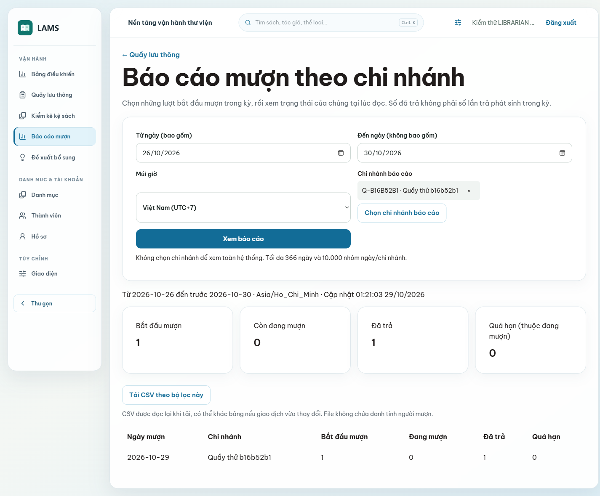

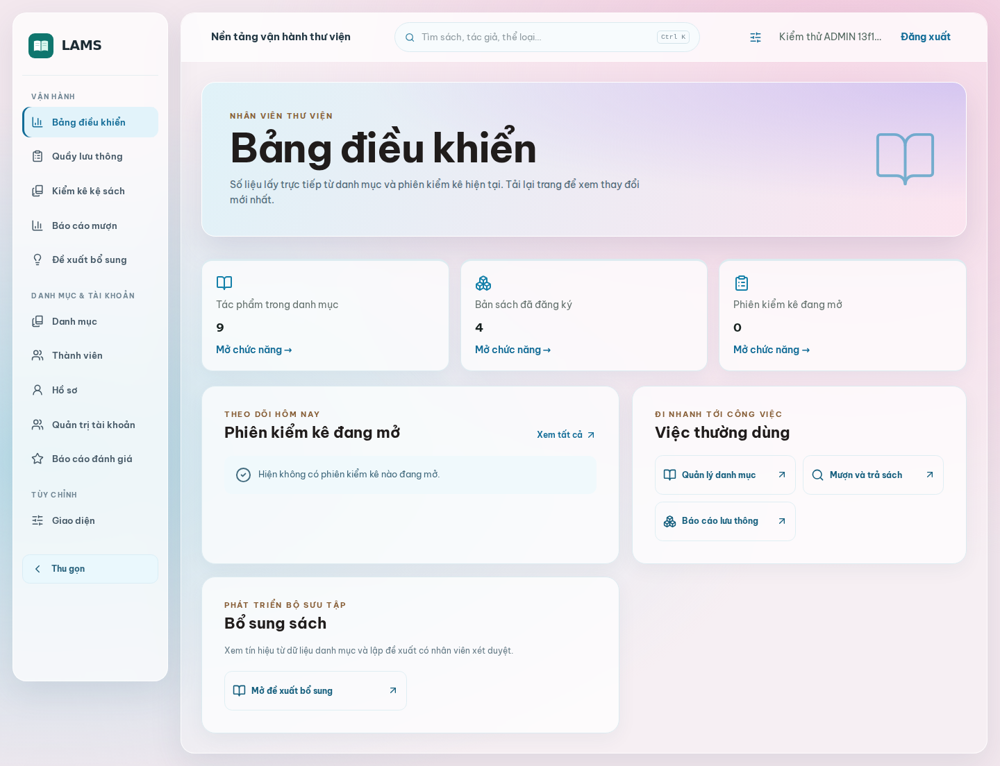

Đợt benchmark local trước đó dùng 10.013 Book demo: p95 trang đầu 32,7 ms, tìm tiền tố 732,1 ms với cấu hình PostgreSQL mặc định; thử `jit=off` cho p95 tiền tố 182,1 ms nhưng khác điều kiện cache, chưa đổi mặc định. Bài kiểm kê 5.000 Copy/100 scan cũng chỉ là tải kiểm soát trên máy phát triển [7]. Số này có giá trị tìm điểm nghẽn, không được gọi là SLA hoặc số của CI head. Runbook phục hồi đã diễn tập hai database cô lập ở đợt phát hành trước [10]; cần diễn tập lại trên hạ tầng pilot, xác định RPO/RTO và quyền sao lưu khi dùng dữ liệu thật.

# Chương 8. Bảo mật, pháp luật và đạo đức

## 8.1. Kiểm soát hiện có và rủi ro còn lại

Core dùng JWT access trong memory, refresh token hash trong database và cookie HttpOnly; role/owner được server xác định. SQL JDBC bind tham số, sort từ allowlist theo nguyên tắc tách dữ liệu khỏi câu lệnh [17]; Prisma dùng typed `where`, không nhận owner do client tự khai. Media inspector giới hạn HTTPS/host/MIME/kích thước và không theo redirect. Provider lookup có hạn mức riêng với đọc/xóa history, nhưng bộ đếm theo process, không thay ingress rate limit nhiều replica. CSV aggregate không chứa danh tính người mượn, escape ký tự công thức; nguy cơ đầu ô bị diễn giải thành công thức được OWASP mô tả riêng [18]. Những cơ chế này giảm rủi ro, không chứng minh “không có lỗ hổng”.

Bảng 17. Threat, biện pháp và phần còn phải làm trước pilot.

| Nguy cơ | Biện pháp trong mã | Phần chưa đóng |
|---|---|---|
| SQL injection | JDBC bind, sort allowlist, Prisma typed query | Review mọi query mới và dữ liệu động. |
| Truy cập chéo owner | JWT/Core current role, owner trong query | Dữ liệu mồ côi xuyên dịch vụ khi xóa tài khoản. |
| SSRF/ảnh ngoài | Host allowlist, HTTPS, no redirect, giới hạn bytes | URL sau duyệt có thể đổi; IP người xem tới host nguồn. |
| Lạm dụng provider | Quota 10/phút lookup và quota 60/phút đọc/xóa history | Rate limit phân tán/ingress chưa có. |
| CSV formula | Escape đầu ô nguy hiểm, row cap, UTF-8 | Chưa kiểm mọi ứng dụng bảng tính. |
| Secret/backup | `.env` local và runbook khôi phục | Chưa nghiệm thu secret manager/HTTPS/RPO production. |

Lượt OSV theo metadata Maven ngày 28/10/2026 còn hai advisory `spring-webmvc` 6.2.19: CVE-2026-47890 và CVE-2026-47884. Core hiện trả JSON qua `@RestController`, không dùng SSE hoặc `XsltView` theo đường khai thác được nhà cung cấp mô tả; advisory vẫn còn trên SBOM và phải đánh giá lại khi đổi framework/endpoint. `npm audit` cũ ghi frontend không có advisory, Insight có tám LOW ở chuỗi dev; Docker Scout còn cảnh báo image hạ tầng. Đây là snapshot cũ, không thay quét lại ở commit phát hành [11].

## 8.2. Dữ liệu cá nhân và quyền ảnh

`metadata_lookups` không lưu payload nhà cung cấp nhưng UUID owner/ISBN và thời gian vẫn có thể liên quan một cá nhân. Chưa có TTL hoặc xóa theo tài khoản ở Insight; review report, Inbox và quyết định no-show cũng chưa có thời hạn lưu giữ được phê duyệt. Trước pilot cần chốt căn cứ, thời hạn, yêu cầu xóa/xuất dữ liệu, phạm vi backup và người chịu trách nhiệm. Báo cáo không đề xuất chạy lệnh xóa production theo một mốc chưa phê duyệt.

[Luật Bảo vệ dữ liệu cá nhân 91/2025/QH15](https://vanban.chinhphu.vn/?classid=1&docid=214590&pageid=27160&typegroup=) là nguồn chính thức để rà nghĩa vụ khi dùng dữ liệu thật; [Luật 07/2022/QH15 sửa đổi Luật Sở hữu trí tuệ](https://congbao.chinhphu.vn/van-ban/luat-so-07-2022-qh15-37504.htm) là căn cứ rà quyền tài sản trí tuệ. Báo cáo không phải ý kiến pháp lý hoặc chứng nhận tuân thủ. [Giấy phép Pexels](https://www.pexels.com/license/) cho phép dùng ảnh trong app, nhưng không bán ảnh nguyên bản, dùng làm nhãn hiệu hay ngụ ý người trong ảnh ủng hộ LAMS. Ảnh bìa/portrait từ nguồn khác phải kiểm license từng file; URL công khai không đồng nghĩa quyền sao chép [5], [12].

## 8.3. Đạo đức nghề nghiệp và minh bạch

Không dùng ảnh chân dung sai người để làm đầy card; fallback phải ghi đúng trạng thái. Không tự động phạt người đọc từ tín hiệu no-show hay anomaly có thể sai. Điểm Acquisition chỉ hỗ trợ nhân viên đánh giá, không tự thay quyết định mua. Nhóm phải giữ lịch sử đóng góp đúng tác giả commit, tách dữ liệu demo khỏi dữ liệu thật và không quay người dùng thật khi chưa có quyền. Bằng chứng kiểm thử cần gắn SHA, môi trường và giới hạn; một ảnh đẹp không thay bài test. Khi trình bày kết quả, mỗi thành viên cần giải thích được phần việc mình phụ trách và ghi nhận đúng phần được tiếp nhận từ người khác.

# Chương 9. Đóng góp cá nhân của Nguyễn Trọng Tuấn

## 9.1. Phạm vi công việc

Trong dự án LAMS, tôi đảm nhận vai trò DEV1 trên nhánh `Tuan/core-platform`. Công việc của tôi tập trung vào xây dựng nền tảng, hoàn thiện giao diện người dùng, kết nối Core với Insight, đóng gói ứng dụng Windows và kiểm tra các luồng sau tích hợp. Tôi cũng chuẩn bị dữ liệu trình diễn, tài liệu vận hành và báo cáo này. Các phần dưới đây trình bày những sản phẩm cụ thể của công việc đó cùng với bằng chứng có thể đối chiếu trong repository.

Khi làm việc với phần backend do Toàn bàn giao, tôi giữ ranh giới giữa triển khai gốc và sửa đổi tích hợp. Chẳng hạn, Favorites/Reviews/Rating được tiếp nhận qua PR #11; công việc tiếp theo trên nhánh của tôi là nối API vào giao diện, bổ sung trải nghiệm My Library và xử lý các vấn đề được phát hiện khi chạy xuyên hệ thống. Tương tự, truy vấn snapshot kiểm kê và resolver alias là đầu vào cho luồng kiểm kê và tìm kiếm. Việc merge một PR không được tính là viết toàn bộ module trong PR đó.

## 9.2. Nền tảng và tích hợp dịch vụ

Tôi tổ chức luồng truy cập theo ba vai trò Reader, Librarian và Admin, đồng thời nối việc xác thực giữa frontend, Core và Insight. Một điểm cần xử lý là trạng thái tài khoản thay đổi trong khi request cũ vẫn đang chạy. Nếu chỉ đổi màn hình sau đăng xuất, phản hồi của tài khoản trước có thể quay về muộn và xuất hiện trong phiên mới. Tôi đã sửa cách quản lý trạng thái và kiểm thử chuyển tài khoản; thay đổi này được ghi tại commit `0ef4007`.

Đối với lịch sử tra ISBN, phần tích hợp trên DEV1 bao gồm màn hình tra cứu, danh sách lịch sử, lọc, xem lại và xóa theo chủ sở hữu. Dữ liệu được lưu bằng Prisma ở Insight. Tôi chú ý hai điều kiện: danh tính phải lấy từ phiên đã xác thực và thao tác giao diện chỉ báo thành công sau khi API hoàn tất. Bài E2E thực hiện tra cứu, tải lại trang và xóa bản ghi để kiểm tra dữ liệu đã được lưu trong PostgreSQL. Luồng này được phát triển ở PR #12; phần giải thích ORM nằm ở Chương 6.

Trong các bước tích hợp tiếp theo, tôi nối màn hình lưu thông, giữ chỗ, kiểm kê và đề xuất bổ sung với API của từng dịch vụ. Với các lệnh làm thay đổi bản sách, giao diện gửi version và request ID theo hợp đồng. Khi server trả xung đột, người dùng được yêu cầu tải lại trạng thái trước khi quyết định tiếp. Cách xử lý này giúp giao diện phản ánh kết quả giao dịch thay vì tự suy rằng thao tác đã thành công.

## 9.3. Giao diện và trải nghiệm sử dụng

Tôi xây dựng các khu vực Public, Reader, Staff và Admin trên cùng ứng dụng React. Phần điều hướng được bố trí theo vai trò: người đọc ưu tiên tìm kiếm và theo dõi sách; nhân viên ưu tiên thao tác tại quầy, biên mục và kiểm kê. Các màn hình cần thể hiện trạng thái đang tải, chưa có dữ liệu, lỗi và thao tác thành công để người dùng biết có nên chờ, thử lại hay sửa thông tin.

Ở đợt hoàn thiện giao diện, tôi bổ sung thiết lập hiển thị theo tài khoản, cách bố trí nền sáng và ảnh minh họa có nguồn. Commit `6a14dd8` ghi phần giao diện và lưu tùy chọn; `a8a1867` ghi việc bổ sung ảnh thể loại và sửa trạng thái ảnh khi chuyển trang. Khi chưa có bìa được duyệt, trang sách dùng bìa chữ có tên tác phẩm. Cách trình bày này cho phép giữ bố cục rõ ràng mà không gắn ảnh không đúng ấn bản.

Một vấn đề tôi sửa ở trang chi tiết sách là sự cân đối giữa phần bìa và phần thông tin. Bìa cần đủ nổi bật trên desktop nhưng không chiếm hết màn hình nhỏ. Commit `23b90ba` điều chỉnh vùng bìa, chú thích và phần trợ giúp đăng nhập. Tôi kiểm tra 25 route ở bảy độ rộng từ 390 đến 1920 px; lượt kiểm ghi nhận 175 lần truy cập trả HTTP 200 và không tràn ngang theo phép đo của script. Kết quả này kiểm tra bố cục tại các trạng thái đã chụp, còn các thao tác nghiệp vụ được kiểm bằng E2E.

Ở đợt `011eb53`, tôi nối API Hold Activity của Toàn vào màn báo cáo, bổ sung dashboard theo số liệu thực, chuông thông báo và phần mượn/giữ chỗ trong My Library. Tôi sửa việc mất bản xem thử khi chuyển trang và phản hồi lưu đến muộn sau khi đổi tài khoản. Lượt kiểm bàn phím tiếp theo ở `e5c238d` bổ sung vòng Tab trong hộp thoại. Các thay đổi này thuộc phần tích hợp giao diện; không quy phần truy vấn báo cáo của Toàn thành công việc cá nhân.

## 9.4. Đóng gói ứng dụng Windows và môi trường phát triển

Tôi đưa giao diện React vào Tauri để người dùng có thể mở LAMS bằng cửa sổ riêng. Phần việc gồm cấu hình build, địa chỉ API, điều hướng trong WebView2, hướng dẫn cài công cụ và các script chạy dịch vụ. Bản release chứa frontend; Core, Insight và PostgreSQL vẫn chạy riêng. Đây là điều cần giải thích khi bàn giao để người dùng không hiểu bộ cài EXE là toàn bộ hệ thống độc lập.

Để kiểm tra bản desktop, tôi dùng Playwright kết nối vào WebView2 của EXE, xác nhận Tauri bridge và chạy các hành trình trên database test cô lập. Lượt kiểm ngày 29/10/2026 đạt 18/18 bài với bản EXE được build sau commit UI `23b90ba`. Tôi cũng sửa bước chụp ảnh để đưa trang về đầu trước khi lưu, nhờ đó phần điều hướng và nội dung trong ảnh không bị lệch do vị trí cuộn trước đó.

Khi khởi động lại môi trường demo, tôi phát hiện Core trả health DOWN dù tính năng email đang tắt. Nguyên nhân là Actuator vẫn kiểm tra SMTP mặc định trong khi Mailpit là dịch vụ tùy chọn. Tôi gắn kiểm tra mail với cờ `LAMS_EMAIL_ENABLED`, bổ sung bài tích hợp cho trường hợp không dùng SMTP và cập nhật hướng dẫn chạy local. Commit `8df60c9` ghi thay đổi này; sau khi khởi động lại, health trả HTTP 200. Khi bật email, kiểm tra SMTP vẫn được giữ để phản ánh lỗi kết nối thật.

## 9.5. Kiểm thử và tài liệu bàn giao

Tôi kiểm tra các phần tích hợp bằng nhiều lớp kiểm thử. Unit test giúp kiểm những nhánh xử lý riêng; integration test dùng PostgreSQL thật để kiểm constraint và transaction; E2E kiểm đường đi từ màn hình tới API và dữ liệu. Trước khi bàn giao, tôi đối chiếu kết quả theo commit, vì build thành công ở một phiên bản không chứng minh mọi phiên bản sau đều hoạt động như vậy.

Các commit trong vòng hoàn thiện PR #32 thể hiện những đầu ra sau: `23b90ba` sửa giao diện; `d8b3b1d` hoàn thiện sơ đồ, báo cáo và minh chứng; `8df60c9` sửa health khi email tắt; `6de20fa` sửa điều hướng ấn bản, phản hồi chốt kiểm kê và hoàn thiện lớp giao diện. PR #32 đã merge tại `d0ba015`. CI run `40805480758` của `8df60c9` đạt đủ năm job: Core, Node, hợp đồng API, web E2E và Windows desktop. Bộ frontend local đạt 191/191 bài; bộ PilotAuthSecurityTest đạt 5/5 bài sau sửa health. Các ảnh EXE và kết quả cũ vẫn ghi đúng mốc riêng trong Chương 7.

Tôi biên soạn tài liệu chạy local, cách build desktop và các sơ đồ phục vụ giải thích hệ thống. Với báo cáo, tôi đối chiếu lớp với Java record, quan hệ dữ liệu với migration và phần ORM với Prisma Client thực tế. Tôi giữ nguồn sơ đồ có thể chỉnh sửa để có thể cập nhật khi model thay đổi. Nội dung chung của nhóm được trình bày trong các chương trước; chương này tập trung vào phần tôi trực tiếp phụ trách và quá trình tích hợp trên DEV1.

Bảng 18. Đối chiếu đầu việc cá nhân với lịch sử bàn giao.

| Đầu việc của tôi | Sản phẩm kiểm tra được | Mốc đối chiếu và ranh giới đóng góp |
|---|---|---|
| Tích hợp frontend và chuyển phiên | Cache/state theo tài khoản, route vai trò | PR #31, `0ef4007`; không quy toàn bộ backend trong PR thành công việc cá nhân |
| Settings và hoàn thiện UI | Appearance, bố cục chi tiết sách, hero và điều hướng | `6a14dd8`, `a8a1867`, `23b90ba`, `6de20fa`; xem diff tương ứng |
| Sửa luồng xem ấn bản và chốt kiểm kê trên UI | Scroll/focus ấn bản, biên nhận đóng phiên cập nhật trực tiếp | `6de20fa`, PR #32; không thay ownership thuật toán kiểm kê |
| Kiểm desktop và tài liệu triển khai | EXE E2E, ảnh/manifest, hướng dẫn Windows | `23b90ba` và `d8b3b1d`; không đồng nhất test EXE với kiểm installer |
| Sửa health khi SMTP tùy chọn tắt | Cấu hình mail health và regression | `8df60c9`, PR #32 |
| Biên soạn báo cáo và đối chiếu nguồn | Markdown, sơ đồ, DOCX/PDF, manifest | `d8b3b1d` và bản báo cáo này; mốc mã nghiệp vụ `d0ba015` |

PR #33 và commit `615e827` ghi phần báo cáo hoạt động giữ chỗ của Toàn. Tôi đối chiếu API, test và giới hạn để cập nhật báo cáo, không nhận phần triển khai đó là của mình. Lịch sử PR #11, #25 và #28 cũng là căn cứ phân biệt phần Toàn bàn giao với công việc nối UI, review hoặc bổ sung sau đó. Các mốc trong bảng chỉ hỗ trợ truy nguyên đầu việc, không dùng để tính phần trăm đóng góp.

## 9.6. Tự đánh giá và bài học

Kết quả rõ nhất trong phần việc của tôi là đưa các module thành những luồng có thể sử dụng từ giao diện web và desktop. Quá trình đó cho thấy một API chạy đúng riêng lẻ vẫn có thể gây lỗi trải nghiệm khi phản hồi đến muộn, khi phiên đăng nhập thay đổi hoặc khi dữ liệu đã được người khác cập nhật. Tôi cần kiểm tra cả trạng thái giao diện, dữ liệu server và hành vi thử lại để kết luận một luồng đã hoạt động đúng.

Tôi cũng rút ra rằng môi trường kiểm thử phải được nhận diện rõ. Trong một lượt EXE E2E, tiến trình Nest cũ chiếm lại cổng 3000 khiến bài kiểm tra gọi nhầm dịch vụ demo. Tôi xử lý tiến trình cũ, bổ sung kiểm tra backend trước khi chạy và thực hiện lại bộ test trên database cô lập. Vấn đề này được ghi lại để tránh coi một kết quả chạy sai môi trường là bằng chứng đạt.

Phần tôi còn cần hoàn thiện trước khi sử dụng rộng rãi là thử cài đặt trên một máy Windows khác, đánh giá trợ năng với người dùng và kiểm tra triển khai HTTPS nhiều máy. Dữ liệu ảnh, chính sách lưu giữ và quy trình vận hành cũng cần được thống nhất trước khi dùng dữ liệu thư viện thật. Những giới hạn này không làm thay đổi kết quả demo đã kiểm chứng, nhưng xác định rõ phạm vi mà tôi có thể chịu trách nhiệm trong lần báo cáo này.

# Chương 10. Kết quả, giới hạn và kết luận

## 10.1. Kết quả thực tế

LAMS có mô hình Book/Edition/Copy, nghiệp vụ tài khoản, Catalog, đánh giá, lưu thông, giữ chỗ, kiểm kê, tìm kiếm, báo cáo và đề xuất nội bộ trên hai dịch vụ. Web và Tauri chia sẻ UI. PR #31 bổ sung tài khoản/email, thông báo, xử lý đánh giá/no-show, camera kiểm kê, cải thiện tìm kiếm, preset giao diện và ảnh biên tập có nguồn. CI của merge commit `8169ac7` đạt 5/5; ảnh Web E2E cũ và ảnh local UI mới được ghi đúng mốc riêng. Nhóm có đủ đường trình diễn phát triển, nhưng chưa chứng minh sẵn sàng vận hành dữ liệu thật trên Internet.

## 10.2. Giới hạn và điều kiện triển khai

Bìa/portrait theo từng bản ghi chưa có bộ ảnh được duyệt đầy đủ; nhóm thể loại đã nhận diện dùng ảnh chủ đề, nhóm chưa nhận diện dùng ảnh thư viện chung có ghi rõ là minh họa. Mười hai bìa demo đã đối chiếu chỉ được gắn qua thao tác duyệt trên đúng database demo; 20 ứng viên còn lại chưa được chấp thuận. EXE ở mốc `23b90ba` đã qua E2E local, nhưng chưa có bằng chứng cài/gỡ installer tại baseline `d0ba015` hoặc thử trên máy Windows thứ hai; nguồn ảnh web và ảnh WebView2 ở Chương 5 được chú thích riêng. Các bộ ảnh có admin/dashboard và những route chính nhưng chưa bao phủ mọi trạng thái CRUD, lỗi hoặc xác nhận thao tác nghiệp vụ. Widget ẩn/hiện nhưng chưa kéo thả sắp xếp. Đợt `011eb53` bổ sung axe ở 17 màn theo vai trò và kiểm focus hộp thoại bằng bàn phím; các màn đã đo không có vi phạm tự động trong bộ quy tắc được chọn. Chưa có nghiệm thu screen reader hay chứng nhận WCAG 2.2 đầy đủ [19].

Video demo và kiểm trên máy Windows thứ hai chưa có bằng chứng. Trước pilot cần chốt HTTPS, secret, backup/restore, retention và kiểm lại dependency/container advisory. PR #31, #33 và #32 đã merge. Bản báo cáo bổ sung được review ở PR riêng; phần mô tả mã nguồn lấy `d0ba015` làm baseline và không tự tuyên bố đã triển khai pilot.

## 10.3. Kết luận

Thiết kế tách tác phẩm, ấn bản và bản vật lý cho phép Catalog giàu thông tin mà vẫn giữ giao dịch tồn kho đúng bản sách. JDBC/Flyway ở Core và Prisma ở Insight phản ánh hai kiểu lưu dữ liệu với owner rõ; outbox giảm phụ thuộc broker ở đường nghiệp vụ. Giao diện sáng và settings giúp người dùng điều chỉnh cách đọc, trong khi ảnh theo bản ghi vẫn tuân theo quy trình duyệt. Các bài test ở mốc đã ghi cho thấy hệ thống có thể trình diễn và tiếp tục phát triển; những giới hạn triển khai, quyền dữ liệu và kiểm chứng Windows thực phải được xử lý trước khi dùng như phần mềm thư viện production.

# Tài liệu tham khảo

[1] Project Gutenberg, [Offline Catalogs](https://www.gutenberg.org/ebooks/offline_catalogs.html); manifest snapshot trong `data/catalog/` của repository LAMS, truy cập 28/10/2026.

[2] Repository LAMS, [PR #31](https://github.com/Shuuma4869/He-thong-quan-ly-va-khai-thac-thu-vien/pull/31) và [CI run 40690841710](https://github.com/Shuuma4869/He-thong-quan-ly-va-khai-thac-thu-vien/actions/runs/40690841710), SHA `0ef4007ac95fc4704e56527569fb0c1399a56e0d`.

[3] LAMS, `tai-lieu/01-yeu-cau/user-stories.md`, `story-test-matrix.md` và Core/Insight OpenAPI trong cùng repository, cùng mốc khảo sát.

[4] LAMS, `tai-lieu/05-api-va-event/outbox-delivery.md` và mã `OutboxPublisher`, cùng mốc khảo sát.

[5] LAMS, `tai-lieu/06-giao-dien/nguon-anh.md`; [Pexels License](https://www.pexels.com/license/), kiểm ngày 28/10/2026.

[6] LAMS, `tai-lieu/04-nghiep-vu/thuat-toan/phan-phoi-hold.md`, `HoldAllocationService` và các integration test.

[7] LAMS, `tai-lieu/07-kiem-thu/hieu-nang.md`, số liệu local ngày 28/10/2026, không phải SLA.

[8] LAMS, `tai-lieu/04-nghiep-vu/thuat-toan/hybrid-search-ranking.md` và `BookRepository`.

[9] LAMS, `tai-lieu/04-nghiep-vu/thuat-toan/acquisition-score.md` và Insight recommendation tests.

[10] LAMS, `tai-lieu/08-van-hanh/sao-luu-khoi-phuc.md`, diễn tập trước mốc báo cáo.

[11] LAMS, `tai-lieu/07-kiem-thu/security-matrix.md`; [Spring CVE-2026-47890](https://spring.io/security/cve-2026-47890) và [CVE-2026-47884](https://spring.io/security/cve-2026-47884), snapshot 28/10/2026.

[12] Quốc hội, [Luật 91/2025/QH15](https://vanban.chinhphu.vn/?classid=1&docid=214590&pageid=27160&typegroup=) và [Luật 07/2022/QH15](https://congbao.chinhphu.vn/van-ban/luat-so-07-2022-qh15-37504.htm), nguồn chính thức kiểm ngày 28/10/2026.

[13] Object Management Group, [Unified Modeling Language 2.5.1](https://www.omg.org/spec/UML/2.5.1/About-UML), đặc tả, truy cập 29/10/2026.

[14] PostgreSQL Global Development Group, [Transaction Isolation](https://www.postgresql.org/docs/current/transaction-iso.html), tài liệu chính thức về tính nhất quán giao dịch, truy cập 29/10/2026.

[15] Spring, [Using the JDBC Core Classes](https://docs.spring.io/spring-framework/reference/data-access/jdbc/core.html), tài liệu framework, truy cập 29/10/2026.

[16] Prisma, [Transactions](https://www.prisma.io/docs/orm/fundamentals/transactions), tài liệu ORM; API cụ thể của dự án đối chiếu phiên bản trong package-lock, truy cập 29/10/2026.

[17] OWASP, [SQL Injection Prevention Cheat Sheet](https://cheatsheetseries.owasp.org/cheatsheets/SQL_Injection_Prevention_Cheat_Sheet.html), hướng dẫn bảo mật, truy cập 29/10/2026.

[18] OWASP, [CSV Injection](https://community.owasp.org/attacks/CSV_Injection), mô tả nguy cơ xuất dữ liệu bảng tính, truy cập 29/10/2026.

[19] W3C, [Web Content Accessibility Guidelines 2.2](https://www.w3.org/TR/WCAG22/), W3C Recommendation, 12/12/2024, truy cập 29/10/2026.

[20] Tauri, [Tauri Architecture](https://v2.tauri.app/concept/architecture/), kiến trúc ứng dụng, truy cập 29/10/2026.

[21] GitHub, [Understanding GitHub Actions](https://docs.github.com/en/actions/get-started/understand-github-actions), tài liệu workflow/job/step, truy cập 29/10/2026.

# Phụ lục

## Phụ lục A. Hợp đồng và migration

Đường hợp đồng: `contracts/openapi/core-api.yaml`, `contracts/openapi/insight-api.yaml`. Core migration: `backend/core-service/src/main/resources/db/migration/V1__foundation.sql` đến `V31__ui_preferences.sql`; Insight Prisma: `backend/insight-service/prisma/schema.prisma` và thư mục `migrations/`. Sơ đồ trong Chương 3 chỉ chọn quan hệ phục vụ phân tích; các cột/constraint chính xác xem migration và data dictionary. Không dùng SQL trong báo cáo để thay schema thực.

Bảng 19. Các nhóm bảng Core có trong Flyway tại mốc khảo sát.

| Nhóm | Bảng đang có trong migration | Vai trò |
|---|---|---|
| Hạ tầng và danh tính | `system_metadata`, `outbox_events`, `users`, `roles`, `user_roles`, `refresh_tokens`, `account_admin_audit`, `user_ui_preferences` | Version, sự kiện, phiên, quyền, quyết định quản trị và preset giao diện. |
| Catalog | `authors`, `categories`, `publishers`, `books`, `book_authors`, `book_categories`, `editions`, `catalog_media_references`, `category_aliases`, `catalog_external_sources` | Tác phẩm, phân loại, ấn bản, nguồn và media đã duyệt. |
| Địa điểm, bản sách và kiểm kê | `branches`, `shelves`, `book_copies`, `inventory_sessions`, `inventory_snapshots`, `inventory_scans`, `inventory_anomalies`, `inventory_resolutions` | Vị trí Copy, snapshot, lượt quét và quyết định xử lý. |
| Lưu thông và giữ chỗ | `loans`, `circulation_requests`, `copy_state_changes`, `holds`, `hold_changes`, `loan_extensions`, `hold_no_show_decisions` | Giao dịch mượn/trả, hàng chờ và dấu vết quyết định. |
| Tương tác người đọc | `favorites`, `reviews`, `review_reports`, `review_moderation_audit` | Sách yêu thích, đánh giá và kiểm duyệt. |

## Phụ lục B. Cách chạy và tái lập kiểm thử

Theo `tai-lieu/08-van-hanh/chay-local.md`, máy Windows cần PowerShell 7, Java 21, Node 22 và Docker Desktop. Từ root chạy `scripts/setup-desktop.ps1`, `bootstrap-local.ps1`, rồi mở ba terminal chạy `start-core.ps1`, `start-insight.ps1`, `start-desktop.ps1`. Xác nhận database local trước khi nạp demo; chạy `smoke-test.ps1` và `check-quality.ps1`. Web dùng cổng 5173, Core 8080, Insight 3000. Bộ cài Windows xem `tai-lieu/08-van-hanh/desktop-windows.md`; backend vẫn phải chạy riêng.

## Phụ lục C. Ảnh và nguồn sơ đồ

Ảnh Web E2E baseline ở `ho-so-nop-bai/minh-chung-giao-dien/d0ba015/`, ảnh cũ ở `pr31/`; ảnh web local và EXE E2E mới ở `23b90ba/`, mỗi bộ có README ghi nguồn. Use Case, Class, ERD, sequence và flowchart có nguồn PlantUML trong `ho-so-nop-bai/bao-cao/so-do/`, dựng bằng `scripts/render-report-uml.ps1`; các hình bối cảnh, component và wireframe còn do `scripts/report_figures.py` dựng. Hình 3 mô tả Java record chứ không phải JPA entity; Hình 4 chỉ lấy bảng liên quan lưu thông để không thu nhỏ toàn schema. Wireframe là thiết kế, ảnh UI là runtime.

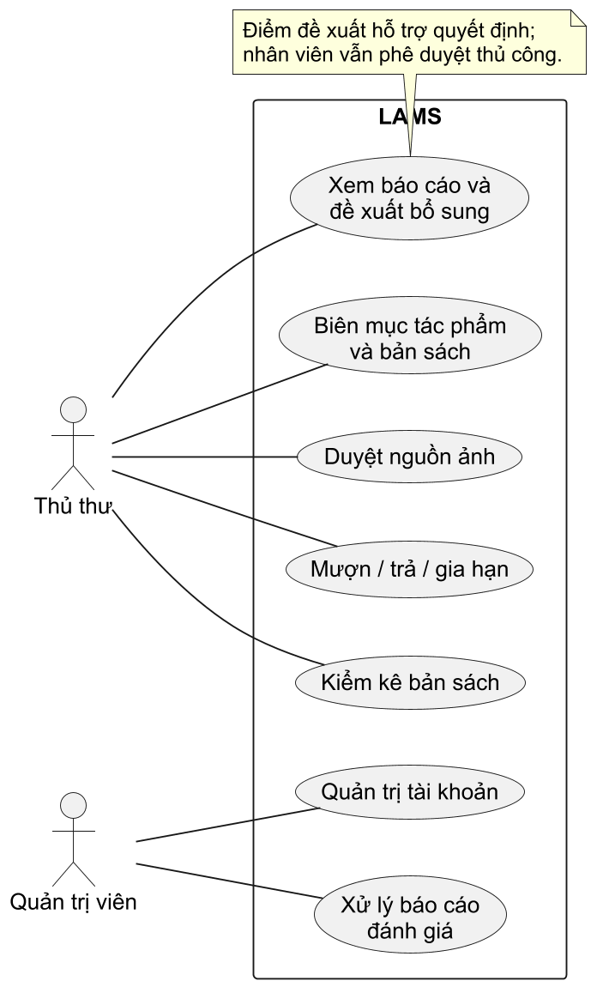

Catalog tách `Book` và `Edition`; `Book.RelatedItem` chỉ là bản chiếu id/tên từ quan hệ tác giả hoặc thể loại. [Hình 21](#fig-21) bổ sung các record này để Hình 3 không phải nén mọi lớp vào một trang. [Hình 22](#fig-22) phân biệt record bằng chứng kiểm kê với bảng Copy sống; anomaly chứa bản chụp/current/scan tùy trường hợp.

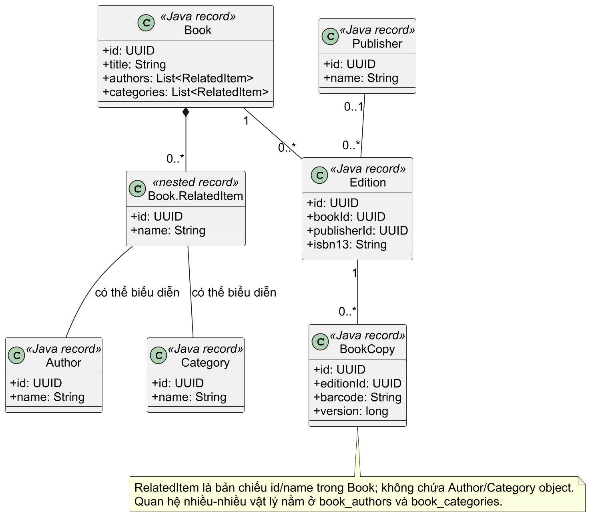

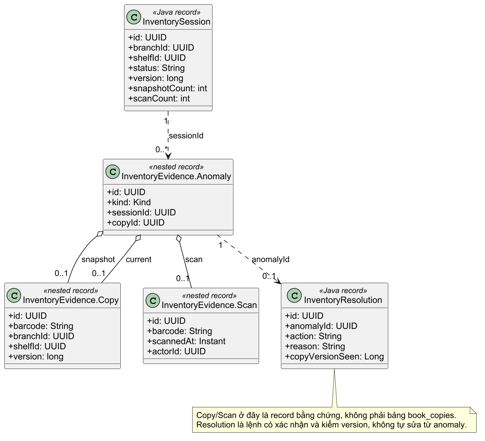

[Hình 23](#fig-23) vẽ RBAC và preferences theo V2/V31. `refresh_tokens` tham chiếu users; một user có tối đa một hàng preferences. [Hình 24](#fig-24) vẽ phiên kiểm kê, bản chụp, scan, anomaly và resolution theo V20/V21. `inventory_snapshots.copy_id` và `inventory_anomalies.copy_id` cố ý không có FK tới Copy sống, để bằng chứng không mất khi dữ liệu tài sản thay đổi.

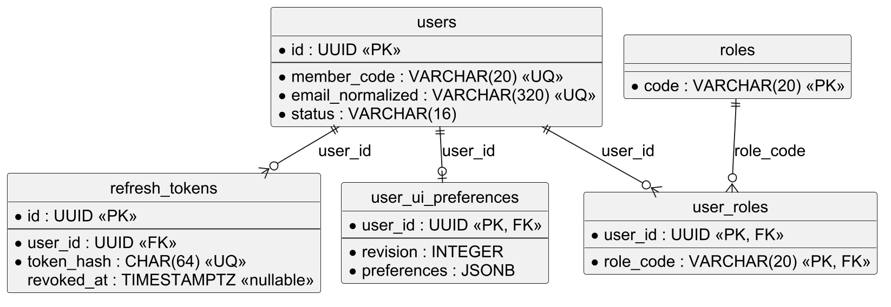

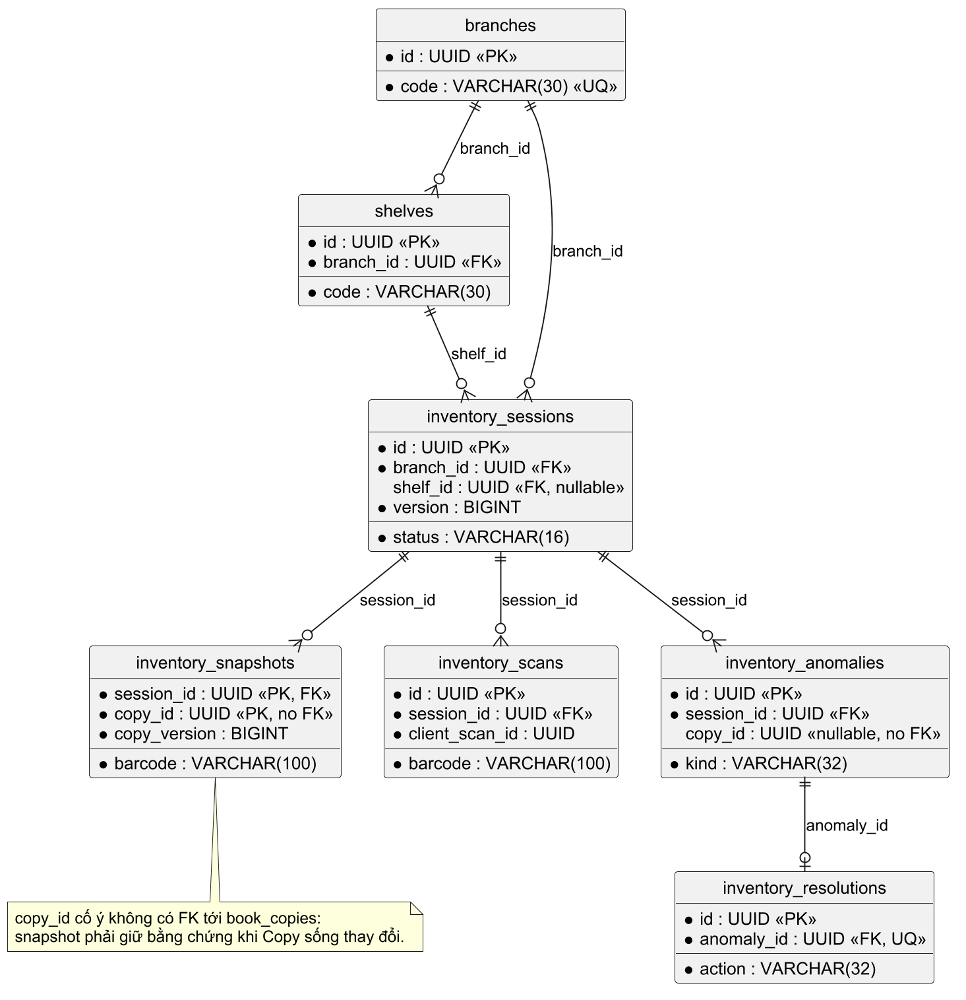

Ảnh dưới đây là nội dung WebView2 trong lượt E2E EXE local, không phải giao diện dựng lại. Điểm 58,8 là kết quả của fixture 1 giữ chỗ và 1 lượt mượn; quyết định chỉ là duyệt nội bộ, không đặt mua sách.

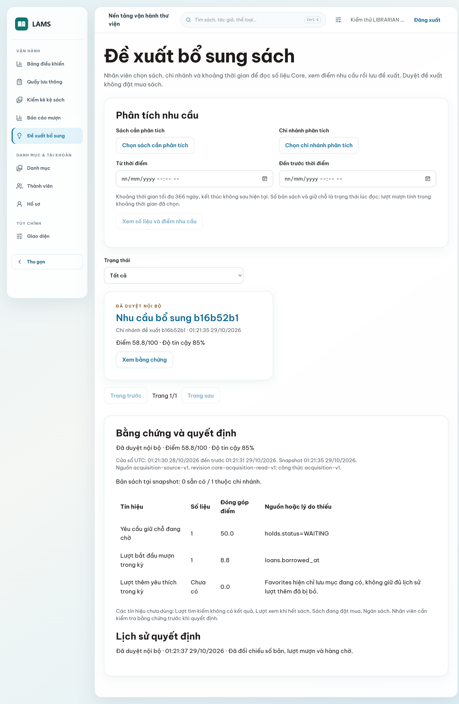

## Phụ lục D. Đối chiếu phần việc và bàn giao

Phần đóng góp cá nhân nằm ở Chương 9. Baseline mã nguồn là `d0ba0158bd875a3da6ef812045d5d268e7dbf1a1`, CI run `40880637621`; PR #32 đã merge. File `manifest-bao-cao.json` cạnh bản Markdown ghi nguồn hình, hash và số lượng cấu trúc. Commit bàn giao báo cáo được tra từ lịch sử Git của các file, tránh đưa chính hash của file vào nội dung file đó. Giảng viên chưa được điền theo yêu cầu của tác giả; trạng thái hồ sơ là NEEDS_USER_INPUT cho đến khi hoàn tất ô này.

## Phụ lục E. Mười use case nghiệp vụ trọng tâm

Các mô tả dưới đây dùng cùng mã UC với Bảng 6. Chúng nêu đường thành công và lỗi có thể kiểm tra, còn mã lỗi cụ thể phải đối chiếu OpenAPI và bài kiểm thử ở phiên bản nộp cuối. Dịch vụ ngoài hoặc dữ liệu ảnh không được coi là tin cậy chỉ vì có URL.

### UC02. Đăng nhập

**Actor và mục đích:** thành viên vào vùng đúng vai trò bằng email hoặc mã thành viên.

**Tiền điều kiện:** tài khoản tồn tại, không bị khóa; form có định danh và mật khẩu.

**Luồng chính:**

1. Người dùng gửi định danh và mật khẩu qua POST `/api/v1/auth/login`.

2. AuthService kiểm thông tin và trạng thái tài khoản rồi cấp access token/refresh cookie nếu hợp lệ.

3. Frontend lấy principal, xóa state của phiên cũ và điều hướng theo vai trò.

**Hậu điều kiện:** phiên hợp lệ, cache của tài khoản cũ không hiển thị.

**Luồng thay thế/ngoại lệ:** định danh hoặc mật khẩu sai và tài khoản khóa bị từ chối; lỗi mạng không được báo đăng nhập thành công.

**Quy tắc và AC:** refresh token được lưu dạng hash, logout thu hồi family; US02 đạt khi thử đúng, sai, khóa và reload theo `AuthIntegrationTest`/AuthFlow. Reset mật khẩu tự phục vụ chưa có API; màn đăng nhập hướng dẫn liên hệ thư viện.

### UC17. Ghi nhận mượn sách

**Actor và mục đích:** thủ thư cho thành viên mượn đúng bản vật lý.

**Tiền điều kiện:** thủ thư còn quyền, thành viên hợp lệ, Copy sẵn có tại chi nhánh, request có khóa retry.

**Luồng chính:**

1. Thủ thư chọn thành viên, quét Copy và xác nhận chi nhánh.

2. POST `/api/v1/loans` mang request key và version tới LoanCommandService.

3. Core kiểm quota/quyền, khóa dữ liệu, ghi Loan/Copy/receipt/audit/outbox trong một transaction; UI nhận biên nhận.

**Hậu điều kiện:** một Loan đang mở cho Copy, biên nhận có thể tra lại.

**Luồng thay thế/ngoại lệ:** retry cùng key trả kết quả cũ; cùng key khác nội dung hoặc version cũ trả xung đột; lỗi giao dịch rollback toàn bộ.

**AC/test:** US17, unique partial index `uq_loans_active_copy`, `LoanCommandIntegrationTest` với PostgreSQL; UI không tự kết luận thành công trước response.

### UC18. Nhận trả sách

**Actor và mục đích:** thủ thư kết thúc Loan và xử lý bản sách vừa trả.

**Tiền điều kiện:** Loan còn mở, đúng chi nhánh và version; tài khoản người mượn bị khóa vẫn được nhận trả.

**Luồng chính:**

1. Thủ thư tra Loan đang mở và xác nhận trả.

2. POST `/api/v1/loans/{id}/return` gửi request key, branch/version.

3. LoanCommandService ghi trả và gọi HoldAllocationService trong cùng transaction; UI hiển thị biên nhận.

**Hậu điều kiện:** Loan đóng; Copy AVAILABLE hoặc ON_HOLD theo kết quả phân bổ.

**Luồng thay thế/ngoại lệ:** Loan đã trả, sai chi nhánh hoặc version cũ bị từ chối; retry cùng request lấy biên nhận cũ.

**AC/test:** US18, `LoanCommandIntegrationTest` và `HoldIntegrationTest`; nếu Kafka chậm, giao dịch vẫn đúng nhưng Inbox có thể đến sau.

### UC19. Gia hạn

**Actor và mục đích:** chủ Loan hoặc thủ thư gia hạn khi chính sách cho phép.

**Tiền điều kiện:** Loan còn mở, chưa quá hạn, còn lượt, không có Hold WAITING phù hợp.

**Luồng chính:**

1. Chủ Loan hoặc thủ thư chọn gia hạn.

2. POST `/api/v1/loans/{id}/renew` tới LoanRenewalService kiểm quyền, hạn và hàng chờ.

3. Core tăng hạn/count/version và ghi loan_extensions một lần rồi trả kết quả.

**Hậu điều kiện:** hạn và lịch sử chính sách cập nhật một lần.

**Luồng thay thế/ngoại lệ:** hết lượt, quá hạn, có người chờ hoặc renew/return tranh chấp bị từ chối; retry không tăng lần nữa.

**AC/test:** US19, `HoldIntegrationTest` và phép kiểm phiên Reader/staff ở Web E2E.

### UC20. Giữ chỗ

**Actor và mục đích:** người đọc yêu cầu một Book tại chi nhánh nhận, có thể chọn Edition cụ thể.

**Tiền điều kiện:** tài khoản ACTIVE, Book/Edition/chi nhánh hợp lệ; không có Hold WAITING/READY khác cho cùng Book.

**Luồng chính:**

1. Người đọc chọn Book, chi nhánh nhận và tùy chọn Edition.

2. POST `/api/v1/holds` tới HoldService kiểm tư cách và yêu cầu đang hoạt động.

3. Core ghi hàng chờ; HoldAllocationService chọn yêu cầu tương thích khi có Copy, đặt READY và hạn nhận.

**Hậu điều kiện:** tối đa một READY cho Copy, người đọc thấy trạng thái của mình.

**Luồng thay thế/ngoại lệ:** Edition không phù hợp, yêu cầu trùng, hủy hoặc quá hạn đi theo nhánh riêng; ETA là ước tính có điều kiện, không tạo quyền nhận sách.

**AC/test:** US20, các index unique của V18, `HoldIntegrationTest` và `HoldExpiryJobTest`.

### UC29. Kiểm kê bản sách

**Actor và mục đích:** thủ thư đối chiếu Copy ở một chi nhánh/kệ với dữ liệu tại lúc mở phiên.

**Tiền điều kiện:** phạm vi hợp lệ và không có phiên OPEN xung đột tại chi nhánh.

**Luồng chính:**

1. Thủ thư mở phiên theo phạm vi; InventorySessionService lưu snapshot.

2. API phiên kiểm kê nhận từng scan cùng clientScanId; UI hiển thị receipt.

3. Nhân viên chốt, xem anomaly và xác nhận resolution dựa trên bằng chứng/version hiện tại.

**Hậu điều kiện:** snapshot bất biến, resolution có người thực hiện và thời điểm.

**Luồng thay thế/ngoại lệ:** scan retry cùng ID trả biên nhận cũ; barcode lạ/quét trùng được ghi thành bằng chứng; Copy đổi version trước resolution trả 409, không tự ghi đè.

**AC/test:** US29, V20–V21, `InventorySessionIntegrationTest`. Camera chỉ hỗ trợ nhập mã, không tự xác nhận xử lý.

### UC09. Biên mục

**Actor và mục đích:** thủ thư tạo/sửa Book, Edition, Copy và vị trí.

**Tiền điều kiện:** còn quyền staff; dữ liệu đáp ứng độ dài, ID tham chiếu và phạm vi chi nhánh.

**Luồng chính:**

1. Thủ thư tạo/sửa Book và liên kết Author/Category.

2. Các API Catalog gửi Edition và Copy theo đúng ID tham chiếu.

3. BookService, EditionService và BookCopyService kiểm dữ liệu rồi commit từng thao tác; UI đọc lại.

**Hậu điều kiện:** public Catalog đọc được dữ liệu đã commit.

**Luồng thay thế/ngoại lệ:** ISBN sai, barcode trùng, shelf khác branch hoặc version cũ trả lỗi; form giữ dữ liệu và chỉ báo thành công sau response.

**AC/test:** US09–US10, `Catalog`/`InventoryCatalogIntegrationTest` và StaffCatalogPage.

### UC12. Duyệt ảnh

**Actor và mục đích:** thủ thư gắn ảnh đúng Edition hoặc Author cùng nguồn và quyền sử dụng.

**Tiền điều kiện:** bản ghi tồn tại; URL, MIME, kích thước và căn cứ định danh/giấy phép được kiểm.

**Luồng chính:**

1. Thủ thư xem ứng viên và xác minh định danh, license, attribution.

2. Gửi tham chiếu qua `/api/v1/catalog-media/{kind}/{id}` tới MediaService.

3. Core kiểm nguồn/version và lưu quyết định; public đọc media đã duyệt.

**Hậu điều kiện:** public chỉ hiển thị media đã duyệt của đúng ID.

**Luồng thay thế/ngoại lệ:** ảnh lỗi hoặc bị thu hồi chuyển sang bìa chữ/visual fallback; nguồn sai, stale revision hoặc URL không an toàn bị từ chối.

**AC/test:** US12, `MediaInspectorTest`, `MediaIntegrationTest`, `BookCover.test.tsx`. Không lấy ảnh ngẫu nhiên để giả làm chân dung tác giả.

### UC27. Đề xuất bổ sung

**Actor và mục đích:** nhân viên xem tín hiệu nhu cầu trước khi đề nghị mua sách.

**Tiền điều kiện:** Book, chi nhánh và time window hợp lệ.

**Luồng chính:**

1. Nhân viên chọn Book/Branch/time window và yêu cầu tính đề xuất.

2. API Insight lấy Core facts rồi tính score/confidence, lưu evidence và version.

3. Nhân viên đọc bằng chứng, gửi quyết định duyệt/bác có lý do; workflow kiểm version trước ghi.

**Hậu điều kiện:** recommendation và decision được lưu, CSV đọc lại được.

**Luồng thay thế/ngoại lệ:** tín hiệu chưa triển khai được ghi là thiếu, không điền 0; dữ liệu Core không sẵn sàng hoặc version stale thì không ghi quyết định giả.

**AC/test:** US27, `AcquisitionFactsIntegrationTest` và recommendation integration; điểm số không tự phê duyệt mua.

### UC25. Quản trị tài khoản

**Actor và mục đích:** ADMIN quản lý trạng thái và vai trò tài khoản.

**Tiền điều kiện:** ADMIN có quyền, tài khoản đích và version hợp lệ.

**Luồng chính:**

1. ADMIN chọn tài khoản, xem version và nhập lý do thay đổi.

2. AdminAccountService kiểm quyền, version và self-protection.

3. Core cập nhật tài khoản, thu hồi phiên khi cần và ghi audit.

**Kết quả và ngoại lệ:** server áp quyền mới và lưu audit. Reader/Librarian nhận 403; version cũ nhận 409. UI giữ thông báo lỗi, không báo thành công.

**AC/test:** US25, `AdminAccountIntegrationTest`, AdminAccountsPage.
