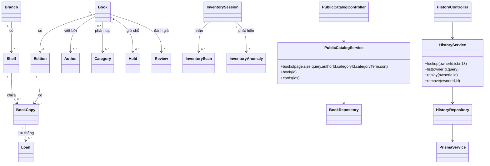
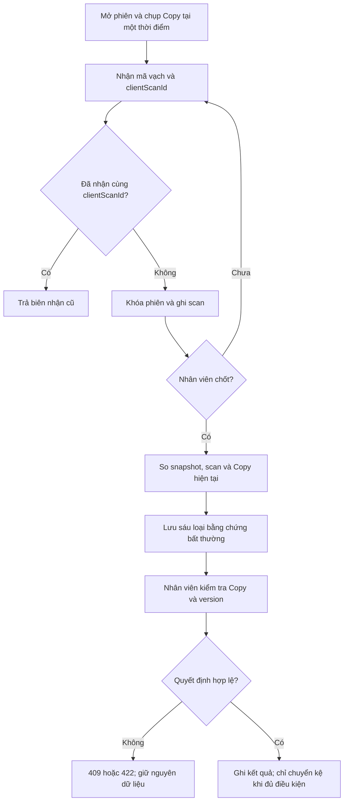

# Hệ thống quản lí và khai thác thư viện LAMS

## Báo cáo bài tập lớn

**Học phần:** Lập trình hướng đối tượng. **Nhóm:** hai thành viên. Tên, mã sinh viên, lớp, giảng viên và học kỳ cần điền theo hồ sơ học phần đã được xác nhận. Bản này mô tả mã nguồn trên nhánh `Tuan/core-platform` ngày 28/10/2026; đây là bản làm việc của PR #31, chưa phải kết quả nghiệm thu trên `main`. Bằng chứng CI có SHA riêng ở mục 4.2 và không tự áp dụng cho thay đổi sau SHA đó.

## Tóm tắt

LAMS phục vụ người đọc tra cứu, lưu sách quan tâm, đánh giá, theo dõi mượn và giữ chỗ; nhân viên quản lý biên mục, bản sách, kiểm kê, lưu thông và đề xuất bổ sung. Hệ thống có giao diện web và ứng dụng Windows dùng Tauri. Core Service (Java/Spring Boot) giữ dữ liệu tài khoản, danh mục và lưu thông; Insight Service (NestJS/Prisma) giữ lịch sử tra ISBN, thông báo và đề xuất bổ sung. Hai dịch vụ dùng PostgreSQL riêng. Bản cài Windows chỉ đóng gói giao diện; backend và database vẫn cần khởi chạy.

Các chức năng đã chạy được trong môi trường phát triển không đồng nghĩa đã sẵn sàng dùng dữ liệu người đọc thật. Chưa nghiệm thu HTTPS nhiều máy, chính sách lưu giữ cho mọi bảng, chữ ký mã phát hành, máy quét vật lý và chất lượng tìm kiếm ngữ nghĩa. Báo cáo tách bằng chứng kiểm thử theo từng commit để tránh lấy kết quả của bản cũ gán cho bản đang review.

# Chương 1. Bài toán và phạm vi

Một cuốn sách có thể có nhiều ấn bản; mỗi ấn bản lại có nhiều bản vật lý ở các chi nhánh và kệ khác nhau. Nếu chỉ lưu một dòng “sách”, hệ thống khó trả lời chính xác bản nào còn cho mượn, bản nào đã giữ chỗ và mã vạch nào cần kiểm kê. LAMS vì vậy tách `Book`, `Edition`, `BookCopy` và `Branch/Shelf`. Tài khoản có vai trò READER, LIBRARIAN hoặc ADMIN; quyền được kiểm tại máy chủ trước mỗi thao tác.

Phạm vi đã triển khai gồm xác thực và hồ sơ, Catalog, ảnh duyệt thủ công, tra metadata ISBN, lịch sử tra cứu, yêu thích/đánh giá, mượn trả/gia hạn, giữ chỗ, kiểm kê, tra cứu từ vựng và đề xuất bổ sung nội bộ. Không có chức năng thanh toán, đặt hàng tới nhà cung cấp hoặc tự phạt người đọc vì giữ chỗ quá hạn. Các gợi ý và bằng chứng kiểm kê phải được nhân viên xem xét.

## 1.1. Câu chuyện người dùng

Các câu dưới đây là nhu cầu và đầu ra quan sát được; trạng thái từng câu cần đối chiếu với API, UI và kiểm thử tại SHA nộp bài. Ma trận đầy đủ có trong `tai-lieu/01-yeu-cau/user-stories.md`.

| Mã | Câu chuyện người dùng | Điều kiện chấp nhận chính |
|---|---|---|
| US01 | Là người đọc mới, tôi muốn đăng ký tài khoản để dùng dịch vụ thư viện. | Đăng ký hợp lệ tạo READER; email trùng bị từ chối. |
| US02 | Là thành viên, tôi muốn đăng nhập bằng email hoặc mã thành viên. | Sai mật khẩu hoặc tài khoản bị khóa không vào được. |
| US03 | Là thành viên, tôi muốn đăng xuất để kết thúc phiên trên thiết bị. | Refresh token bị thu hồi; giao diện xóa dữ liệu phiên. |
| US04 | Là thành viên, tôi muốn xem hồ sơ của mình. | Máy chủ chỉ trả hồ sơ thuộc principal hiện tại. |
| US05 | Là thủ thư, tôi muốn tìm thành viên để hỗ trợ tại quầy. | Có lọc/phân trang; người đọc nhận 403. |
| US06 | Là người đọc, tôi muốn tìm và lọc sách để chọn tài liệu. | Từ khóa, tác giả, thể loại cùng áp dụng; trạng thái rỗng rõ ràng. |
| US07 | Là người đọc, tôi muốn xem các ấn bản để chọn đúng phiên bản. | Book và Edition hiển thị riêng; ID sai trả 404. |
| US08 | Là người đọc, tôi muốn xem tác giả và sách liên quan. | Lọc theo tác giả; ảnh chưa duyệt có fallback. |
| US09 | Là thủ thư, tôi muốn quản lý tác phẩm và danh mục. | CRUD kiểm quyền, FK, unique và version. |
| US10 | Là thủ thư, tôi muốn quản lý chi nhánh, kệ và mã vạch. | Barcode duy nhất; kệ thuộc đúng chi nhánh. |
| US11 | Là thủ thư, tôi muốn tra metadata theo ISBN để hỗ trợ biên mục. | ISBN hợp lệ; dữ liệu ngoài không tự ghi vào Core. |
| US12 | Là thủ thư, tôi muốn duyệt ảnh và nguồn sử dụng. | Chỉ ảnh có chứng cứ nguồn và quyết định duyệt mới hiển thị. |
| US13 | Là thủ thư, tôi muốn lưu và xóa lịch sử tra ISBN của riêng mình. | Persist sau reload; truy cập bản ghi người khác trả 404. |
| US14 | Là người đọc, tôi muốn lưu sách yêu thích. | Danh sách chỉ thuộc tài khoản hiện tại; vẫn còn sau reload. |
| US15 | Là người đọc, tôi muốn viết và sửa đánh giá. | Chỉ sửa đánh giá của mình; input không hợp lệ bị từ chối. |
| US16 | Là người đọc, tôi muốn cho điểm sách từ 1 đến 5. | Trung bình và số đánh giá lấy từ dữ liệu đã được hiển thị. |
| US17 | Là người đọc, tôi muốn xem các lượt mượn của mình. | Không đọc được khoản mượn của tài khoản khác. |
| US18 | Là thủ thư, tôi muốn ghi mượn, trả và gia hạn. | Trạng thái Copy đổi trong giao dịch; xung đột không ghi một phần. |
| US19 | Là người đọc, tôi muốn giữ chỗ khi chưa mượn được sách. | Hàng chờ và thời hạn được máy chủ quyết định. |
| US20 | Là thủ thư, tôi muốn kiểm kê bằng mã vạch. | Snapshot giữ nguyên; bất thường có bằng chứng và quyết định có xác nhận. |

## 1.2. Tác nhân và yêu cầu phi chức năng

READER tra cứu và thao tác trên dữ liệu cá nhân. LIBRARIAN vận hành tài sản thư viện; ADMIN quản lý tài khoản và xử lý báo cáo đánh giá/giữ chỗ hết hạn. Dịch vụ metadata bên ngoài là nguồn tham khảo; PostgreSQL của Core là nguồn dữ liệu có thẩm quyền cho Catalog. Hệ thống cần phân quyền ở server, không lộ token trong log, phản hồi lỗi rõ, giới hạn phân trang/đầu vào, chống ghi đè đồng thời và lưu bằng chứng quyết định. Giao diện hỗ trợ bàn phím và kích thước màn hình hẹp, nhưng chưa có nghiên cứu usability hoặc audit trợ năng đầy đủ.

# Chương 2. Phân tích đối tượng và thiết kế

## 2.1. Quan hệ dữ liệu

`Book` có nhiều `Edition`; một `Edition` có nhiều `BookCopy`. `Book` liên kết nhiều `Author` và `Category` qua bảng nối. `BookCopy` thuộc `Shelf`, `Shelf` thuộc `Branch`. `Loan` gắn người mượn và bản sách; `Hold` gắn người yêu cầu, tác phẩm/ấn bản và chi nhánh nhận. `InventorySession` có snapshot, scan và anomaly; quyết định xử lý là bản ghi riêng để không xóa bằng chứng. `Review` gắn người viết với Book; chỉ đánh giá được công khai mới tham gia điểm hiển thị. `MetadataLookup` ở database Insight chỉ tham chiếu UUID người thực hiện do Core xác thực; không có khóa ngoại xuyên hai database.

## 2.2. Sơ đồ lớp UML



Sơ đồ kết hợp quan hệ domain với dependency của một số lớp điều phối. Trong mã Java, `Book` là record và repository dùng JDBC; nó không phải JPA entity. `MetadataLookup` là model Prisma của Insight. Phương thức và các lớp đầy đủ hơn nằm trong `tai-lieu/02-kien-truc/lop-va-thuat-toan.md`; ERD database nằm trong `tai-lieu/03-du-lieu/erd.md`.

## 2.3. Thuật toán kiểm kê



Sáu loại gồm sai kệ, thiếu bản trong snapshot, trạng thái không khớp, sai chi nhánh, mã vạch không tồn tại và quét trùng. Hàng đợi offline ở frontend chỉ giữ tối đa 20 mã trong bộ nhớ của trang, không phải snapshot mới hay dữ liệu đã được server chấp nhận.

## 2.4. Wireframe bố cục chính

```text
┌───────────────────────────────────────────────────────────┐
│ Logo LAMS    Tìm sách      Thư viện của tôi      Tài khoản │
├───────────────────────────────────────────────────────────┤
│ Ô tìm kiếm [tựa sách, tác giả, ISBN]        [Tìm]         │
│ Bộ lọc thể loại / tác giả       Sắp xếp / số kết quả       │
│ ┌───────┐ ┌───────┐ ┌───────┐                              │
│ │ Bìa   │ │ Bìa   │ │ Bìa   │  Thẻ sách: tên, tác giả,     │
│ │ Tên   │ │ Tên   │ │ Tên   │  trạng thái khả dụng          │
│ └───────┘ └───────┘ └───────┘                              │
│ Phân trang / trạng thái rỗng / lỗi                         │
└───────────────────────────────────────────────────────────┘
```

Trang nhân viên dùng thanh điều hướng tới biên mục, quầy lưu thông, kiểm kê và đề xuất bổ sung. Màn hình kiểm kê đặt thông tin phiên ở đầu, ô mã vạch/camera và danh sách mã chờ ở giữa, nút chốt có xác nhận tách khỏi danh sách anomaly. Wireframe chi tiết W1–W5 và trạng thái responsive nằm trong `tai-lieu/06-giao-dien/wireframes.md`; ảnh chụp runtime có thư mục minh chứng riêng, không được gọi là wireframe.

# Chương 3. Kiến trúc, API và cơ sở dữ liệu

## 3.1. Luồng thông tin

Web hoặc Tauri gọi API `/api/v1` bằng access JWT trong bộ nhớ phiên. Core xác minh chữ ký, trạng thái tài khoản và vai trò hiện tại trước khi vào service. Service kiểm DTO, invariant và version, repository dùng tham số SQL để đọc/ghi PostgreSQL. Dữ liệu phản hồi được ánh xạ sang DTO, tránh gửi cột không cần thiết. Insight xác thực actor qua Core trước khi ghi lịch sử ISBN hoặc đọc Inbox; Core và Insight không ghi trực tiếp database của nhau. Luồng thông báo dùng Core outbox, Kafka và consumer Insight khi các thành phần được bật/cấu hình. Nếu consumer tắt, dữ liệu giữ chỗ vẫn nằm trong Core; hộp thông báo chưa có sự kiện mới.

## 3.2. ORM và truy vấn

Insight dùng Prisma: controller nhận request, guard lấy UUID actor, service gọi repository, repository gọi Prisma Client. Ví dụ lịch sử ISBN sử dụng `create` để ghi `ownerId`, ISBN13, status/provider và thời gian; `findFirst`/`deleteMany` luôn có điều kiện `ownerId`. Danh sách chạy `count` và `findMany` trong transaction `RepeatableRead`, sắp xếp theo `createdAt` rồi `id`. Provider HTTP được gọi ngoài transaction để không giữ khóa database trong thời gian chờ mạng. Replay dùng ISBN cũ để tra nguồn hiện tại, không tự ghi thành Book/Edition.

Core dùng Spring JDBC thay cho ORM entity. Truy vấn Catalog dùng SQL có bind parameter cho từ khóa/UUID và tập sort nằm trong allowlist; count và page của một request dùng `REPEATABLE READ`. Chỉ mục GIN phục vụ full-text/trigram; kết quả xếp theo ISBN đúng, tựa đúng/tiền tố, full-text, tác giả, phần tên và tên gần đúng. Khi không có kết quả và không kèm bộ lọc, giao diện có thể hiển thị tối đa năm nhan đề gần đúng để người đọc tự chọn tìm lại; đây là so khớp chữ, không phải hiểu ngữ nghĩa. Hai request ở hai trang khác thời điểm không mặc nhiên cùng snapshot. Query kiểm kê đọc snapshot đã lưu, không ghép các trang Copy sống rồi coi đó là một ảnh chụp thống nhất.

Một ví dụ giản lược của phép đọc trang trong Core là `SELECT id FROM matches ORDER BY score DESC, id LIMIT ? OFFSET ?`. `matches` được tạo từ truy vấn tìm kiếm có điều kiện và các giá trị `?` là tham số JDBC; mã không nối trực tiếp từ khóa người dùng vào SQL. Dữ liệu thẻ sách được lấy tiếp theo tập ID của trang, gồm ảnh đã duyệt, điểm trung bình của review hiển thị và nguồn Catalog. Tên cột sort được chọn từ ba giá trị cố định `title`, `updated`, `relevance`, không lấy một chuỗi tùy ý từ request. Cách này vẫn cần đo tải trên dữ liệu lớn, vì kết hợp nhiều bảng và phép xếp hạng có thể tăng thời gian đọc.

Ở Insight, phép xóa history tương đương điều kiện `WHERE id = :id AND owner_id = :actorId`; hàng thuộc người khác không được tiết lộ. Truy vấn danh sách áp dụng `ownerId`, prefix ISBN, `skip/take` và thứ tự `createdAt, id` qua Prisma Client. `ownerId` đi từ guard xác thực với Core, không đi từ query/body của người dùng. Dù Prisma giúp tạo SQL và quản lý schema, nghiệp vụ vẫn phải tự kiểm quyền, đầu vào, transaction và lỗi khi database không sẵn sàng.

## 3.3. API và trường hợp lỗi

Contract Core và Insight nằm tại `contracts/openapi/core-api.yaml` và `contracts/openapi/insight-api.yaml`. Ví dụ: `POST /auth/login` cấp phiên; `GET /public/catalog/books` trả trang sách; các endpoint lưu thông/giữ chỗ/kiểm kê ở Core nhận requestId hoặc version tại điểm cần chống retry/ghi đè. `GET/POST/DELETE /metadata/history` ở Insight chỉ thao tác trên actor đã xác thực. Từ chối đầu vào theo 400/422; không đăng nhập 401, thiếu quyền 403, không tìm thấy hoặc không phải chủ sở hữu 404, xung đột version/unique 409, hạn mức 429, dependency tạm lỗi 503. Không báo thành công nếu transaction rollback hoặc Prisma write thất bại. Trường hợp mất phản hồi sau commit phải tra biên nhận/danh sách hoặc retry cùng khóa idempotency ở nghiệp vụ hỗ trợ; không tạo request mới một cách mù quáng.

| Tình huống | Kết quả mong đợi | Kiểm chứng |
|---|---|---|
| Đăng nhập hợp lệ | Tạo access token và refresh session | Auth integration và E2E |
| Mật khẩu sai hoặc tài khoản khóa | Từ chối, không cấp phiên | Auth integration |
| Người đọc gọi API nhân viên | 403, không thay đổi dữ liệu | HTTP/integration quyền |
| ISBN sai checksum | 400, không gọi provider và không ghi history | Metadata service/HTTP |
| Bản ghi history khác owner | 404 cho đọc/xóa/replay | Insight integration |
| Version Copy cũ khi xử lý kiểm kê | 409, không lưu quyết định hoặc đổi kệ một phần | PostgreSQL integration |
| Mất phản hồi khi gửi scan | Retry cùng clientScanId trả biên nhận cũ | Inventory integration và frontend |
| Database Insight lỗi khi lưu history | 503, giao diện không báo đã lưu | HTTP/frontend test |

# Chương 4. Triển khai và kiểm thử

## 4.1. Cách chạy

Môi trường phát triển cần Java 21, Node 22.23.3, Docker Engine và PostgreSQL. Cấu hình biến môi trường theo `.env.example`, khởi động hạ tầng bằng Compose, chạy Flyway/Prisma migration rồi khởi động Core, Insight và frontend theo `README.md` và `tai-lieu/08-van-hanh/chay-local.md`. Ứng dụng Windows chạy theo `tai-lieu/08-van-hanh/desktop-windows.md`; Tauri mở cửa sổ riêng nhưng vẫn gọi backend đã khởi động. Không đưa mật khẩu trong báo cáo hay dùng dữ liệu thật cho demo.

## 4.2. Bằng chứng và giới hạn kiểm thử

Baseline `main` là `c05b593` trước PR #31. Commit `46c1916` của nhánh làm việc đạt 5/5 job CI trong [run 40667899756](https://github.com/Shuuma4869/He-thong-quan-ly-va-khai-thac-thu-vien/actions/runs/40667899756): Core (gồm PostgreSQL integration), Node apps, API contracts, Web E2E và desktop Windows. Artifact bộ cài `lams-windows-x64` gắn với SHA này. Trước đó, test `InventoryFlow` 8/8, typecheck và lint đã đạt local; ở lần sửa tìm kiếm, 31 test frontend liên quan và năm test Node dữ liệu/đo lường đạt local. Test camera dùng mock `getUserMedia`/`BarcodeDetector`; chưa có kết quả thử máy quét vật lý. Bộ 25 câu hỏi tìm kiếm mới đã đối chiếu với snapshot Gutenberg nhưng chưa chạy phép đo API trên đủ 10.000 Book. Tài liệu này được cập nhật sau commit `46c1916`; thay đổi tiếp theo vẫn cần CI gắn SHA nộp bài.

Các lớp kiểm thử gồm unit (thuật toán, validation), PostgreSQL/Testcontainers (migration, transaction, quyền, race), contract OpenAPI, frontend component và E2E Web. Build EXE chỉ xác nhận đóng gói; E2E trong WebView2 cần chạy độc lập cho phiên bản nộp bài. Với thao tác kiểm kê, test bao phủ snapshot, sáu anomaly, version, retry và xác nhận trước khi sửa; vẫn cần diễn tập thực địa với mạng không ổn định và camera/thiết bị thật.

## 4.3. Giao diện và nguồn ảnh

Nhánh làm việc sau SHA `504499b` bổ sung bố cục sáng với sidebar tách khỏi vùng làm việc, các bề mặt có độ trong vừa phải và trang `/cai-dat/giao-dien`. Người dùng chọn màu nhấn, blur, độ bo góc, mật độ, cỡ chữ, chuyển động, kiểu hiển thị sách và trạng thái sidebar rồi xem trước trước khi lưu. Khách lưu trong trình duyệt; người đăng nhập lưu preset theo tài khoản qua Core. API chỉ nhận các giá trị trong danh sách cho phép, có phiên bản schema và revision để tránh ghi đè khi hai thiết bị cùng sửa. Các khối trên bảng điều khiển nhân viên có thể được ẩn hoặc hiện; số liệu vẫn đọc từ API thật.

Ảnh thư viện ở trang chủ và đăng nhập là ảnh nhóm đã cung cấp. Chín ảnh Pexels mới được lưu cục bộ: ba ảnh cho đầu trang Catalog, trang tác giả/thể loại, khối giới thiệu hành trình đọc; sáu ảnh minh họa cho các nhóm thể loại đã ánh xạ. Bảng nguồn ảnh nằm trong `tai-lieu/06-giao-dien/nguon-anh.md`. Ảnh minh họa được ghi nhãn riêng, không gán thành chân dung tác giả hoặc bìa sách. Khi chưa có media đã duyệt và không có chủ đề phù hợp, card dùng thiết kế chữ và nhãn đúng trạng thái. URL media Catalog đã duyệt vẫn được tải trực tiếp từ nguồn; việc sao chép toàn bộ ảnh này về máy chủ chưa nằm trong thay đổi giao diện.

Ở lượt kiểm tra local ngày 28/10/2026, frontend đạt 187/187 test và chụp trang cài đặt ở 390, 768, 1440 px không có cuộn ngang; trang chủ 1440 px cũng không tràn. Core biên dịch được mã nguồn và mã test, nhưng Docker Engine chưa chạy nên test PostgreSQL của migration và API mới chưa có kết quả local. CI và E2E Web/EXE của commit bàn giao mới phải được ghi riêng sau khi chạy; bằng chứng ở mục 4.2 không áp dụng cho thay đổi này.

# Chương 5. An ninh, pháp luật và đạo đức

Auth giữ access JWT trong memory, refresh token trong cookie HttpOnly; role/owner được server xác định thay vì tin body. Query SQL dùng tham số; Prisma không ghép raw SQL từ request. Validation giới hạn độ dài, phân trang và ISBN; media ngoài được duyệt thủ công trước khi hiển thị. Hệ thống có test 401/403/404/409/422/429/503, nhưng CI và quét dependency không thể chứng minh tuyệt đối rằng không còn lỗ hổng. Bản pilot có dữ liệu thật cần kiểm HTTPS, secret, backup, retention, bảo vệ ingress và rate limit dùng chung nhiều replica.

Lịch sử ISBN chỉ lưu UUID actor, ISBN, provider/status và thời gian, không lưu payload provider; hiện chưa có TTL/tự xóa khi tài khoản ngừng dùng. Báo cáo đánh giá, Inbox và quyết định no-show cũng chưa có retention đã phê duyệt. Tài liệu vòng đời dữ liệu phân biệt khóa ngoại ở Core với UUID lưu xuyên dịch vụ ở Insight; truy vấn kiểm kê retention chỉ đếm số hàng và mốc thời gian, không xóa dữ liệu. Không triển khai xóa production theo một mốc đề xuất chưa được chủ dữ liệu chấp thuận. Ảnh bìa/tác giả cần nguồn, giấy phép và ghi công; truy cập được qua API không đồng nghĩa được phép sao chép. Google Books mặc định tắt theo quyết định dự án.

Nhóm cần rà nghĩa vụ theo [Luật Bảo vệ dữ liệu cá nhân 91/2025/QH15](https://vanban.chinhphu.vn/?classid=1&docid=214590&pageid=27160&typegroup=) và [Luật 07/2022/QH15 sửa đổi Luật Sở hữu trí tuệ](https://congbao.chinhphu.vn/van-ban/luat-so-07-2022-qh15-37504.htm) trước khi vận hành dữ liệu thật hoặc phát hành asset. Đây là căn cứ tham khảo, không phải kết luận tuân thủ pháp luật. Về đạo đức nghề nghiệp, nhóm phải giữ chính xác tác giả commit, không dùng dữ liệu cá nhân thật trong video khi chưa có quyền, công khai giới hạn kiểm thử và không tự động phạt người đọc từ tín hiệu có thể sai. Mức sử dụng công cụ hỗ trợ trong học phần cần được thành viên khai báo theo quy định thực tế của giảng viên; báo cáo không tự suy sự chấp thuận đó.

# Chương 6. Kết luận và việc còn lại

LAMS đã có các luồng thư viện chính trên hai dịch vụ và giao diện Windows, với kiểm thử tự động theo nhiều lớp. Kết quả phù hợp để trình diễn trên môi trường phát triển; PR #31 vẫn là bản làm việc chưa được merge. Phần chưa hoàn tất của mục tiêu mở rộng gồm embedding/semantic search, hybrid ranking, cá nhân hóa gợi ý sách, zero-result analytics, dữ liệu nhu cầu theo thời gian cho Acquisition, ngân sách/đề xuất mua nội bộ, chính sách retention có phê duyệt và nghiệm thu pilot HTTPS. Các nội dung này không được trình bày như chức năng đã chạy. Tùy chỉnh giao diện ở mục 4.3 là thiết lập trình bày, không phải thuật toán gợi ý sách.

Trước buổi bảo vệ, nhóm cần chốt SHA và CI của bản nộp, chạy lại E2E Web/EXE, xác nhận tên/mã sinh viên và phân công, quay video demo, rà quyền ảnh và áp dụng mẫu của giảng viên. Bản báo cáo này sẽ được cập nhật theo các bằng chứng đó.

## Tài liệu tham khảo nội bộ

`README.md`; bộ tài liệu trong `tai-lieu/`; Core và Insight OpenAPI; PR #31 và CI gắn SHA. Luật 91/2025/QH15: `vanban.chinhphu.vn`; Luật 07/2022/QH15: `congbao.chinhphu.vn`.
