# Báo cáo tiểu luận Hệ thống quản lí và khai thác thư viện LAMS

**Bản làm việc:** `Tuan/core-platform`, PR #31; mã nguồn được khảo sát tại `0ef4007ac95fc4704e56527569fb0c1399a56e0d`, ngày 28/10/2026. Thay đổi sau mốc này phải có kiểm thử và SHA riêng trước khi nộp.

**Thông tin trường, học phần, giảng viên, sinh viên, lớp và ngày nộp:** chưa có hồ sơ được xác nhận trong repository. Nhóm cần điền theo thông báo học phần; báo cáo không suy các thông tin này từ tên thư mục hay dự án tham khảo.

# Tóm tắt

LAMS giải quyết bài toán tìm tài liệu và quản lý bản sách vật lý tại thư viện. Người đọc tra cứu tác phẩm, xem ấn bản và tình trạng bản sách, lưu sách yêu thích, đánh giá, theo dõi mượn và giữ chỗ. Nhân viên biên mục, xử lý giao dịch tại quầy, kiểm kê và xem báo cáo. Quản trị viên xử lý tài khoản, báo cáo đánh giá và các quyết định cần thẩm quyền cao hơn. Hệ thống tách tác phẩm (`Book`), ấn bản (`Edition`) và bản vật lý (`BookCopy`), vì một nhan đề không tương đương một mã vạch hoặc một số lượng tồn kho.

Ứng dụng React/TypeScript chạy trên trình duyệt và trong cửa sổ Tauri/WebView2 Windows. Core Service dùng Spring Boot, JDBC và Flyway để quản lý danh tính, Catalog, lưu thông và kiểm kê. Insight Service dùng NestJS/Prisma để lưu lịch sử tra ISBN, thông báo và đề xuất bổ sung. Mỗi dịch vụ sở hữu một database PostgreSQL. PR #31 bổ sung giao diện sáng, điều hướng nổi, thiết lập giao diện theo tài khoản và ảnh biên tập có ghi nguồn.

Trên SHA khảo sát, CI đạt 5/5 job: Core, Node apps, API contracts, Web E2E và build desktop Windows. Local đạt 190/190 test frontend, lint, typecheck và build; 35 tổ hợp năm trang với bảy độ rộng không tràn ngang hoặc mất ảnh cục bộ. Đây là bằng chứng của phiên bản cụ thể, không phải kết luận đã nghiệm thu sản xuất. Docker Engine local chưa hoạt động ở thời điểm bắt đầu viết lại báo cáo nên thao tác WebView2 cùng dữ liệu thật của mốc mới còn chờ; PostgreSQL integration đã chạy qua CI.

**Từ khóa:** thư viện; Catalog; PostgreSQL; JDBC; Prisma; Tauri; kiểm kê; giữ chỗ; kiểm thử.

# Mục lục

<!--TOC-->

# Danh mục hình

<!--LISTFIG-->

# Danh mục bảng

<!--LISTTAB-->

# Từ viết tắt

Bảng 1. Thuật ngữ sử dụng trong báo cáo.

| Thuật ngữ | Nghĩa trong LAMS |
|---|---|
| API | Giao diện lập trình giữa frontend, Core và Insight. |
| AC | Điều kiện chấp nhận của câu chuyện người dùng. |
| Core | Dịch vụ Spring Boot sở hữu dữ liệu thư viện có thẩm quyền. |
| Insight | Dịch vụ NestJS/Prisma phục vụ metadata, thông báo và đề xuất. |
| JWT | Access token ký số, được giữ trong bộ nhớ trình duyệt. |
| ORM | Ánh xạ qua Prisma Client ở Insight; Core dùng JDBC thay vì ORM entity. |
| PR | Pull request để review trước khi tích hợp vào `main`. |
| WebView2 | Bộ máy hiển thị web trong ứng dụng Tauri trên Windows. |

# Chương 1. Tổng quan đề tài

## 1.1. Bối cảnh và bài toán

Ở thư viện có nhiều chi nhánh, cùng một tác phẩm có thể tồn tại dưới nhiều ấn bản, và mỗi ấn bản có nhiều bản sách với mã vạch, kệ và trạng thái riêng. Một bảng sách duy nhất không thể trả lời đồng thời “tác phẩm này nói về gì?”, “ấn bản nào có ISBN này?” và “bản vật lý nào còn cho mượn tại chi nhánh A?”. LAMS tách ba cấp dữ liệu đó và đặt thay đổi trạng thái bản sách trong giao dịch có kiểm tra cạnh tranh. Người đọc chỉ xem thông tin công khai và dữ liệu của mình; nhân viên cần màn hình nghiệp vụ và bằng chứng để xử lý sai lệch.

Tra cứu ISBN và ảnh từ bên ngoài có thể hỗ trợ biên mục, nhưng nguồn ngoài không tự trở thành dữ liệu chính thức của thư viện và không mặc nhiên cấp quyền sao chép. Ảnh theo tác giả/ấn bản vì vậy cần đối chiếu và duyệt; metadata chỉ là ứng viên. Bộ 10.000 định danh từ Project Gutenberg phục vụ diễn tập tìm kiếm, không chứng minh có 10.000 bản sách vật lý [1].

## 1.2. Mục tiêu và phạm vi

Mục tiêu đã triển khai là tra cứu Catalog có phân trang, thao tác tài khoản an toàn, mượn/trả/gia hạn và giữ chỗ nhất quán, kiểm kê có bằng chứng, báo cáo lưu thông, thông báo và đề xuất nội bộ. Giao diện web và Tauri dùng chung React. Thao tác thất bại không được hiển thị là thành công.

LAMS chưa có thanh toán, đơn mua gửi nhà cung cấp, ngân sách phê duyệt, xếp hạng vector/semantic search hoặc triển khai HTTPS nhiều máy đã nghiệm thu. `APPROVED` trong đề xuất bổ sung chỉ là quyết định nội bộ. Bộ cài Windows đóng gói giao diện, không chứa hai backend hay database. Những giới hạn này ảnh hưởng trực tiếp đến cách trình diễn và kết luận ở Chương 9.

Bảng 2. Thành phần runtime và trách nhiệm.

| Thành phần | Công nghệ | Trách nhiệm và giới hạn |
|---|---|---|
| Web và desktop | React, TypeScript, Vite, Tauri/WebView2 | Cùng route/component; desktop vẫn gọi API đang chạy. |
| Core | Java 21, Spring Boot, Security, JDBC, Flyway | Identity, Catalog, Copy, Loan, Hold, Inventory, read projection và outbox. |
| Insight | Node 22, NestJS, Prisma | Metadata/history, Inbox, đề xuất; xác minh actor qua Core. |
| Dữ liệu | Hai database PostgreSQL | Không có FK xuyên dịch vụ; migration theo owner. |
| Hạ tầng tùy chọn | Kafka, Redis, MinIO | Kafka phục vụ outbox/consumer khi bật; MinIO không phục vụ ảnh Catalog hiện tại. |

[Hình 1](#fig-1) tách ranh giới người dùng, ứng dụng và hai database. Kênh sự kiện là tùy chọn, không thay giao dịch đồng bộ của mượn/trả.

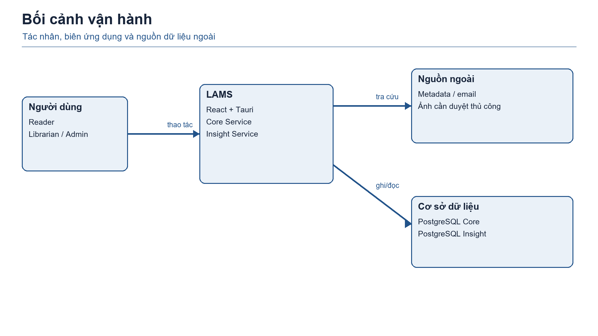

## 1.3. Phân công và nguồn xác nhận

Tài liệu thành viên giao Tuan phần nền tảng, frontend và tích hợp; Toan sở hữu các phần backend theo task map từng phase. Người tạo PR, review, merge và tác giả commit có thể khác nhau. Bản nộp cuối cần đối chiếu `git log`, PR #11/#25/#27/#31 và xác nhận danh tính từng tài khoản; báo cáo không suy tên pháp lý hay tỷ lệ đóng góp từ alias Git. Số liệu trong slide cũ gắn mốc riêng, không tự chuyển thành kết quả của head PR #31 [2].

# Chương 2. Phân tích yêu cầu

## 2.1. Tác nhân, use case và quyền

`READER` tra cứu công khai, quản lý đóng góp và giao dịch của mình. `LIBRARIAN` biên mục, thao tác ở quầy, kiểm kê và xem báo cáo. `ADMIN` có các quyền nhân viên cùng chức năng quản lý tài khoản, xử lý báo cáo đánh giá và quyết định no-show. Nguồn metadata và email là hệ thống ngoài, không có quyền ghi Catalog. Quyền phải được Core/Insight kiểm tại request; ẩn nút trong UI chỉ giảm thao tác nhầm. [Hình 2](#fig-2) chỉ vẽ nhóm use case hiện có trong route/API.

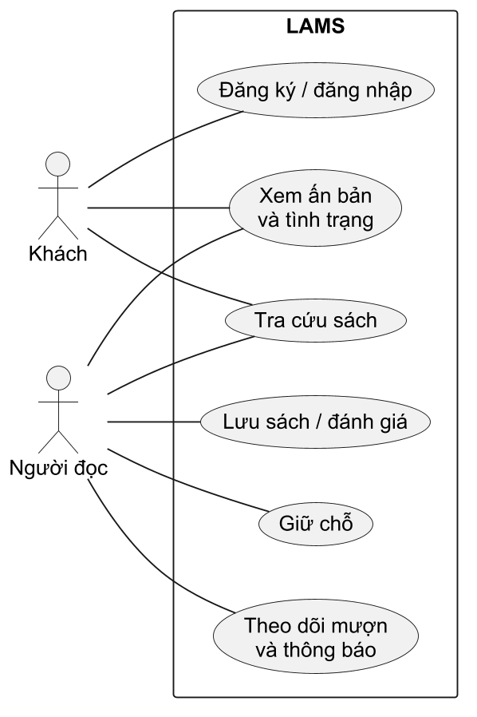

## 2.2. Câu chuyện người dùng

US01–US22 đối chiếu với `tai-lieu/01-yeu-cau/user-stories.md`. US23–US29 tổng hợp từ mã PR #31 và tài liệu nghiệp vụ, chưa thay mã số trong task map gốc. Một story có mặt ở đây khi có màn hình hoặc API thật; điều kiện chấp nhận là tiêu chí kiểm chứng, không tự chứng minh đã PASS.

Bảng 3. Câu chuyện người dùng US01–US15.

| Mã | Câu chuyện người dùng | Điều kiện chấp nhận ngắn |
|---|---|---|
| US01 | Là người đọc mới, tôi muốn đăng ký để dùng dịch vụ thư viện. | Email trùng bị từ chối; tài khoản mới có vai trò READER. |
| US02 | Là thành viên, tôi muốn đăng nhập bằng email hoặc mã thành viên. | Sai mật khẩu hoặc tài khoản khóa không được cấp phiên. |
| US03 | Là thành viên, tôi muốn đăng xuất để kết thúc phiên. | Refresh token bị thu hồi; UI xóa dữ liệu phiên. |
| US04 | Là thành viên, tôi muốn xem hồ sơ của mình. | Principal chỉ đọc dữ liệu thuộc mình. |
| US05 | Là thủ thư, tôi muốn tìm thành viên tại quầy. | Có lọc/phân trang; READER nhận 403. |
| US06 | Là người đọc, tôi muốn tìm sách theo từ khóa, tác giả và thể loại. | Kết quả, tổng và trang nhất quán trong một request. |
| US07 | Là người đọc, tôi muốn xem các ấn bản của tác phẩm. | Book và Edition tách; ID sai trả 404. |
| US08 | Là người đọc, tôi muốn xem tác giả và sách liên quan. | Truy vấn đúng tác giả; ảnh thiếu có fallback rõ. |
| US09 | Là thủ thư, tôi muốn sửa Catalog để biên mục chính xác. | CRUD kiểm quyền, ràng buộc và xung đột. |
| US10 | Là thủ thư, tôi muốn quản lý chi nhánh, kệ và mã vạch. | Barcode duy nhất; kệ thuộc đúng chi nhánh. |
| US11 | Là thủ thư, tôi muốn tra ISBN để hỗ trợ biên mục. | ISBN hợp lệ; provider không tự ghi Core. |
| US12 | Là thủ thư, tôi muốn duyệt ảnh và nguồn sử dụng. | Cần nguồn, giấy phép, bằng chứng và xác nhận. |
| US13 | Là thủ thư, tôi muốn quản lý lịch sử tra ISBN của mình. | Lưu sau reload; bản ghi người khác trả 404. |
| US14 | Là người đọc, tôi muốn lưu sách yêu thích. | Danh sách gắn tài khoản, tồn tại sau reload. |
| US15 | Là người đọc, tôi muốn viết và sửa đánh giá. | Chỉ chủ sở hữu sửa; input sai bị từ chối. |

Bảng 4. Câu chuyện người dùng US16–US29.

| Mã | Câu chuyện người dùng | Điều kiện chấp nhận ngắn |
|---|---|---|
| US16 | Là người đọc, tôi muốn chấm điểm sách từ một đến năm. | Tổng và trung bình lấy từ review đang hiển thị. |
| US17 | Là thủ thư, tôi muốn ghi nhận một lượt mượn. | Chỉ bản sẵn có được mượn; retry cùng request không nhân đôi. |
| US18 | Là thủ thư, tôi muốn trả hoặc gia hạn lượt mượn. | Copy/Hold đổi cùng giao dịch; xử lý theo policy. |
| US19 | Là người đọc, tôi muốn gửi yêu cầu giữ chỗ. | Hàng chờ và hạn nhận do server quyết định. |
| US20 | Là thủ thư, tôi muốn quét mã và xử lý kiểm kê. | Snapshot, sáu loại bất thường và xác nhận có version. |
| US21 | Là người đọc, tôi muốn xem lượt mượn của mình. | Không đọc lịch sử của người khác; staff có bộ lọc riêng. |
| US22 | Là nhân viên, tôi muốn xem và xuất báo cáo lưu thông. | Khoảng ngày hợp lệ; CSV không lộ danh tính và chống formula. |
| US23 | Là thành viên, tôi muốn chọn giao diện dễ đọc và lưu lựa chọn. | Khách lưu local; tài khoản lưu Core, revision ngăn ghi đè. |
| US24 | Là người đọc, tôi muốn báo cáo đánh giá không phù hợp. | Mỗi người một báo cáo/review; ADMIN quyết định có lý do. |
| US25 | Là quản trị viên, tôi muốn khóa tài khoản hoặc đổi vai trò. | Kiểm quyền và version; quyết định được lưu. |
| US26 | Là người đọc, tôi muốn xem thông báo giữ chỗ. | Chỉ xem/đánh dấu mục của mình; cần outbox/consumer bật. |
| US27 | Là nhân viên, tôi muốn xem tín hiệu bổ sung sách. | Số liệu/confidence có nguồn; phê duyệt nội bộ cần lý do. |
| US28 | Là quản trị viên, tôi muốn rà trường hợp không nhận sách giữ chỗ. | Xác nhận/miễn trừ có lý do; không tự phạt. |
| US29 | Là thủ thư, tôi muốn dùng camera hoặc hàng đợi tạm để quét mã. | Camera chỉ điền ô; offline tối đa 20 mã trong bộ nhớ. |

## 2.3. Yêu cầu phi chức năng và ma trận truy vết

Các yêu cầu quan trọng là quyền ở server, bất biến khi hai người thao tác cùng Copy, giới hạn payload/phân trang, xử lý lỗi mạng trung thực, giao diện dùng bàn phím và alt text cho ảnh. Hệ thống lưu ISBN, review và quyết định quản trị nên phải xét truy cập chéo tài khoản, SQL injection, CSV formula injection và SSRF. Số đo local không thay SLA của pilot. [Bảng 5](#tbl-5) nối story với nơi thực thi và bài kiểm chứng; AC chi tiết của US01–US22 ở tài liệu gốc [3].

Bảng 5. Ma trận truy vết nhu cầu, mã, dữ liệu và kiểm thử.

| Story | UI và API hiện có | Dữ liệu và bài kiểm chứng |
|---|---|---|
| US01–05 | Auth/Profile/Member; `/auth/*`, `/me/profile`, `/members` | `users`, `refresh_tokens`; Auth/Member integration, AuthFlow, MemberFlow. |
| US06–10 | Catalog/Directory/StaffCatalog; Catalog API | `books`, `editions`, `book_copies`; Book/Edition/InventoryCatalog integration, CatalogFlow. |
| US11–13 | MetadataHistory/Media; Insight history và Core media API | `metadata_lookups`, `catalog_media_references`; history integration, MediaIntegrationTest. |
| US14–16,24 | MyLibrary/ReviewReports; favorites, reviews, moderation API | `favorites`, `reviews`, `review_reports`; Review/Favorite integration, LibraryFlow. |
| US17–22,28–29 | ReaderLoans/StaffCirculation/Inventory/Report; loan, hold, inventory, report API | V16–V21/V30, receipt/outbox; Hold/Loan/Inventory integration, CSV test, Web E2E. |
| US23 | AppearancePage; `/me/ui-preferences` | V31 `user_ui_preferences`; UiPreferencesIntegrationTest, AppearanceProvider test. |
| US25 | AdminAccountsPage; account admin API | V26–V28; AccountCenterIntegrationTest, E2E Admin. |
| US26 | NotificationsPage; Inbox API | Core outbox, Insight notices/inbox; notification integration, Web E2E. |
| US27 | AcquisitionPage; Core facts, Insight recommendations/CSV | Insight recommendation/decision; score unit, integration, Web E2E. |

Đường dẫn source chỉ chứng minh có implementation. Chương 7 ghi kết quả theo đúng SHA; những AC chưa có bài chạy trực tiếp được nêu riêng.

# Chương 3. Phân tích đối tượng và dữ liệu

## 3.1. Thực thể và bất biến

`Book` là tác phẩm logic, `Edition` là lần xuất bản có ISBN/ngôn ngữ/nhà xuất bản khi biết, `BookCopy` là tài sản có barcode, trạng thái, kệ và version. Bảng nối liên kết Book với Author/Category. Một Loan mở chỉ trỏ tới một Copy; unique partial index ngăn hai Loan chưa trả trên cùng Copy. Hold gắn Book, có thể chọn đúng Edition hoặc chấp nhận ấn bản phù hợp tại chi nhánh nhận. Một người có tối đa một Hold WAITING/READY cho cùng Book; một Copy chỉ có một assignment READY. Những điều kiện này không thể bảo đảm bằng nút UI và được kiểm trong transaction/constraint.

`InventorySession` chụp snapshot trước khi nhận scan; `InventoryScan` có `clientScanId` để retry, `InventoryAnomaly` giữ bằng chứng và `InventoryResolution` ghi quyết định. Không xóa snapshot khi sửa kệ, vì nếu không sẽ mất căn cứ đối chiếu. `Review` là nhận xét của một user trên một Book, rating 1–5; điểm hiển thị chỉ lấy review VISIBLE. `MetadataLookup` ở Insight lưu UUID owner, ISBN, provider/status và thời gian, không lưu response của nhà cung cấp. UUID liên dịch vụ không phải khóa ngoại xuyên database.

## 3.2. Cấu trúc lớp UML

[Hình 3](#fig-3) mô tả record miền và lớp điều phối có thật, gồm `BookRepository.list/search`, `HoldAllocationService.allocateBook` và `InventorySessionService.start/scan/close`. Core dùng `JdbcTemplate` ánh xạ dòng vào record/DTO; repository này không phải JPA entity. Insight dùng Prisma model và Client. Sơ đồ không gán phương thức service vào bảng dữ liệu. Phân biệt này giúp nhìn ra điểm chịu trách nhiệm giữ bất biến: DTO kiểm biên HTTP, service quyết định nghiệp vụ, repository thực hiện SQL trong transaction.

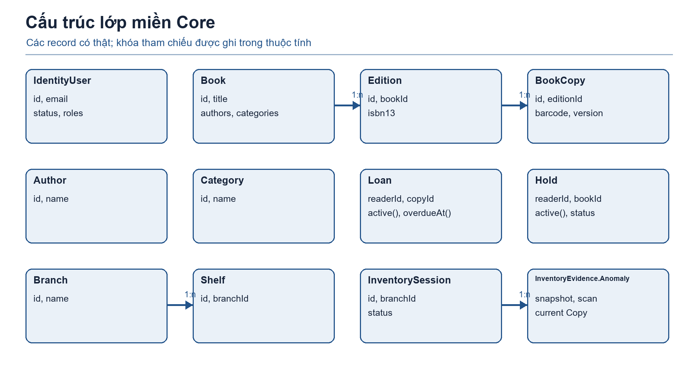

## 3.3. ERD và vòng đời schema

Flyway Core có V1–V31; V31 tạo `user_ui_preferences` với khóa người dùng, revision và JSONB preset. Prisma Insight có migration độc lập cho `metadata_lookups`, `acquisition_recommendations`/`acquisition_decisions`, notices và Inbox. [Hình 4](#fig-4) vẽ các quan hệ cốt lõi từ migration, không đưa bảng dự kiến `search_documents`, `media_assets` hay `system_policies` vào ERD thực thi. [Hình 5](#fig-5) tách bảng Insight và ghi rõ UUID Book/Branch/User không có FK tới Core.

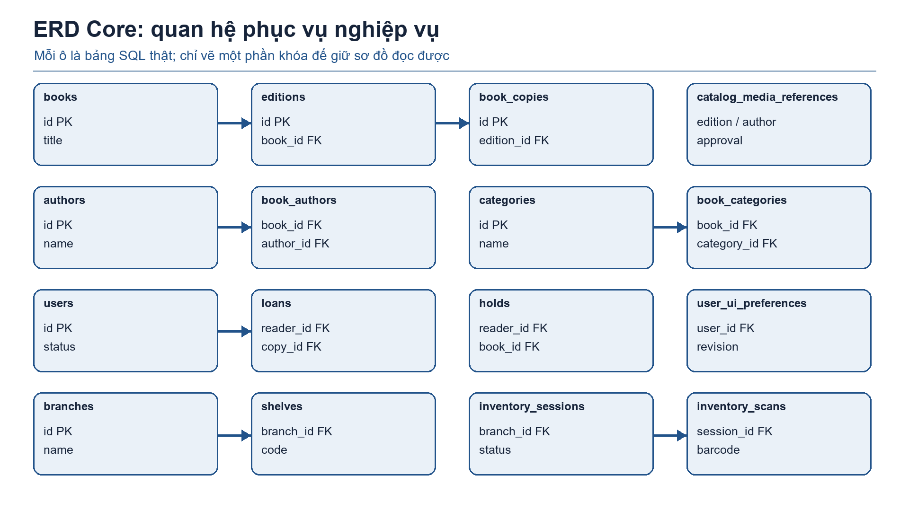

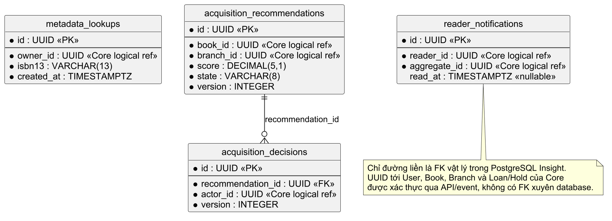

Với ảnh, `catalog_media_references` trỏ đúng một Author hoặc Edition, lưu URL, giấy phép, ghi công, bằng chứng và quyết định duyệt. Favorite có khóa ghép user/book; Review có thể cần giữ bằng chứng khi có báo cáo. Xóa User không đồng nghĩa xóa sạch dữ liệu ở Insight; vòng đời thông báo, lịch sử ISBN và quyết định cần chính sách, công cụ riêng trước pilot. Bảng 6 phân biệt quan hệ vật lý với tham chiếu logic.

Bảng 6. Quan hệ và ràng buộc dữ liệu tiêu biểu.

| Quan hệ | Ràng buộc đang dùng | Hệ quả nghiệp vụ |
|---|---|---|
| Book → Edition → BookCopy | FK và barcode unique | Không suy số bản từ Book; Copy là tài sản cụ thể. |
| Branch → Shelf → BookCopy | FK, kiểm cùng chi nhánh | Không chuyển Copy sang kệ của chi nhánh khác. |
| User/Copy → Loan | FK và unique partial Loan mở | Hai giao dịch không cùng mượn một bản. |
| User/Book → Hold | Unique active theo người/Book; READY theo Copy | Chặn yêu cầu trùng và phân bổ kép. |
| Session → Snapshot/Scan/Anomaly/Resolution | FK và khóa retry scan | Có thể giải thích kiểm kê sau khi Copy thay đổi. |
| User → Preferences | FK ON DELETE CASCADE, revision | Preset theo tài khoản, tránh ghi đè giữa hai thiết bị. |
| Core UUID ↔ Insight owner/book | Không có FK xuyên database | Cần xác minh actor và xử lý mồ côi/retention. |

## 3.4. Từ dữ liệu đến truy vấn

Core dùng Spring JDBC. Ví dụ truy vấn danh mục chuẩn hóa từ khóa, áp dụng bộ lọc, sort từ allowlist rồi bind giá trị qua `?`; count và trang kết quả được đọc trong transaction `REPEATABLE READ`. Tập ID của trang được mở rộng thành thẻ sách gồm tác giả, bìa đã duyệt và điểm đánh giá hiển thị. Một request có snapshot nhất quán không có nghĩa trang 1 và trang 2 gọi ở hai thời điểm có chung snapshot. Truy vấn kiểm kê vì thế đọc bảng snapshot đã lưu, không ghép các trang `book_copies` đang sống rồi coi là cùng một ảnh chụp.

Insight dùng Prisma Client với điều kiện `ownerId` lấy từ guard, không từ body. Danh sách history có count/findMany trong transaction `RepeatableRead` và thứ tự `createdAt, id`. Provider HTTP chạy ngoài transaction để không giữ kết nối và khóa khi chờ mạng. Khi xóa lịch sử, điều kiện ID và owner đi cùng nhau; bản ghi của người khác không được tiết lộ. Đây là khác biệt quan trọng giữa ORM (giảm thao tác ghép SQL) và authorization (vẫn phải tự thiết kế, kiểm thử).

Bảng 7. Hai đường truy vấn dữ liệu chính.

| Luồng | Đầu vào → xử lý → đầu ra | Kiểm soát lỗi |
|---|---|---|
| Catalog | Query/UUID/page → chuẩn hóa, bind JDBC, count/page, enrich card → DTO | 400/422 cho tham số sai; 404 chi tiết; sort allowlist. |
| History | JWT → Core xác minh owner → Prisma where/transaction → DTO | 401/403/404; 503 khi DB/provider lỗi; không false success. |
| Report CSV | Khoảng ngày/chi nhánh → aggregate JDBC → UTF-8 CSV | Tối đa 366 ngày/10.000 nhóm; chống formula, không xuất người mượn. |

# Chương 4. Kiến trúc và luồng thông tin

## 4.1. Thành phần và đường đi request

Trong web, trình duyệt tải tài nguyên tĩnh do Vite phục vụ khi phát triển. Trong desktop, Tauri chứa cùng bundle và hiển thị bằng WebView2. Cả hai gọi Core cho dữ liệu thư viện và Insight cho chức năng metadata, Inbox hoặc Acquisition. Access JWT ở memory; refresh token dùng cookie HttpOnly. Insight kiểm actor và quyền hiện tại với Core; một JWT cũ không tự trao quyền staff nếu vai trò đã bị thu hồi. Core và Insight chỉ ghi database của mình. [Hình 6](#fig-6) tách đường request đồng bộ, database và kênh sự kiện.

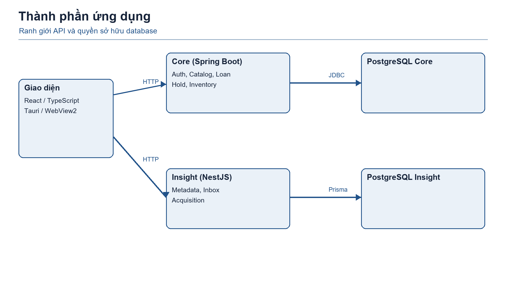

Kiến trúc hai dịch vụ tăng độ rõ ownership nhưng đổi lại phải xử lý mạng lỗi, xác minh actor xuyên dịch vụ và dữ liệu tham chiếu không có FK. Catalog, Loan và Hold được giữ tại Core để tránh giao dịch phân tán ở đường mượn/trả. Insight có thể chậm hoặc tắt mà không làm mất giao dịch lưu thông đã commit trong Core. Cơ chế thông báo dựa trên outbox, Kafka và consumer, mặc định chưa bật cho môi trường không cấu hình broker.

## 4.2. Sequence giữ chỗ và nhất quán

Người đọc gửi Hold qua Core. Service kiểm tài khoản, Book/Edition/chi nhánh, khóa theo Book và kiểm hàng chờ; PostgreSQL ghi Hold, thay đổi và outbox trong cùng transaction. Khi Copy trở lại AVAILABLE, bộ phân bổ chọn Hold WAITING tương thích theo `queuedAt, id`, kiểm lại điều kiện và chuyển một Hold sang READY. Kết quả có deadline nhận. Không dùng `SKIP LOCKED` làm bỏ qua người đứng trước trong cùng Book. [Hình 7](#fig-7) nhấn mạnh ranh giới transaction và thông báo sau commit; màn hình ETA chỉ là mô phỏng điều kiện, không quyết định phân bổ.

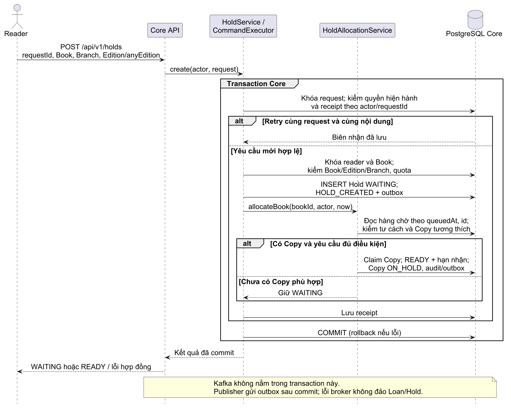

Khi worker chạy lại, constraint và kiểm trạng thái ngăn phân bổ kép. Khi người dùng hủy hoặc quá hạn, hệ thống kiểm lại status/version/deadline rồi phân bổ tiếp. Nếu gửi request xong mất response, client phải dùng cùng khóa idempotency ở nghiệp vụ hỗ trợ hoặc tra cứu trạng thái; gửi request mới mù quáng có thể tạo xung đột hoặc thông báo sai.

## 4.3. Triển khai local và giới hạn production

Compose local dùng PostgreSQL, Redis, Kafka; MinIO nằm trong profile tùy chọn, mặc định không chạy. Core và Insight chạy trên host Windows qua script; desktop mở cửa sổ riêng nhưng cần API/backend đang hoạt động. Pilot HTTPS chỉ có cấu hình chuẩn bị, chưa có tài khoản Render/Neon hay chứng nhận vận hành nhiều máy. [Hình 8](#fig-8) phân biệt host, container và máy người dùng. Cổng database trong Compose chỉ bind loopback; không dùng sơ đồ local như sơ đồ production.

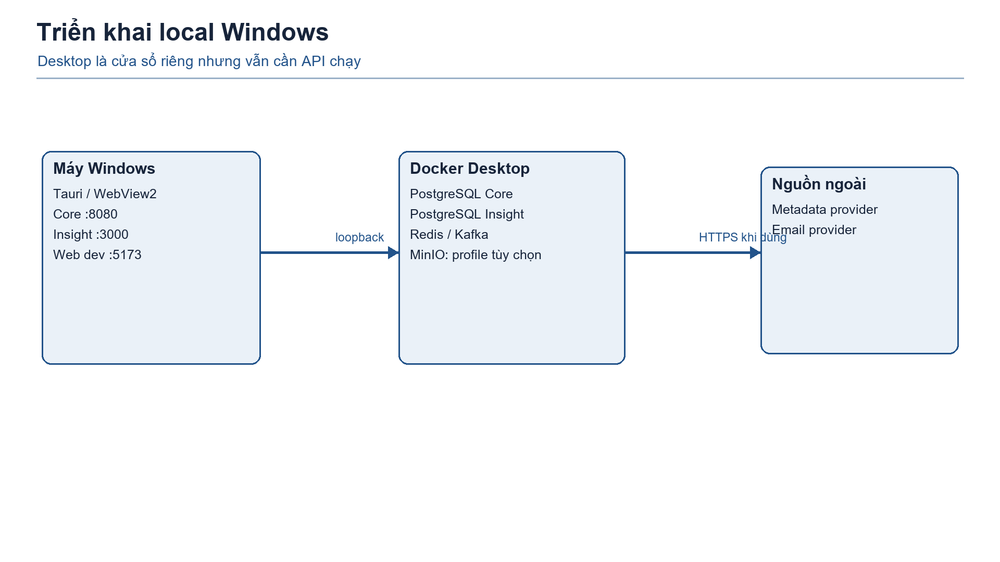

## 4.4. Hợp đồng API và sự kiện

`contracts/openapi/core-api.yaml` và `insight-api.yaml` mô tả đường `/api/v1`. Login trả phiên; Catalog public trả trang sách; loan/hold/inventory nhận khóa retry hoặc version khi cần; Insight history không cho nhập owner tùy ý. Lỗi theo ngữ cảnh: 400/422 cho input, 401 thiếu phiên, 403 thiếu quyền, 404 không thấy hoặc không là chủ sở hữu, 409 xung đột, 429 quá hạn mức, 503 dependency không sẵn sàng. Frontend không báo lưu thành công trước response. Riêng API giao diện `GET/PUT /me/ui-preferences` chỉ nhận preset allowlist, schema version và revision; người dùng khác không thể đọc hàng của nhau.

Core ghi outbox cùng Loan/Hold rồi publisher gửi sự kiện tới Kafka sau commit. Consumer Insight dùng ID sự kiện để chống lặp và tạo read model thông báo/Inbox khi bật. Cách này chấp nhận thông báo tới muộn nhưng không đánh đổi tính đúng đắn của giao dịch mượn sách. Nếu Kafka tắt, fact trong Core vẫn tồn tại; không được nói Inbox có thông báo mới. Hợp đồng sự kiện và retry nằm ở tài liệu outbox [4].

Bảng 8. Lỗi được diễn giải cho người dùng và nhân viên.

| Trường hợp | HTTP/biểu hiện | Hành vi đúng |
|---|---|---|
| Mật khẩu sai hoặc tài khoản khóa | 401/403 | Không cấp phiên; giữ form và thông báo ngắn. |
| ISBN sai checksum | 400 | Không gọi provider, không lưu history. |
| Reader gọi màn staff | 403 | Không thực hiện thao tác; UI quay về vùng được phép. |
| Stale version Copy/Preferences | 409 | Yêu cầu tải lại; không ghi đè quyết định mới. |
| Provider/Insight DB lỗi | 503 | Không báo đã lưu; cho thử lại có kiểm soát. |
| Quá hạn mức provider | 429 và Retry-After | Chờ đúng thời hạn, không retry vòng lặp. |

# Chương 5. Thiết kế giao diện và hình ảnh

## 5.1. Design system và bố cục

Giao diện theo hướng sáng, với sidebar/topbar tách khỏi workspace, bề mặt trắng xanh trong vừa phải, viền mảnh và bóng mềm. `appearance.css` đặt các token màu nhấn, độ kính, blur, khoảng cách, bo góc, bề rộng sidebar và chiều cao topbar. `PublicLayout`, `ReaderLayout`, `StaffLayout` dùng cùng lớp nền và navigation; các trang nghiệp vụ vẫn giữ bảng, form và thông báo phù hợp tác vụ. Độ trong không được làm chữ khó đọc; khi người dùng giảm chuyển động hoặc hệ điều hành yêu cầu, animation được rút ngắn/tắt.

Thiết lập `/cai-dat/giao-dien` cho chọn màu, kính, blur, kiểu/trạng thái sidebar, mật độ, bo góc, cỡ chữ, chuyển động, lưới/danh sách sách và ẩn/hiện widget. Khách lưu localStorage; người đăng nhập dùng hàng `user_ui_preferences` của Core. `revision` ngăn ghi đè giữa hai thiết bị, preset allowlist ngăn CSS tùy ý. Khi đổi tài khoản, provider che giao diện trong lúc tải và bỏ phản hồi save của chủ cũ đến muộn. Widget chưa có kéo thả đổi thứ tự. [Hình 9](#fig-9) là screenshot local của trang cài đặt, không phải mockup.

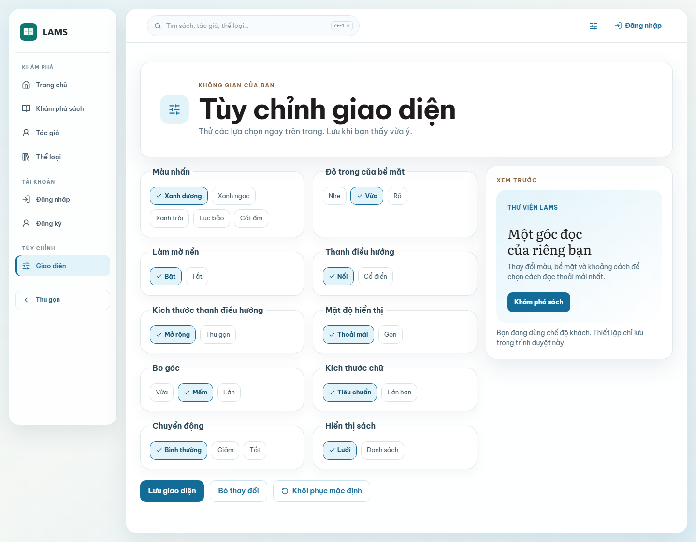

## 5.2. Hành trình theo vai trò và wireframe

Public có landing, Catalog, tác giả/thể loại, chi tiết sách, login/register và 404. Reader có hồ sơ, My Library, mượn/giữ chỗ, Inbox và đóng góp. Staff có dashboard, thành viên, Catalog, quầy lưu thông, báo cáo, kiểm kê và đề xuất. Admin còn có quản lý tài khoản và xử lý báo cáo đánh giá. `AppRouter` đặt guard theo vai trò, còn server kiểm lại ở endpoint. Wireframe [Hình 10](#fig-10) thể hiện vị trí thanh điều hướng, tìm kiếm, bộ lọc và vùng làm việc; nó là hình thiết kế, khác screenshot runtime ở [Hình 11](#fig-11) và [Hình 12](#fig-12).

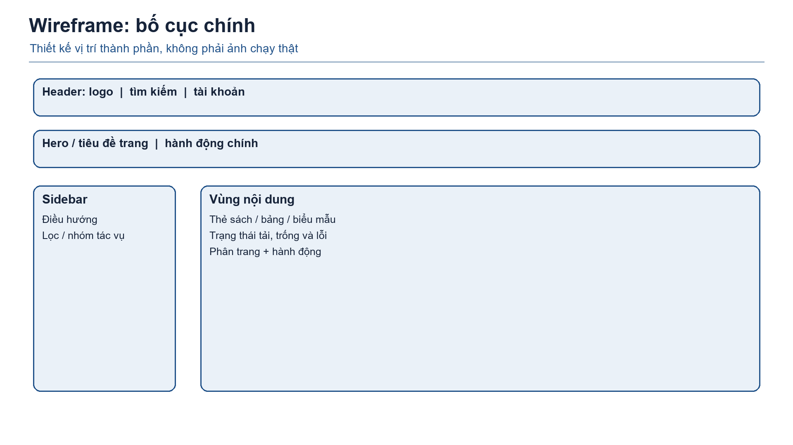

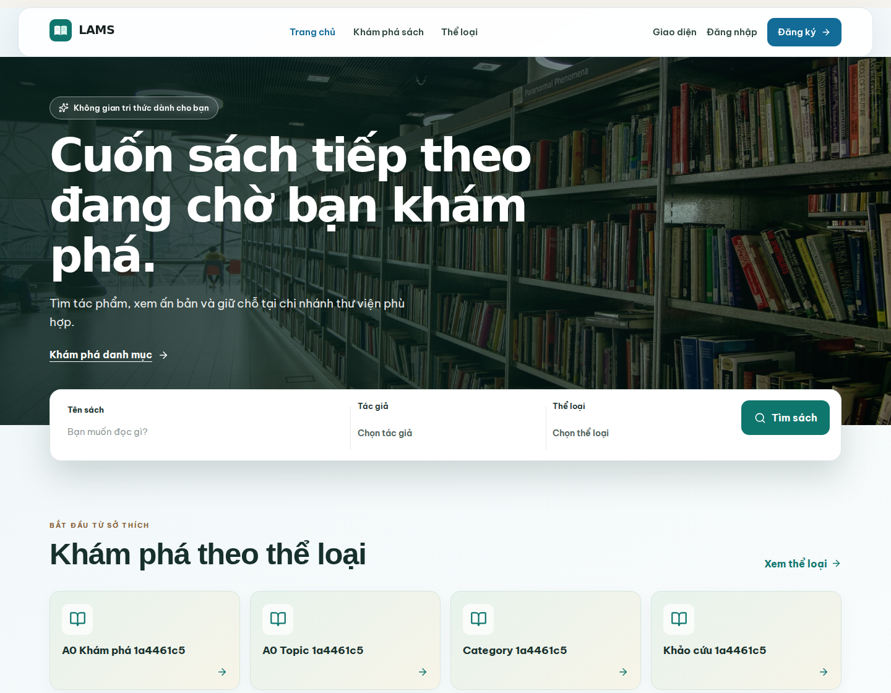

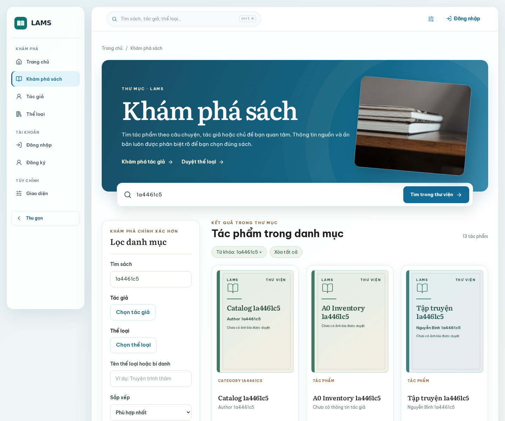

Các ảnh ở [Hình 11](#fig-11) và [Hình 12](#fig-12) là phần đầu được cắt để in từ bản chụp toàn trang Web E2E trên `0ef4007`, có dữ liệu test. Ảnh gốc, không chỉnh sửa, lưu trong hồ sơ minh chứng. [Hình 13](#fig-13) là màn người đọc xem mượn/giữ chỗ; [Hình 14](#fig-14) và [Hình 15](#fig-15) là màn nhân viên. Các trang CRUD khác dùng component và token chung nhưng không được nhận là đã có screenshot cho từng trạng thái.

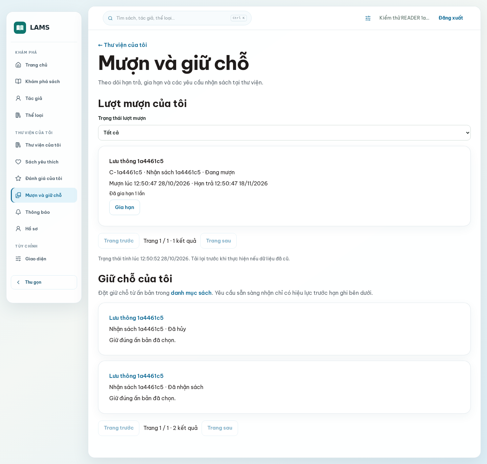

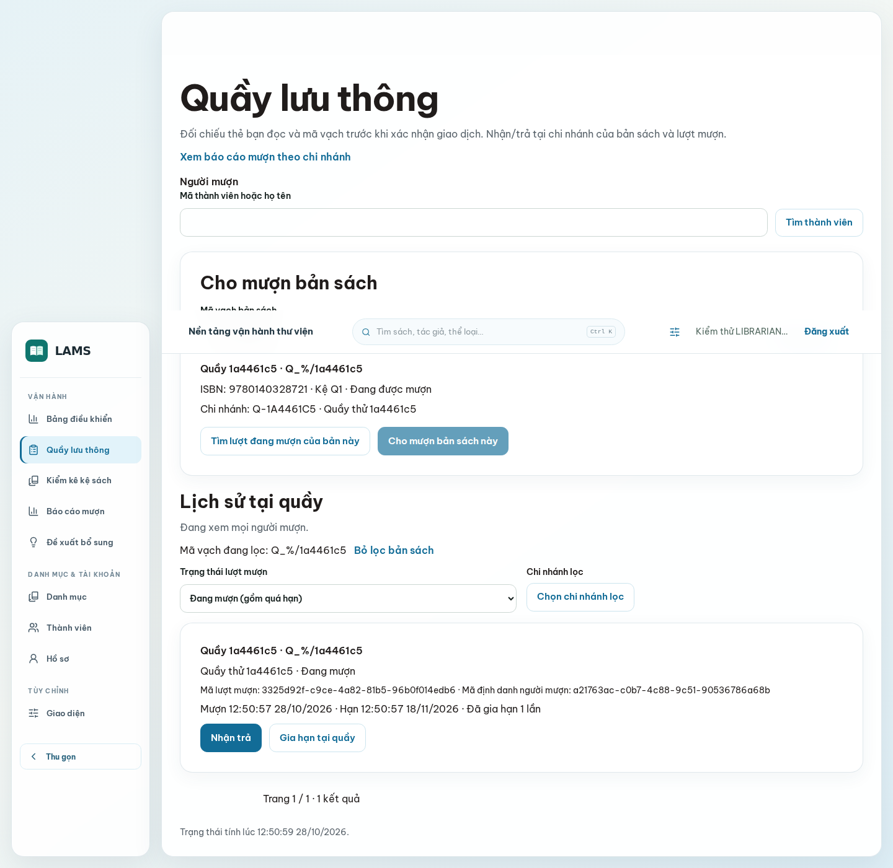

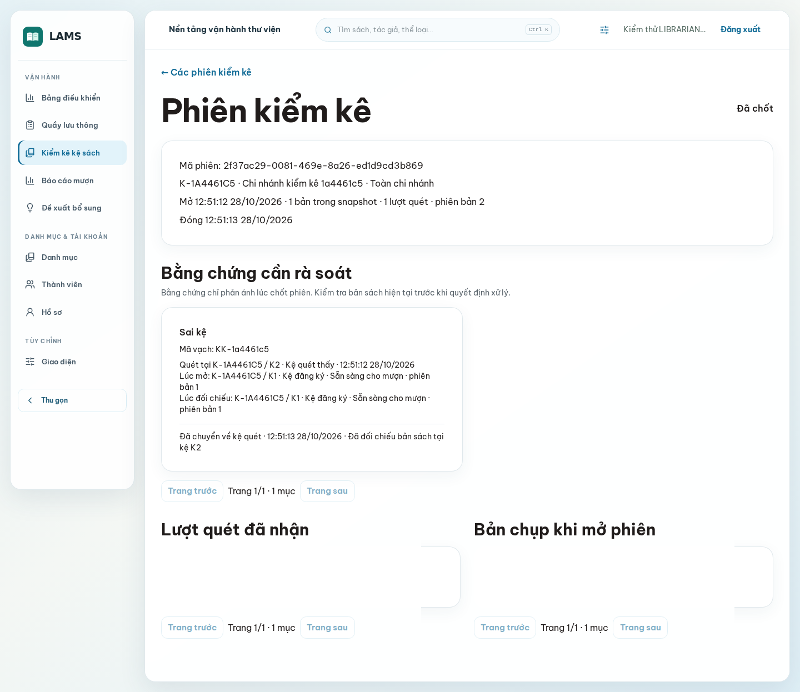

## 5.3. Chiến lược media, fallback và trợ năng

Ba ảnh biên tập Pexels nằm ở landing/Catalog/directory; chín ảnh khác minh họa nhóm thể loại. Nguồn, tác giả và giấy phép ở `tai-lieu/06-giao-dien/nguon-anh.md` [5]. Chúng là ảnh chủ đề, không phải bìa của từng Book hoặc chân dung tác giả. Ảnh tác giả/ấn bản chỉ được xem là media của bản ghi khi có tham chiếu đã duyệt; khi thiếu hoặc URL hỏng, UI dùng bìa chữ/visual có nhãn. Bộ tám bìa Standard Ebooks đã đối chiếu là ứng viên cho demo và có script duyệt có kiểm ID/Edition; danh sách ứng viên không đồng nghĩa database đã duyệt. Không đưa ảnh ngẫu nhiên vào bản ghi để trang trông đầy.

Ảnh cục bộ có alt text theo nội dung; card có focus visible, trạng thái tải/rỗng/lỗi và thao tác bàn phím. Responsive đã được kiểm ở 390, 768, 1024, 1366, 1440, 1536 và 1920 px trên năm route public/settings, không có cuộn ngang hoặc lỗi tải ảnh cục bộ. Bài kiểm 35 trường hợp này chưa phải audit WCAG toàn diện hay nghiệm thu cảm nhận với người dùng thật. Bản WebView2 của head có artifact build Windows, nhưng chưa có ảnh thao tác tay trên máy này khi Docker Engine còn tắt.

Bảng 9. Phân biệt loại hình trong báo cáo và nguồn kiểm chứng.

| Loại hình | Ví dụ | Có thể kết luận | Không thể kết luận |
|---|---|---|---|
| Wireframe | Hình 10, sinh từ bố cục thiết kế | Vị trí và thứ bậc thao tác dự kiến | Dữ liệu/API chạy đúng. |
| Screenshot CI | Hình 11–15, artifact Web E2E | UI ở trạng thái test trên SHA `0ef4007` | WebView2 hay mọi trạng thái nghiệp vụ. |
| Screenshot local | Hình 9, Chromium/Vite | Trang settings không backend ở 1440 px | API lưu theo tài khoản đã chạy local. |
| Ảnh biên tập | Pexels trong UI | Minh họa không gian/chủ đề theo license | Danh tính tác giả hoặc bìa ấn bản. |

# Chương 6. Cài đặt, thuật toán và xử lý lỗi

## 6.1. JDBC, Flyway và Prisma trong một request

Flyway áp dụng các migration Core theo thứ tự và lưu lịch sử checksum. V31 thêm bảng settings, không sửa dữ liệu thư viện cũ. `BookRepository` dùng `JdbcTemplate` với tham số bind; service đặt transaction và kiểm bất biến trước khi gọi repository. Với thay đổi Copy, lệnh cập nhật kiểm `version` hoặc khóa dòng để tránh ghi đè. Nếu một bước của Loan/Hold thất bại, transaction rollback dữ liệu liên quan; response lỗi không được biến thành thành công ở frontend. Bộ test migration kiểm database mới và nâng cấp từ version cũ.

Prisma Client sinh truy vấn từ schema Insight, nhưng `ownerId` vẫn phải lấy từ guard. History dùng `create`, `findMany`, `count`, `deleteMany` với điều kiện chủ sở hữu; count và page trong `RepeatableRead`. Provider chỉ được gọi trước/sau transaction phù hợp, không giữ transaction chờ HTTP. Insight trả lỗi 503 khi không lưu được history, nhờ đó giao diện không nói “đã lưu” sai. Sơ đồ [Hình 16](#fig-16) thể hiện hai nhánh truy vấn và ranh giới database.

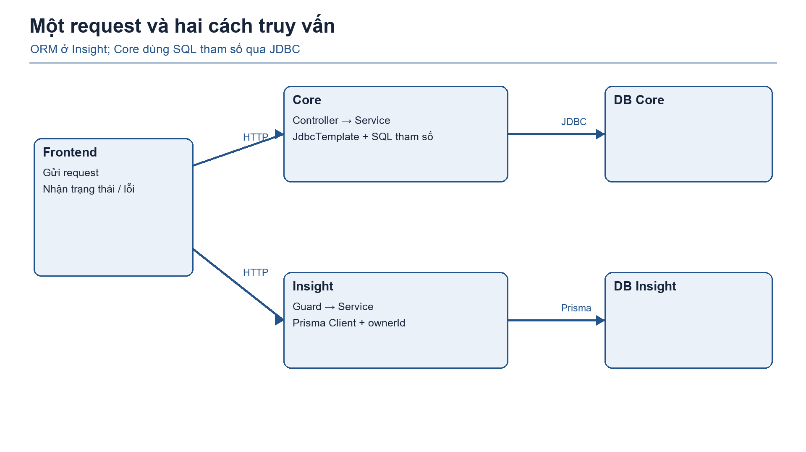

## 6.2. Phân bổ Hold và vòng đời Loan

`HoldAllocationService.allocateBook` chọn WAITING tương thích với Copy theo thời điểm xếp hàng rồi ID để giải hòa. Nó kiểm reader còn đủ điều kiện, Edition/chi nhánh phù hợp, claim Copy, đặt READY và deadline trong cùng giao dịch. Hủy, nhận, hết hạn và trả Copy đều phải đối chiếu trạng thái hiện tại. ETA ở `HoldEtaModel` là phép mô phỏng có giả định, không phải cam kết giao sách; khi thiếu dữ liệu hoặc quá hạn, UI phải nói rõ không thể ước tính. Test cạnh tranh hai Copy trả gần nhau và retry worker kiểm không phân bổ kép [6].

Quầy mượn/trả nhận khóa request để lần gửi lại sau mất mạng có thể trả biên nhận cũ. Loan mở có unique partial index trên Copy; Copy được cập nhật trạng thái/version trong transaction. Gia hạn phải kiểm người mượn, chính sách và hàng Hold đang chờ. Các quy tắc này nằm ở Core, không dựa trên nút disabled của UI.

## 6.3. Kiểm kê và sáu loại bất thường

Khi mở phiên, hệ thống chụp bản sách theo phạm vi vào snapshot. Mỗi scan có `clientScanId`; gửi lại cùng ID trả kết quả cũ thay vì nhân đôi. Khi chốt, service đối chiếu snapshot, scan và Copy hiện tại để tạo bằng chứng sai kệ, thiếu trong snapshot, trạng thái không khớp, sai chi nhánh, barcode không tồn tại và quét trùng. Nhân viên xem bằng chứng và xác nhận quyết định; version Copy cũ gây 409, không tự chuyển kệ. [Hình 17](#fig-17) là flowchart của hành vi này, khác sơ đồ lớp.

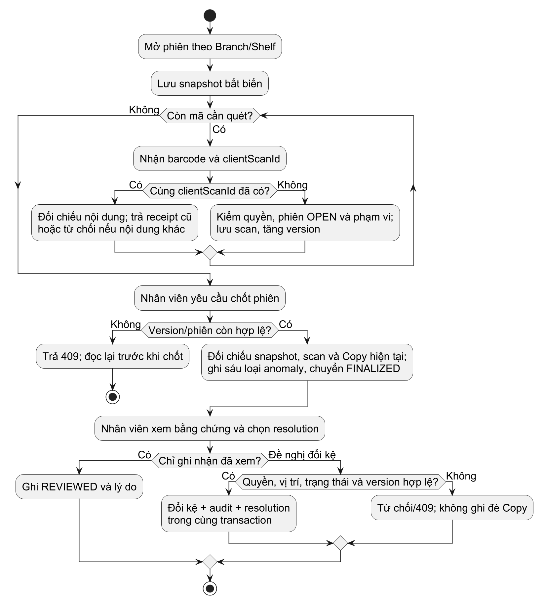

Camera trên thiết bị hỗ trợ `BarcodeDetector` chỉ điền mã vào ô; người dùng vẫn gửi/kiểm lại. Offline ở trang kiểm kê giữ tối đa 20 mã trong memory, đồng bộ tuần tự khi có kết nối và khóa chốt khi còn mã chờ. Đóng trang làm mất hàng đợi này; không nên mô tả nó là bộ lưu offline bền vững. Benchmark Testcontainers tại mốc 5.000 Copy/100 scan từng ghi open 489 ms, scan p95 17,7 ms, finalize 689 ms, nhưng đó là lượt đo local có fixture và môi trường riêng, không phải p95 sản xuất hoặc số đo của head PR #31 [7].

## 6.4. Tìm kiếm và đề xuất bổ sung

Catalog V22 chuẩn hóa chữ với `unaccent`, dùng `tsvector`/GIN và `pg_trgm` để tìm tên, mô tả, tác giả, ISBN. Điểm ưu tiên theo điều kiện đầu tiên khớp: ISBN đúng 150, tên đúng 120, tiền tố 80, full text 50 cộng rank giới hạn, tên tác giả 45, tên chứa 35, gần đúng bằng similarity nhân 20. Khi bằng điểm, ID quyết định thứ tự. Bộ lọc tác giả/thể loại, gồm alias đã chuẩn hóa, áp trước phân trang. Gợi ý tối đa năm nhan đề khi tìm rỗng là khớp chữ, không phải semantic search [8].

Insight `acquisition-v1` lấy Hold đang chờ (50%), Loan bắt đầu trong cửa sổ (35%) và Favorite mới nếu có dữ liệu (15%). Nếu một tín hiệu thiếu, giá trị là `null`, đóng góp 0 và confidence giảm; không điền số giả. Kết quả lưu nguồn, khoảng UTC `[from,to)`, snapshot, phiên bản công thức và evidence để nhân viên kiểm. Quyết định duyệt/từ chối cần lý do và version, chỉ xác nhận đề xuất nội bộ. Không có dữ liệu ngân sách, đơn đặt mua hoặc zero-result search để đưa vào công thức [9].

## 6.5. Outbox, retry và giới hạn lỗi

Outbox ghi fact cùng transaction Core. Publisher đọc hàng đã commit rồi gửi Kafka; Insight consumer tạo thông báo sau khi xác nhận sự kiện, có thể nhận lại nên cần idempotency. API mượn/trả không chờ broker. Khi `OUTBOX_ENABLED=false`, fact còn trong Core nhưng Inbox không có thông báo mới từ kênh này. Đây là đánh đổi giữa tính đúng đắn giao dịch và độ trễ thông báo, không phải đảm bảo giao hàng đồng thời tuyệt đối.

Bảng 10. Các trường hợp thành công và thất bại ở ranh giới nghiệp vụ.

| Tình huống | Kết quả mong đợi | Nơi kiểm |
|---|---|---|
| Đăng nhập đúng | JWT/cookie hợp lệ, vào route theo vai trò | Auth integration, Web E2E. |
| Sai mật khẩu/tài khoản khóa | Không cấp phiên | Auth integration. |
| Reader gọi API nhân viên | 403, không ghi dữ liệu | Integration quyền. |
| ISBN sai | 400, không gọi provider/ghi history | Metadata unit/HTTP. |
| History khác owner | 404 cho đọc/xóa/replay | Insight integration. |
| Scan gửi lại cùng clientScanId | Cùng biên nhận, không tạo scan thứ hai | Inventory integration. |
| Copy/version thay trước resolution | 409, không đổi kệ một phần | PostgreSQL integration. |
| Insight DB lỗi khi lưu | 503, không hiển thị đã lưu | History HTTP/frontend. |
| CSV chứa công thức | Nội dung được escape và vẫn là UTF-8 | LoanCsvExporterTest. |

# Chương 7. Kiểm thử và đánh giá

## 7.1. Phương pháp và phân biệt bằng chứng

Unit kiểm quy tắc thuần hoặc service với dependency giả. PostgreSQL/Testcontainers kiểm migration, ràng buộc, transaction, quyền và tranh chấp thật. Contract validator đối chiếu OpenAPI. React/Vitest kiểm state, form, error và chuyển phiên. Playwright Web E2E chạy trình duyệt, hai API và dữ liệu tạm; build Windows chỉ chứng minh bundle/installer tạo được, không tự chứng minh thao tác WebView2. Mỗi kết quả dưới đây ghi môi trường và SHA để không gộp số của những lần khác nhau.

Bảng 11. Bằng chứng kiểm thử tại mốc `0ef4007ac95fc4704e56527569fb0c1399a56e0d`.

| Mã | Kiểm tra | Kỳ vọng | Kết quả quan sát và nguồn |
|---|---|---|---|
| T01 | Frontend Vitest | Không có bài hỏng | 190/190 PASS local; 32 file test. |
| T02 | Frontend lint/typecheck/build | Không có lỗi | PASS local; Vite có cảnh báo chunk trên 500 kB, không phải lỗi build. |
| T03 | Responsive/ảnh cục bộ | 5 trang × 7 độ rộng không tràn/404 asset | 35/35 PASS local, 390–1920 px; chưa thay audit trợ năng. |
| T04 | Appearance/account switch | Không áp phản hồi cũ sang tài khoản mới | `AppearanceProvider.test.tsx` PASS local. |
| T05 | Core PostgreSQL/migration | Test suite đạt trên database CI | Job `core` PASS trong run 40690841710. |
| T06 | Node apps | Test/build Insight và Node script | Job `node-apps` PASS trong cùng run. |
| T07 | API contract | OpenAPI hợp lệ | Job `api-contracts` PASS. |
| T08 | Web E2E | Hành trình chính không hồi quy | Job `web-e2e` PASS; artifact có 32 PNG `test-results`. |
| T09 | Desktop Windows | Build/packaging thành công | Job `desktop-windows` PASS; artifact `lams-windows-x64`. |
| T10 | WebView2 thao tác tay trên máy viết báo cáo | Cửa sổ và luồng nghiệp vụ chạy cùng API | CHƯA CHẠY cho SHA này vì Docker Engine local chưa sẵn sàng lúc khảo sát. |

Nguồn của T05–T09 là [CI run 40690841710](https://github.com/Shuuma4869/He-thong-quan-ly-va-khai-thac-thu-vien/actions/runs/40690841710). T09 không thay T10. Hai mốc trước `46c1916` và `504499b` có CI riêng trong mô tả PR #31; chúng là lịch sử, không là bằng chứng cho thay đổi UI và report sau đó. Khi tài liệu này được commit, CI phải chạy lại tại head mới; kết quả bảng trên vẫn được ghi đúng mốc nguồn.

## 7.2. Bảng ca kiểm thử nghiệp vụ và cạnh tranh

Bảng 12. Ca kiểm thử theo tính chất lỗi, quyền và giao dịch.

| ID | Đầu vào/điều kiện | Kỳ vọng | Bằng chứng và trạng thái |
|---|---|---|---|
| AUTH-01 | Đăng ký email trùng | 409, không thêm user | `AuthIntegrationTest`, Core CI PASS. |
| AUTH-02 | Refresh token tái sử dụng | Thu hồi family, không cấp phiên hai lần | `AuthIntegrationTest`, Core CI PASS. |
| CAT-01 | Tìm với Unicode/alias | Thứ tự ổn định, không ghép SQL từ input | `PublicCatalogIntegrationTest`, Core CI PASS. |
| CAT-02 | Duyệt ảnh sai nguồn/version | Từ chối hoặc 409, ảnh cũ giữ nguyên | `MediaIntegrationTest`, Core CI PASS. |
| LOAN-01 | Hai request mượn cùng Copy | Tối đa một Loan mở | `LoanCommandIntegrationTest`, Core CI PASS. |
| HOLD-01 | Hai Copy trả đồng thời | Không READY kép; FIFO theo Book | `HoldIntegrationTest`, Core CI PASS. |
| INV-01 | Retry scan + chốt session | Một scan/ID; snapshot giữ nguyên | `InventorySessionIntegrationTest`, Core CI PASS. |
| INV-02 | Copy đổi version trước resolution | 409, không sửa một phần | `InventorySessionIntegrationTest`, Core CI PASS. |
| CSV-01 | Nội dung bắt đầu `=`, `+`, `-`, `@` | Không được diễn giải là công thức | `LoanCsvExporterTest`, Core CI PASS. |
| PREF-01 | User A lưu, User B đọc | B không thấy preset A | `UiPreferencesIntegrationTest`, Core CI PASS. |
| PREF-02 | Revision cũ/CSS tùy ý | 409/422, không lưu | Cùng test, Core CI PASS. |
| PREF-03 | Save A trả muộn sau login B | B vẫn giữ preset B | `AppearanceProvider.test.tsx`, local PASS. |

Tên file test trong bảng là chỉ dẫn tới nơi kiểm; kết quả CI khẳng định job đạt, không tự chứng minh từng thao tác sản xuất. Nhật ký từng bài và cấu hình runner cần đọc trong run khi nghiệm thu cuối. Các ca liên quan server thật ở Core có PostgreSQL/Testcontainers trên CI; Vitest không được dùng thay kiểm ràng buộc database.

## 7.3. Giao diện, hiệu năng và phục hồi

Artifact `web-e2e-results` của T08 có ảnh Public, Reader, Staff, Admin tại SHA nêu trên; README trong `ho-so-nop-bai/minh-chung-giao-dien/pr31/` chỉ rõ nguồn từng ảnh. [Hình 18](#fig-18) là báo cáo lưu thông ở staff; [Hình 19](#fig-19) là tài khoản admin trên bài E2E. Hai ảnh chụp một trạng thái, không bao phủ mọi chuyển đổi role hay toàn bộ CRUD.

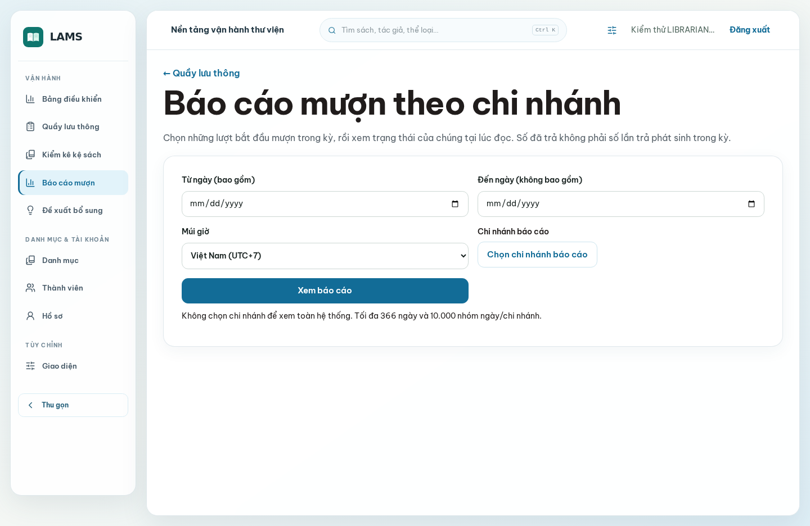

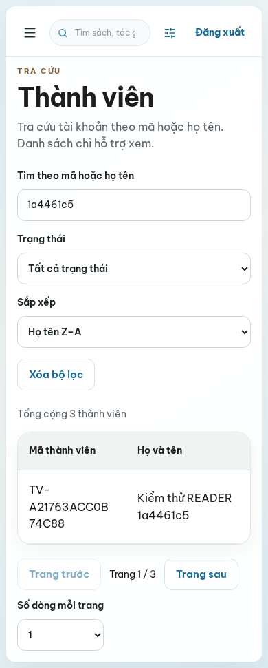

Đợt benchmark local trước đó dùng 10.013 Book demo: p95 trang đầu 32,7 ms, tìm tiền tố 732,1 ms với cấu hình PostgreSQL mặc định; thử `jit=off` cho p95 tiền tố 182,1 ms nhưng khác điều kiện cache, chưa đổi mặc định. Bài kiểm kê 5.000 Copy/100 scan cũng chỉ là tải kiểm soát trên máy phát triển [7]. Số này có giá trị tìm điểm nghẽn, không được gọi là SLA hoặc số của CI head. Runbook phục hồi đã diễn tập hai database cô lập ở đợt phát hành trước [10]; cần diễn tập lại trên hạ tầng pilot, xác định RPO/RTO và quyền sao lưu khi dùng dữ liệu thật.

# Chương 8. Bảo mật, pháp luật và đạo đức

## 8.1. Kiểm soát hiện có và rủi ro còn lại

Core dùng JWT access trong memory, refresh token hash trong database và cookie HttpOnly; role/owner được server xác định. SQL JDBC bind tham số, sort từ allowlist; Prisma dùng typed `where`, không nhận owner do client tự khai. Media inspector giới hạn HTTPS/host/MIME/kích thước và không theo redirect. Provider lookup có hạn mức riêng với đọc/xóa history, nhưng bộ đếm theo process, không thay ingress rate limit nhiều replica. CSV aggregate không chứa danh tính người mượn, escape ký tự công thức. Những cơ chế này giảm rủi ro, không chứng minh “không có lỗ hổng”.

Bảng 13. Threat, biện pháp và phần còn phải làm trước pilot.

| Nguy cơ | Biện pháp trong mã | Phần chưa đóng |
|---|---|---|
| SQL injection | JDBC bind, sort allowlist, Prisma typed query | Review mọi query mới và dữ liệu động. |
| Truy cập chéo owner | JWT/Core current role, owner trong query | Dữ liệu mồ côi xuyên dịch vụ khi xóa tài khoản. |
| SSRF/ảnh ngoài | Host allowlist, HTTPS, no redirect, giới hạn bytes | URL sau duyệt có thể đổi; IP người xem tới host nguồn. |
| Lạm dụng provider | Quota 10/phút lookup và quota 60/phút đọc/xóa history | Rate limit phân tán/ingress chưa có. |
| CSV formula | Escape đầu ô nguy hiểm, row cap, UTF-8 | Chưa kiểm mọi ứng dụng bảng tính. |
| Secret/backup | `.env` local và runbook khôi phục | Chưa nghiệm thu secret manager/HTTPS/RPO production. |

Lượt OSV theo metadata Maven ngày 28/10/2026 còn hai advisory `spring-webmvc` 6.2.19: CVE-2026-47890 và CVE-2026-47884. Core hiện trả JSON qua `@RestController`, không dùng SSE hoặc `XsltView` theo đường khai thác được nhà cung cấp mô tả; advisory vẫn còn trên SBOM và phải đánh giá lại khi đổi framework/endpoint. `npm audit` cũ ghi frontend không có advisory, Insight có tám LOW ở chuỗi dev; Docker Scout còn cảnh báo image hạ tầng. Đây là snapshot cũ, không thay quét lại ở commit phát hành [11].

## 8.2. Dữ liệu cá nhân và quyền ảnh

`metadata_lookups` không lưu payload nhà cung cấp nhưng UUID owner/ISBN và thời gian vẫn có thể liên quan một cá nhân. Chưa có TTL hoặc xóa theo tài khoản ở Insight; review report, Inbox và quyết định no-show cũng chưa có thời hạn lưu giữ được phê duyệt. Trước pilot cần chốt căn cứ, thời hạn, yêu cầu xóa/xuất dữ liệu, phạm vi backup và người chịu trách nhiệm. Báo cáo không đề xuất chạy lệnh xóa production theo một mốc chưa phê duyệt.

[Luật Bảo vệ dữ liệu cá nhân 91/2025/QH15](https://vanban.chinhphu.vn/?classid=1&docid=214590&pageid=27160&typegroup=) là nguồn chính thức để rà nghĩa vụ khi dùng dữ liệu thật; [Luật 07/2022/QH15 sửa đổi Luật Sở hữu trí tuệ](https://congbao.chinhphu.vn/van-ban/luat-so-07-2022-qh15-37504.htm) là căn cứ rà quyền tài sản trí tuệ. Báo cáo không phải ý kiến pháp lý hoặc chứng nhận tuân thủ. [Giấy phép Pexels](https://www.pexels.com/license/) cho phép dùng ảnh trong app, nhưng không bán ảnh nguyên bản, dùng làm nhãn hiệu hay ngụ ý người trong ảnh ủng hộ LAMS. Ảnh bìa/portrait từ nguồn khác phải kiểm license từng file; URL công khai không đồng nghĩa quyền sao chép [5], [12].

## 8.3. Đạo đức nghề nghiệp và minh bạch

Không dùng ảnh chân dung sai người để làm đầy card; fallback phải ghi đúng trạng thái. Không tự động phạt người đọc từ tín hiệu no-show hay anomaly có thể sai. Điểm Acquisition chỉ hỗ trợ nhân viên đánh giá, không tự thay quyết định mua. Nhóm phải giữ lịch sử đóng góp đúng tác giả commit, tách dữ liệu demo khỏi dữ liệu thật và không quay người dùng thật khi chưa có quyền. Bằng chứng kiểm thử cần gắn SHA, môi trường và giới hạn; một ảnh đẹp không thay bài test. Quy định sử dụng công cụ hỗ trợ trong học phần cần được sinh viên xác nhận với giảng viên, báo cáo không tự suy sự chấp thuận.

# Chương 9. Kết quả, giới hạn và kết luận

## 9.1. Kết quả thực tế

LAMS có mô hình Book/Edition/Copy, nghiệp vụ tài khoản, Catalog, reader contribution, lưu thông, giữ chỗ, kiểm kê, tìm kiếm từ vựng, báo cáo và đề xuất nội bộ trên hai dịch vụ. Web và Tauri chia sẻ UI. PR #31 bổ sung tài khoản/email, thông báo, xử lý đánh giá/no-show, camera kiểm kê, cải thiện tìm kiếm, preset giao diện và ảnh biên tập có nguồn. CI của SHA `0ef4007` đạt 5/5; bản báo cáo này đã đối chiếu code, migration, test và ảnh của đúng mốc đó. Nhóm có đủ đường trình diễn phát triển, nhưng chưa chứng minh sẵn sàng vận hành dữ liệu thật trên Internet.

## 9.2. Giới hạn cần xác nhận trước nộp và vận hành

Bìa/portrait theo từng bản ghi chưa có bộ ảnh được duyệt đầy đủ; sáu nhóm thể loại có ảnh minh họa, nhóm khác có visual fallback. Tám bìa demo đã đối chiếu chỉ được gắn qua thao tác duyệt trên đúng database demo. Chưa có ảnh thao tác WebView2 của head mới trên máy viết báo cáo khi Docker chưa sẵn sàng; CI Windows mới chứng minh build. Cần kiểm màn admin quản lý tài khoản, dashboard và nhiều trạng thái CRUD bằng ảnh riêng nếu muốn minh chứng trực quan cho từng màn. Widget ẩn/hiện nhưng chưa kéo thả sắp xếp. Trợ năng mới có kiểm focus/alt/reduced motion ở mức mã và các bài liên quan, chưa có audit WCAG với thiết bị hỗ trợ.

Tên trường, học phần, giảng viên, sinh viên, lớp, phân công cá nhân, ngày nộp và mẫu bìa chính thức còn phải xác nhận. Video demo và kiểm trên máy Windows thứ hai chưa có bằng chứng của SHA này. Trước pilot cần chốt HTTPS, secret, backup/restore, retention và kiểm lại dependency/container advisory. Chỉ sau khi PR #31 được review/merge, một commit trên `main` mới có thể được gọi là mốc bàn giao chính thức; không gán CI của nhánh cho merge SHA chưa tạo.

## 9.3. Kết luận

Thiết kế tách tác phẩm, ấn bản và bản vật lý cho phép Catalog giàu thông tin mà vẫn giữ giao dịch tồn kho đúng bản sách. JDBC/Flyway ở Core và Prisma ở Insight phản ánh hai kiểu lưu dữ liệu với owner rõ; outbox giảm phụ thuộc broker ở đường nghiệp vụ. Giao diện sáng và settings giúp người dùng điều chỉnh cách đọc, trong khi ảnh theo bản ghi vẫn tuân theo quy trình duyệt. Các bài test ở mốc đã ghi cho thấy hệ thống có thể trình diễn và tiếp tục phát triển; những giới hạn triển khai, quyền dữ liệu và kiểm chứng Windows thực phải được xử lý trước khi dùng như phần mềm thư viện production.

# Tài liệu tham khảo

[1] Project Gutenberg, [Offline Catalogs](https://www.gutenberg.org/ebooks/offline_catalogs.html); manifest snapshot trong `data/catalog/` của repository LAMS, truy cập 28/10/2026.

[2] Repository LAMS, [PR #31](https://github.com/Shuuma4869/He-thong-quan-ly-va-khai-thac-thu-vien/pull/31) và [CI run 40690841710](https://github.com/Shuuma4869/He-thong-quan-ly-va-khai-thac-thu-vien/actions/runs/40690841710), SHA `0ef4007ac95fc4704e56527569fb0c1399a56e0d`.

[3] LAMS, `tai-lieu/01-yeu-cau/user-stories.md`, `story-test-matrix.md` và Core/Insight OpenAPI trong cùng repository, cùng mốc khảo sát.

[4] LAMS, `tai-lieu/05-api-va-event/outbox-delivery.md` và mã `OutboxPublisher`, cùng mốc khảo sát.

[5] LAMS, `tai-lieu/06-giao-dien/nguon-anh.md`; [Pexels License](https://www.pexels.com/license/), kiểm ngày 28/10/2026.

[6] LAMS, `tai-lieu/04-nghiep-vu/thuat-toan/phan-phoi-hold.md`, `HoldAllocationService` và các integration test.

[7] LAMS, `tai-lieu/07-kiem-thu/hieu-nang.md`, số liệu local ngày 28/10/2026, không phải SLA.

[8] LAMS, `tai-lieu/04-nghiep-vu/thuat-toan/hybrid-search-ranking.md` và `BookRepository`.

[9] LAMS, `tai-lieu/04-nghiep-vu/thuat-toan/acquisition-score.md` và Insight recommendation tests.

[10] LAMS, `tai-lieu/08-van-hanh/sao-luu-khoi-phuc.md`, diễn tập trước mốc báo cáo.

[11] LAMS, `tai-lieu/07-kiem-thu/security-matrix.md`; [Spring CVE-2026-47890](https://spring.io/security/cve-2026-47890) và [CVE-2026-47884](https://spring.io/security/cve-2026-47884), snapshot 28/10/2026.

[12] Quốc hội, [Luật 91/2025/QH15](https://vanban.chinhphu.vn/?classid=1&docid=214590&pageid=27160&typegroup=) và [Luật 07/2022/QH15](https://congbao.chinhphu.vn/van-ban/luat-so-07-2022-qh15-37504.htm), nguồn chính thức kiểm ngày 28/10/2026.

# Phụ lục

## Phụ lục A. Hợp đồng và migration

Đường hợp đồng: `contracts/openapi/core-api.yaml`, `contracts/openapi/insight-api.yaml`. Core migration: `backend/core-service/src/main/resources/db/migration/V1__foundation.sql` đến `V31__ui_preferences.sql`; Insight Prisma: `backend/insight-service/prisma/schema.prisma` và thư mục `migrations/`. Sơ đồ trong Chương 3 chỉ chọn quan hệ phục vụ phân tích; các cột/constraint chính xác xem migration và data dictionary. Không dùng SQL trong báo cáo để thay schema thực.

## Phụ lục B. Cách chạy và tái lập kiểm thử

Theo `tai-lieu/08-van-hanh/chay-local.md`, máy Windows cần PowerShell 7, Java 21, Node 22 và Docker Desktop. Từ root chạy `pwsh -NoProfile -File .\scripts\setup-desktop.ps1`, `bootstrap-local.ps1`, sau đó mở ba terminal cho `start-core.ps1`, `start-insight.ps1`, `start-desktop.ps1`. Dữ liệu demo chỉ được tạo khi xác nhận đúng database local. Chạy `smoke-test.ps1` và `check-quality.ps1` trước khi demo. Vite web là cổng 5173, Core 8080, Insight 3000; Windows desktop mở cửa sổ riêng nhưng dùng cùng API. Bộ cài/build theo `tai-lieu/08-van-hanh/desktop-windows.md`. Không chép secret `.env` vào báo cáo.

## Phụ lục C. Ảnh và nguồn sơ đồ

Ảnh gốc CI và ảnh local của mốc khảo sát ở `ho-so-nop-bai/minh-chung-giao-dien/pr31/`; README của thư mục ghi SHA, run và điều có thể kết luận. Sơ đồ được tạo từ `scripts/report_figures.py`, đối chiếu với route, migration và service được nêu tại từng chương. Wireframe là thiết kế, ảnh UI là runtime. Khi sửa code hoặc thay ảnh, phải tạo lại cả hình và chú thích nguồn.

## Phụ lục D. Đóng góp và điều kiện bàn giao

Đối chiếu đóng góp theo `ho-so-nop-bai/bao-cao-nguon.md` và lịch sử PR; chủ tài khoản cần xác nhận alias. Tên, mã sinh viên, lớp, giảng viên và tỷ lệ đóng góp còn chờ nhóm điền. Khi nộp, bổ sung SHA cuối, CI, commit merge nếu có, video demo, quyền ảnh và ngày kiểm chứng.
