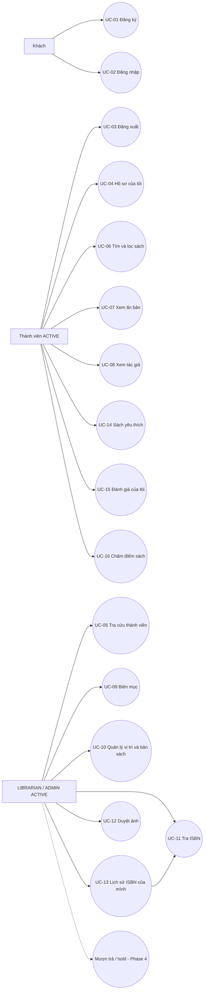

# Use case và phạm vi hiện thực

UC-01–16 khớp số của [User Stories](user-stories.md); actor, mục tiêu, AC và API nằm tại story tương ứng. Nét liền là chức năng có implementation, không mặc nhiên là đã nghiệm thu; nét đứt là roadmap.

Các API staff kiểm quyền hiện hành phía Core; UI ẩn nút không thay authorization. UC-13 lấy owner từ Core principal, kể cả ADMIN không được đọc/xóa history của tài khoản khác. Không có use case công khai tự nâng role. Profile chỉ đọc; mượn/trả và hold chưa phải chức năng chạy được. Favorites/Reviews/Rating và My Library đã có implementation UI; nghiệm thu cần kết quả test đúng SHA.

| UC | Tiền điều kiện | Luồng chính | Luồng thay thế / hậu điều kiện |
|---|---|---|---|
| 01 | Chưa đăng nhập | Validate → tạo READER → phiên | Trùng email 409; sai input không tạo account |
| 02–03 | Account/refresh hợp lệ theo thao tác | Xác thực/rotate hoặc revoke | Sai mật khẩu/refresh 401; access JWT đã cấp có thể còn hạn sau logout |
| 04–05 | Principal ACTIVE; list cần staff | Đọc projection hoặc query trang | 401/403; profile null hợp lệ; GET không ghi DB |
| 06–08 | Đúng quyền đọc API | Query hoặc ID → DTO sách/ấn bản/tác giả | Empty/404; không tính availability giả |
| 09–10 | Staff ACTIVE | Validate → transaction Core → đọc lại | 404/409/422, rollback; Copy version bắt buộc |
| 11–12 | Staff; nguồn ảnh đủ căn cứ | Tra candidate → đối chiếu → duyệt thủ công | Timeout/unavailable/license thiếu không tự lưu ảnh hay sửa metadata |
| 13 | Staff ACTIVE, Insight DB sẵn sàng | ISBN → provider → lưu trace → list/replay/delete | 400/401/403/404/429/503; write lỗi không báo thành công; replay không ghi Core |
| 14 | Thành viên ACTIVE | Lưu/bỏ lưu → reload → danh sách cá nhân | 401/403/404/409; principal từ server, không nhận userId |
| 15–16 | Thành viên ACTIVE; owner khi sửa/xóa | Nội dung và điểm → transaction → list/summary | 403 cross-owner; 409 duplicate; 422 invalid/null; PATCH độc lập field; xóa cuối trả average null/count 0 |
