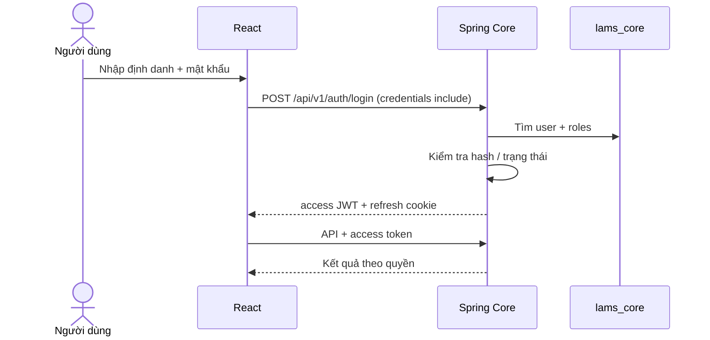
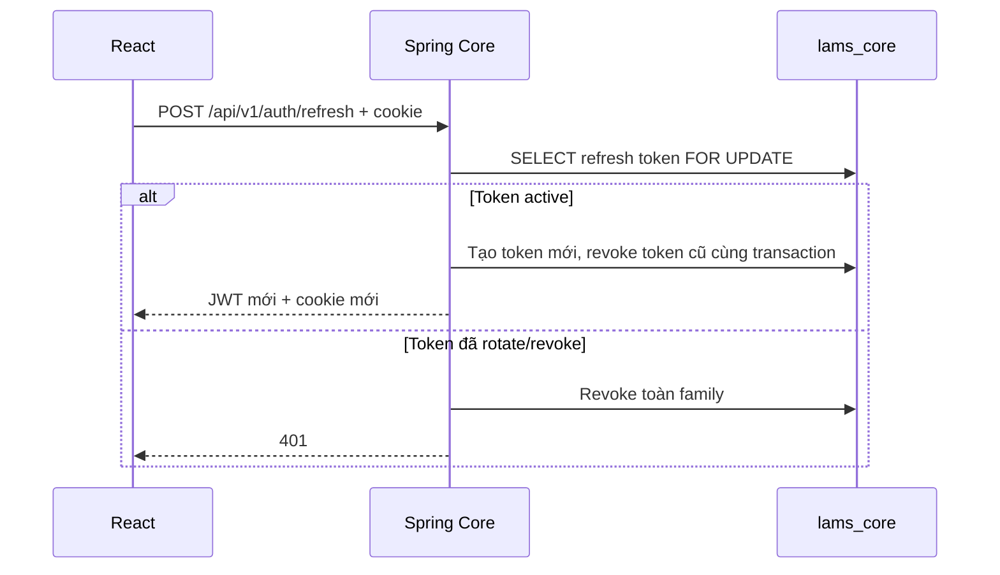
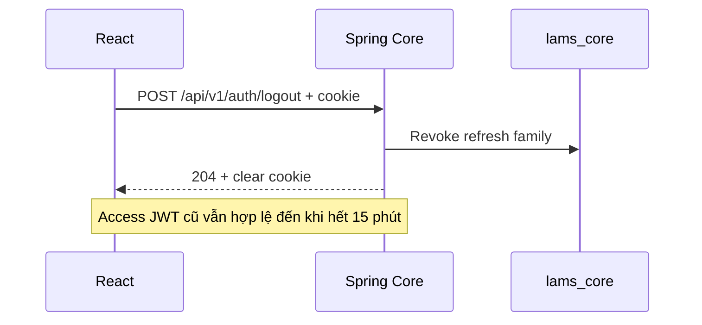
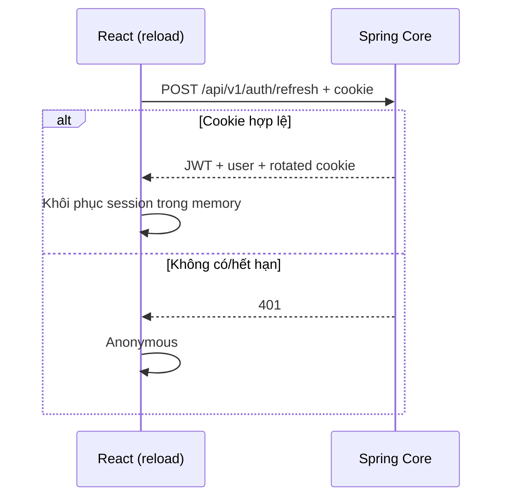

# Authentication Flow — Phase 1A

## Mục đích

Identity nằm trong Spring Core và `lams_core`. Đăng ký chỉ cấp `READER`. Access JWT sống 15 phút trong memory của frontend; opaque refresh token chỉ đi qua cookie `lams_refresh` HttpOnly, path `/api/v1/auth`. Local dùng SameSite=Lax. PostgreSQL lưu SHA-256 của refresh token.

Core yêu cầu `LAMS_JWT_SECRET` (ít nhất 32 byte) khi khởi động; `.env.example` chỉ là giá trị mẫu cho local. Không dùng giá trị mẫu khi triển khai production. CORS chỉ cho các origin cấu hình trong `CORS_ALLOWED_ORIGINS`, có hỗ trợ cookie credentials.

Profile `pilot` phục vụ client khác site với API: refresh cookie bắt buộc `Secure; SameSite=None`, mọi POST `/api/v1/auth/*` phải có Origin HTTPS chính xác trong allowlist và `X-LAMS-Client: 1`. Header không phải secret; nó buộc yêu cầu cross-origin từ trình duyệt đi qua preflight, kết hợp kiểm tra Origin phía server để chống CSRF. Yêu cầu không có Origin cũng bị từ chối trong pilot. API nghiệp vụ vẫn xác thực bằng Bearer JWT, không bằng refresh cookie. Không bật cookie None khi thiếu Secure hoặc thiếu bộ lọc trusted origin; server từ chối cấu hình đó khi khởi động.

Client pilot/production bắt buộc Core URL HTTPS, không fallback localhost; Insight có thể chưa cấu hình. Timeout mặc định 15 giây, cấu hình được trong khoảng 1–120 giây. Lỗi timeout/network không tự gửi lại POST; người dùng nhận thông báo để quyết định thử lại. Cơ chế thử lại sau 401 bên dưới vẫn chỉ thực hiện một lần. Xem [runbook pilot](../08-van-hanh/cloud-pilot.md) trước khi build bản kết nối Internet. Chính sách chặn cookie bên thứ ba của máy vẫn cần kiểm tra thực tế trên WebView2; unit/integration test không thay thế kiểm tra đó.

Frontend gom các yêu cầu refresh đồng thời vào một promise để tránh reuse do rotation. Server dùng row lock; nếu token đã rotate bị dùng lại, cả family bị thu hồi. Account `LOCKED`/`DISABLED` không được login hoặc refresh. `/auth/me` kiểm tra trạng thái từ DB.

## Hồ sơ và đổi thông tin đăng nhập

`/api/v1/me/account` trả về tên, mã thành viên, trạng thái, email đang dùng, số điện thoại và email đang chờ xác minh. Người dùng có thể sửa tên, thêm hoặc bỏ số điện thoại theo định dạng E.164. Số điện thoại có ràng buộc duy nhất ở PostgreSQL; không có bước xác thực quyền sở hữu số này, nên hiện chỉ dùng làm thông tin hồ sơ, không dùng để đăng nhập hoặc khôi phục tài khoản.

Đổi mật khẩu yêu cầu mật khẩu hiện tại. Core lưu hash mới, tăng `credential_version` và thu hồi refresh token trong cùng transaction. Mỗi lần xác thực JWT, Core so phiên bản trong token với tài khoản hiện tại; access token cũ hết hiệu lực ngay sau khi đổi mật khẩu. Giao diện chuyển về trang đăng nhập sau khi thao tác thành công. Việc kiểm phiên bản thêm một truy vấn cơ sở dữ liệu cho mỗi request có JWT, cần theo dõi tải nếu triển khai quy mô lớn.

Đổi email hiện dừng ở bước **ghi nhận yêu cầu**: người dùng nhập mật khẩu hiện tại và email mới; địa chỉ đăng nhập cũ vẫn giữ nguyên. Bản local/pilot chưa có dịch vụ gửi thư, mã xác minh hoặc bước xác nhận sở hữu hộp thư. Vì vậy không có API nào tự áp dụng email đang chờ. Người dùng có thể hủy yêu cầu. Email đang chờ chưa có thời hạn tự xóa; trước khi mở tính năng đổi email hoàn chỉnh cần bổ sung token xác minh, thời hạn, giới hạn gửi lại và xử lý trường hợp địa chỉ được tài khoản khác sử dụng trong lúc chờ.

Profile dùng `GET /api/v1/me/profile`; Member List dùng `GET /api/v1/members` và kiểm quyền/trạng thái hiện tại từ DB. Frontend dùng chung API client và AuthProvider, không lưu token ở localStorage. Mỗi truy vấn Member có cache key theo user và bộ lọc, có AbortSignal; đăng xuất xóa cache và chặn phản hồi refresh cũ khôi phục phiên. Nếu rotation đang chạy, frontend đợi nó kết thúc trước khi gửi logout để server thu hồi đúng refresh family. Một request bị 401 chỉ thử lại một lần sau refresh; nếu vẫn 401 thì kết thúc phiên phía frontend.
