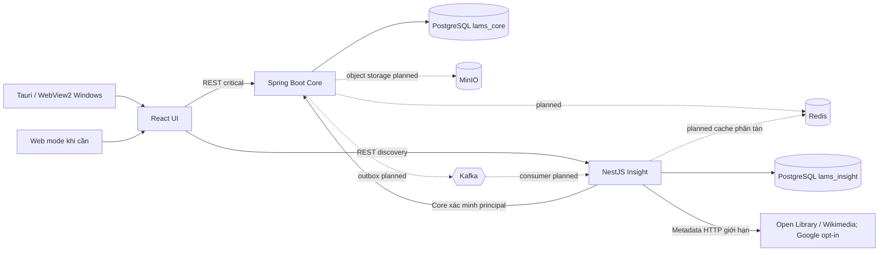

# Container Architecture

## Mục đích

Mô tả trách nhiệm runtime và đường dữ liệu chính.

Core sở hữu transaction nghiệp vụ; Insight không ghi trực tiếp vào `lams_core`. Kafka truyền fact sau commit, không thay transaction đồng bộ.

Tauri không phải backend mới. Release đóng gói static assets; Vite chỉ phục vụ dev. Auth/Member/Catalog/Inventory/media và metadata/history là đường REST có implementation. InsightDB lưu trace ISBN qua Prisma; cache provider hiện trong memory. Search/read model, event và object storage còn planned. Xem [ADR Windows desktop](adr/0007-windows-desktop-tauri.md).
