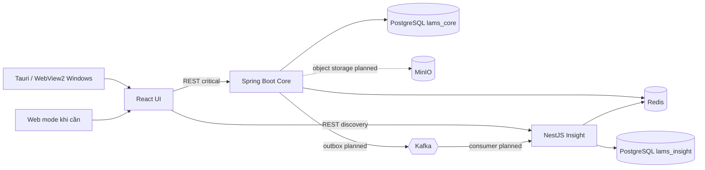

# Container Architecture

## Mục đích

Mô tả trách nhiệm runtime và đường dữ liệu chính.

Core sở hữu transaction nghiệp vụ; Insight không ghi trực tiếp vào `lams_core`. Kafka truyền fact sau commit, không thay transaction đồng bộ.

Tauri không phải backend mới. Release đóng gói static assets; Vite chỉ phục vụ dev. Auth/Member là đường REST hiện thực; search/read model, event và lưu ảnh còn là hướng triển khai. Xem [ADR Windows desktop](adr/0007-windows-desktop-tauri.md).
