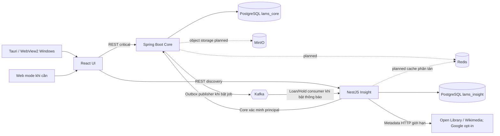

# Container Architecture

## Mục đích

Mô tả trách nhiệm runtime và đường dữ liệu chính.

Core sở hữu transaction nghiệp vụ; Insight không ghi trực tiếp vào `lams_core`. Kafka truyền fact sau commit, không thay transaction đồng bộ.

Tauri không phải backend mới. Release đóng gói static assets; Vite chỉ phục vụ dev. Core triển khai Auth/Member/Catalog, lưu thông, giữ chỗ, kiểm kê, tham chiếu ảnh và tìm kiếm PostgreSQL FTS/trigram. Insight lưu lịch sử ISBN, thông báo và đề xuất bổ sung bằng Prisma trong database riêng; cache provider hiện nằm trong bộ nhớ.

Outbox và consumer Loan/Hold đã có implementation. Đường sự kiện phụ thuộc cấu hình `OUTBOX_JOB_ENABLED`, `NOTIFICATIONS_ENABLED` và Kafka; thông báo có thể đến sau giao dịch. Insight lấy số liệu bổ sung sách qua API Core, không đọc trực tiếp database Core. Redis phân tán và lưu ảnh vào object storage chưa nằm trong luồng đang sử dụng; MinIO mặc định không khởi động. Xem [ADR Windows desktop](adr/0007-windows-desktop-tauri.md).
