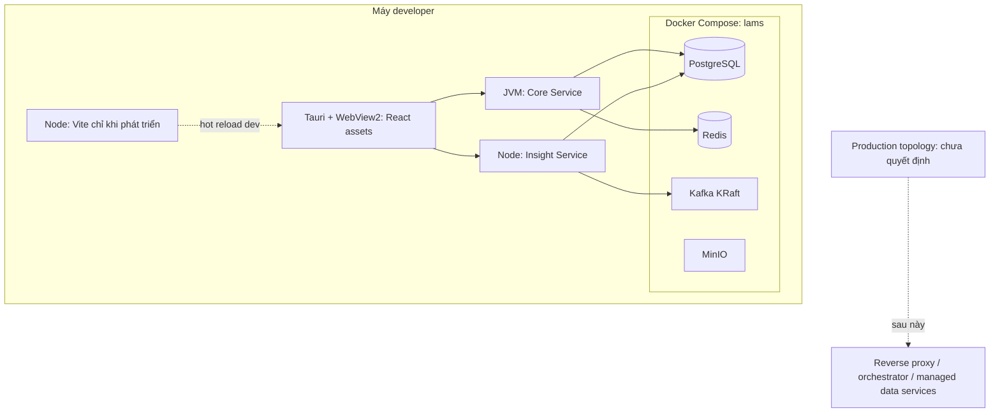

# Deployment Diagram

## Mục đích

Thể hiện topology local hiện tại và hướng production chưa triển khai.

Local dùng desktop client và backend/database riêng. Release không cần Vite; bộ cài không chứa Core, Insight hoặc PostgreSQL. Web mode vẫn dùng cùng React khi cần phát triển/kiểm thử. Xem [desktop Windows](../08-van-hanh/desktop-windows.md). Production cần threat model, backup, HA, secret manager và sizing trước khi chọn nền tảng; sơ đồ không ngụ ý hệ thống đã deploy.
