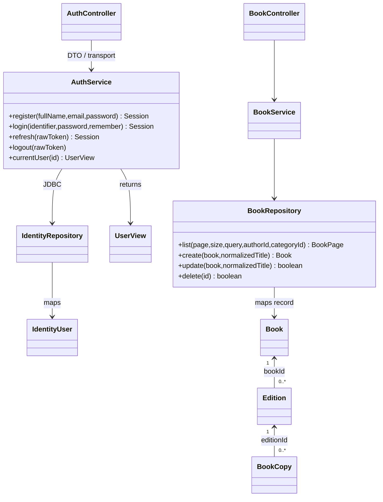
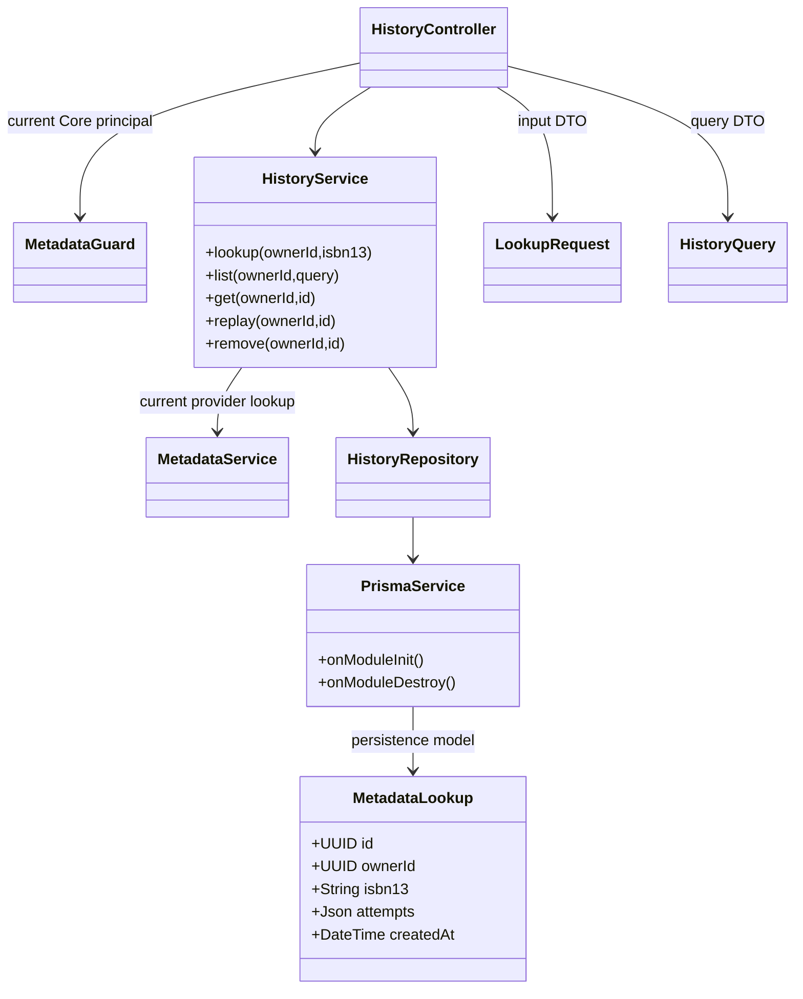
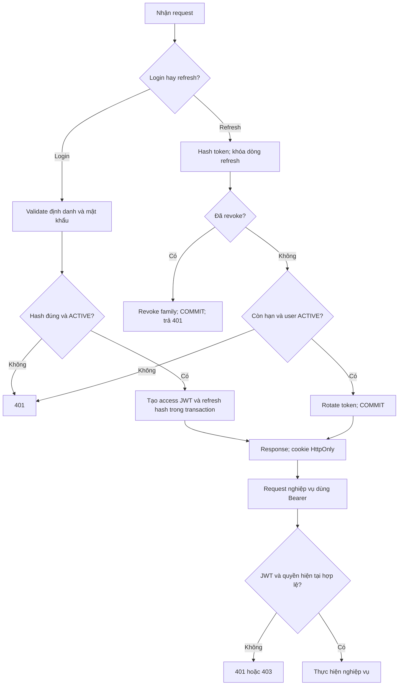
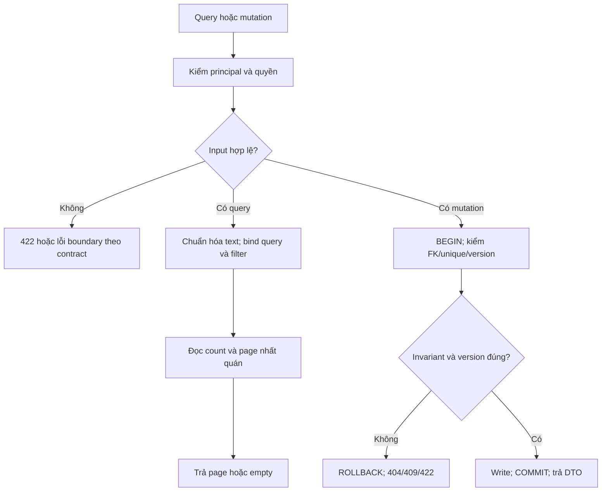
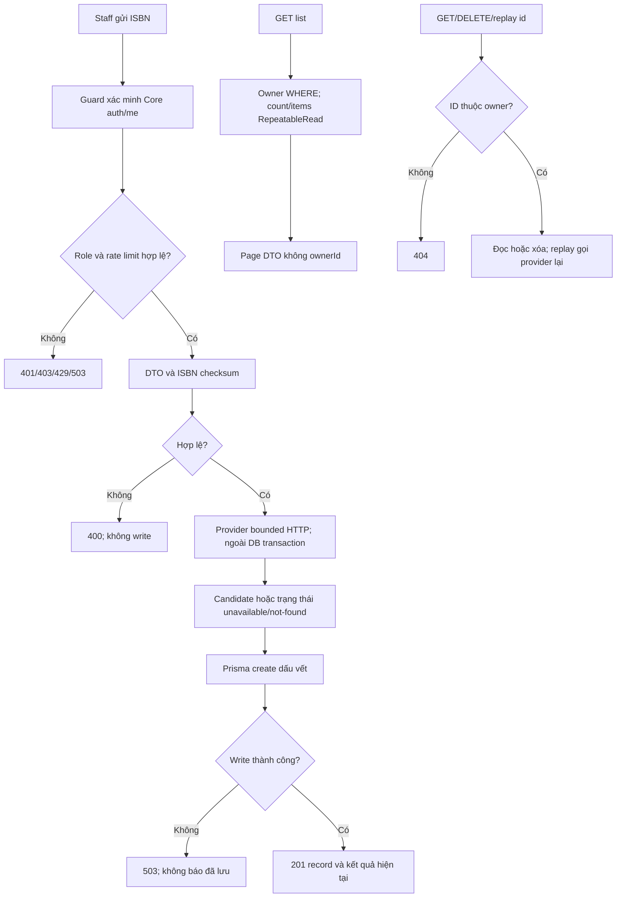

# Lớp và thuật toán đang triển khai

Các sơ đồ tách Core khỏi Insight; quan hệ dependency không phải FK xuyên database. Java domain hiện là record, JDBC repository không phải entity JPA. DTO và Prisma persistence model không được đánh đồng.

## Core Identity/Catalog

## Insight ISBN history

Một actor Core có 0..n MetadataLookup theo ownerId; đây là tham chiếu định danh, không sao chép User vào Insight. Chi tiết connection/transaction ở [ORM](metadata-history-orm.md).

## Đăng nhập, refresh và authorization

## Catalog filtering và cập nhật

Shelf/Copy có thứ tự khóa trong service và regression PostgreSQL; không suy cơ chế đó tự áp dụng cho Review.

## Metadata/history

Các lưu đồ này mô tả implementation; không thay thế bằng chứng runtime. Mượn/trả/outbox vẫn planned.
