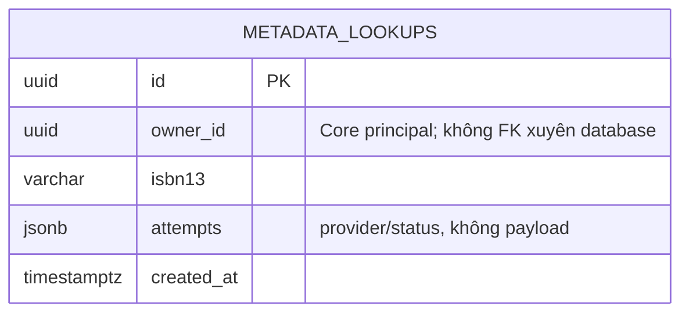
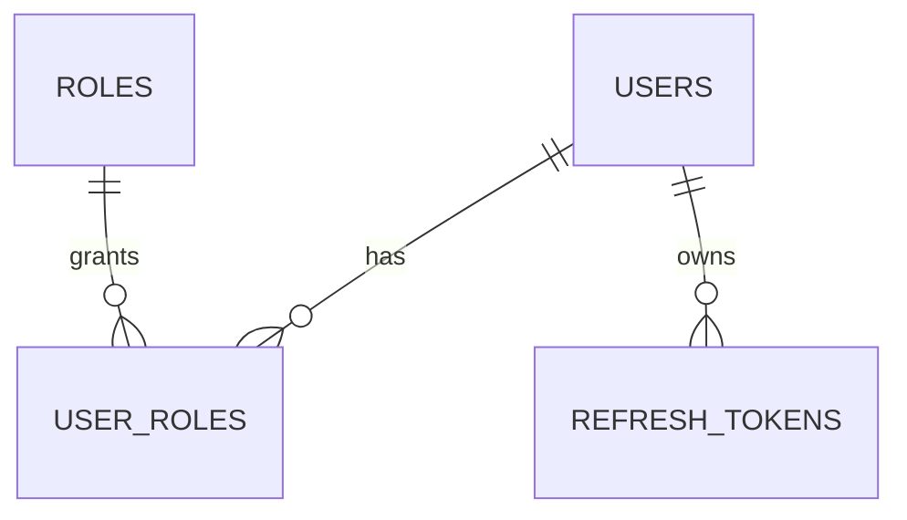
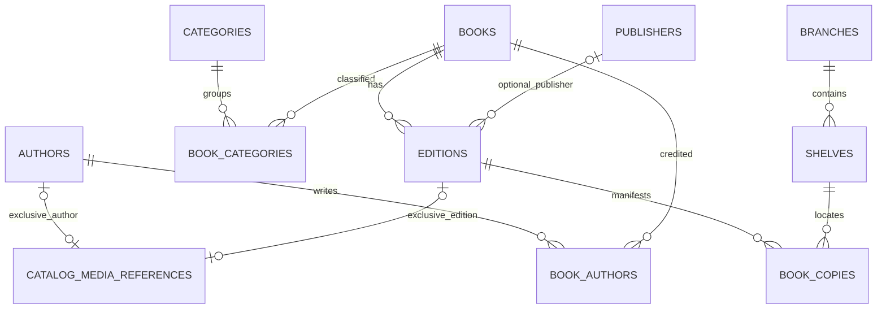
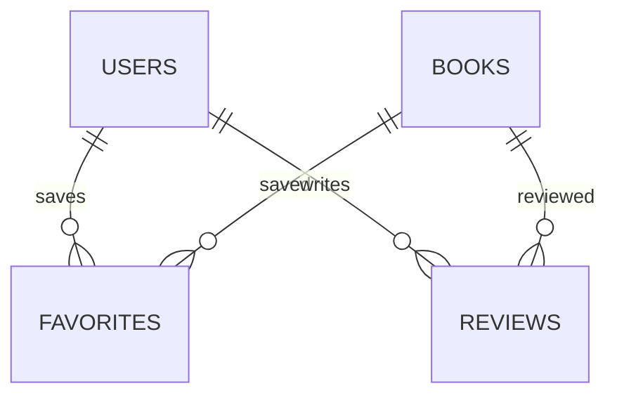
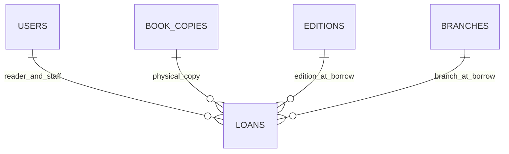
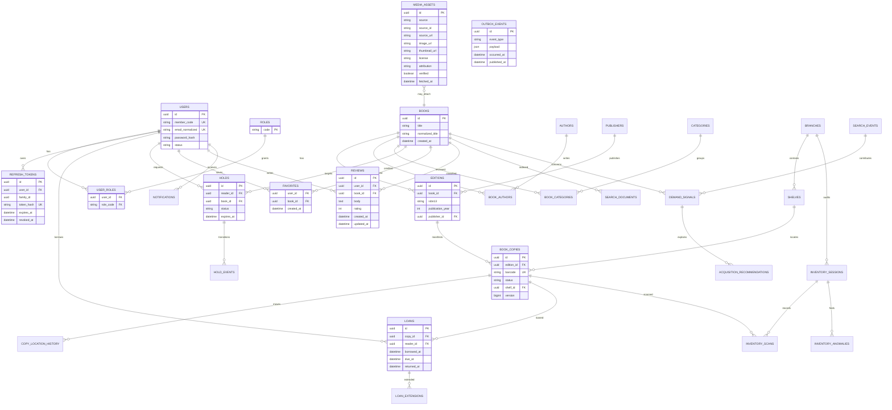

# ERD mục tiêu

## Insight history đã có schema

Database Insight sở hữu lịch sử tra cứu; không nối Book bằng FK và không sao chép Catalog. Schema đã viết không tự chứng minh migration runtime đã được nghiệm thu.

## Core đã có migration

Catalog/Inventory và ảnh tham chiếu:

My Library: Core API và UI Phase 3:

Media reference có đúng một trong hai FK Author/Edition, không phải cả hai cùng lúc; V13 bổ sung revision. Favorites/Reviews đã có schema, backend và UI Phase 3; trạng thái kiểm thử và tích hợp xem [bàn giao](../00-bat-dau/handoff-phase3-4.md). Chi tiết cột và constraint xem data dictionary và migration, không suy từ sơ đồ roadmap bên dưới.

## Mục đích sơ đồ mục tiêu

V16 bổ sung Loan trong Core; V17 thêm receipt và audit phục vụ Borrow/Return (Renew/Hold chưa có):

V17: `users 1—n circulation_requests`, khóa chính `(actor_id, request_id)`; `book_copies 1—n copy_state_changes`, unique `(copy_id, copy_version)`. Audit tham chiếu actor là users khi HUMAN, không có actor khi SYSTEM. Chưa có thao tác SYSTEM ở mốc mượn/trả này.

FK RESTRICT giữ lịch sử; unique partial `copy_id WHERE returned_at IS NULL` chặn hai Loan đang mở. [Kiến trúc lưu thông](../02-kien-truc/circulation.md) ghi transaction và giới hạn schema/policy/retention; chưa có Hold hoặc giao diện lưu thông chỉ từ sơ đồ này.

Mô tả target model để thống nhất tên và ownership. Đây không phải khẳng định mọi bảng đã được migration trong Giai đoạn 01.

## Quy tắc trọng yếu

Catalog/Inventory hiện có V3–V10; V11 nâng cấp khóa chuẩn hóa; V12 triển khai `catalog_media_references` với Edition hoặc Author (exclusive FK), không phải quan hệ MEDIA_ASSETS–BOOKS trong sơ đồ mục tiêu. V14 triển khai Favorites; V15 triển khai Reviews và rating 1–5. Các entity roadmap còn lại trong sơ đồ không đồng nghĩa đã có migration.

Phase 1A đã triển khai `USERS`, `ROLES`, `USER_ROLES`, `REFRESH_TOKENS` bằng Flyway V2. `USERS.id` là UUID cho Member/Profile tham chiếu sau này; `member_code` do Identity tạo, duy nhất. Chưa có bảng MemberProfile.

- Book, Edition và Copy là ba aggregate/data concept khác nhau.
- Chỉ một loan chưa trả được tồn tại cho một copy; thực thi bằng constraint/index cùng transaction.
- Barcode là duy nhất. ISBN không được giả định luôn có hoặc luôn duy nhất toàn cầu nếu dữ liệu nguồn chưa xác minh.
- Copy state và active hold assignment quyết định availability; không dùng `books.available/total` làm nguồn thật.
- Favorites unique theo `(user_id, book_id)`, cascade khi User/Book bị xóa. Reviews unique theo cặp này, restrict xóa User/Book; review hiện công khai ngay, chưa có moderation workflow. Rating nằm trên review; average/count là projection tính từ reviews hiện hành, không phải nguồn dữ liệu riêng.
- Các entity analytics nằm trong `lams_insight`; Core phát fact qua outbox/event thay vì cho Insight sửa schema Core.
