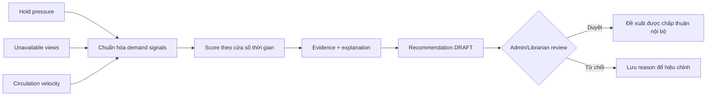

# Workflow đề xuất bổ sung sách

## Mục đích

Tạo đề xuất mua thêm có evidence, không tự động đặt mua.

Score không dùng dữ liệu nhạy cảm cá nhân nếu không cần. Mỗi recommendation lưu component score, cửa sổ, thời điểm snapshot và phiên bản công thức; quyết định nội bộ lưu người duyệt, thời điểm và lý do. Core cung cấp số Copy hiện tại, Hold đang chờ và Loan phát sinh trong cửa sổ thời gian. Lịch sử thêm Favorite và lượt tìm không có kết quả chưa đủ nguồn để đếm, nên được ghi là thiếu chứ không gán bằng 0. Ngân sách, sách đang đặt và mùa vụ chưa có nguồn đáng tin cậy nên chưa phải guardrail đang chạy. Con người quyết định cuối.

Nhánh Tuan đã có read projection Core, adapter gọi Core qua token nhân viên, hàm tính điểm `acquisition-v1`, migration lưu recommendation và workflow chuyển `DRAFT` sang `APPROVED`/`REJECTED` với kiểm tra version, lý do và audit. API và giao diện cho nhân viên xem bằng chứng, tạo đề xuất và quyết định. Bài E2E xuyên Core → Insight → UI dùng hai database PostgreSQL tạm đạt 18/18 trên Web và 18/18 trên EXE build lại tại máy phát triển; CI của commit bàn giao cần đối chiếu riêng. `APPROVED` chỉ là đồng ý với đề xuất, không tạo đơn đặt mua hoặc thanh toán. Mã người tạo/người duyệt được giữ để đối chiếu quyết định; [vòng đời dữ liệu Acquisition](../03-du-lieu/vong-doi-de-xuat-bo-sung.md) ghi rõ bước xem trước và quyết định còn cần đơn vị vận hành phê duyệt. Không tự xóa bản ghi production theo giả định.
