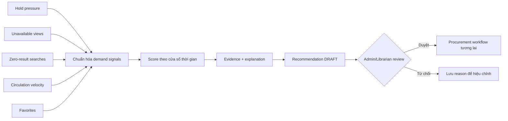

# Workflow đề xuất bổ sung sách

## Mục đích

Tạo đề xuất mua thêm có evidence, không tự động đặt mua.

Score không dùng dữ liệu nhạy cảm cá nhân nếu không cần. Mỗi recommendation lưu component score, cửa sổ, thời điểm snapshot và phiên bản công thức; quyết định nội bộ lưu người duyệt, thời điểm và lý do. Số Copy hiện có được kiểm trong `acquisition-v1`; ngân sách, sách đang đặt và mùa vụ chưa có nguồn đáng tin cậy nên chưa phải guardrail đang chạy. Con người quyết định cuối.

Insight có hàm tính điểm `acquisition-v1`, migration lưu recommendation và workflow chuyển `DRAFT` sang `APPROVED`/`REJECTED` với kiểm tra version, lý do và audit. PostgreSQL integration test kiểm các bước này trên dữ liệu thử. Nhánh DEV1 mở API nhân viên để xem danh sách/chi tiết, duyệt/từ chối và giao diện xem bằng chứng. Chưa có read projection Core nên chưa thể tạo đề xuất từ số liệu thật trong ứng dụng; sơ đồ từ nguồn dữ liệu đến DRAFT vẫn là đích nghiệp vụ. `APPROVED` chỉ là đồng ý với đề xuất, không tạo đơn đặt mua hoặc thanh toán. Mã người tạo/người duyệt được giữ để đối chiếu quyết định; chính sách thời hạn lưu và quy trình xóa/ẩn khi nhân viên rời hệ thống cần được chốt trước vận hành thật. Không tự xóa bản ghi production theo giả định.
