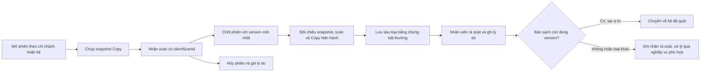

# Kiểm kê kệ sách

Kiểm kê đối chiếu dữ liệu lúc mở phiên với các scan thực tế. Snapshot, scan và bằng chứng bất thường được giữ lại; một scan không tự đổi vị trí hoặc trạng thái bản sách.

## Phạm vi hiện có

Core có API mở/đọc phiên, đọc snapshot/scan, nhận scan, finalize/cancel, đọc bất thường và ghi nhận quyết định rà soát. `InventorySessionService` dùng `InventorySessionRepository`, `InventoryQueryService` và detector thuần `AnomalyDetector`. V20 tạo `inventory_sessions`, `inventory_snapshots`, `inventory_scans`, `inventory_anomalies`; V21 thêm `inventory_resolutions`. Không đổi migration cũ và không suy tạo phiên từ dữ liệu đã có.

Giao diện nhân viên tại `/nhan-vien/kiem-ke` dùng API Core để mở phiên, chọn kệ, nhập/quét mã vạch bằng thiết bị hoạt động như bàn phím, chốt/hủy và xem bằng chứng. Camera/PWA và hàng đợi offline chưa có; cần mạng khi quét. Không dùng màn hình này như bằng chứng đã có quét camera hoặc đồng bộ offline.

## Mở phiên và snapshot

Scope là một chi nhánh ACTIVE, tùy chọn đúng một kệ thuộc chi nhánh đó. Mỗi chi nhánh chỉ có một phiên OPEN, kể cả hai người chọn hai kệ khác nhau; giới hạn này tránh các phiên quét chồng lấn. Có thể mở phiên mới sau khi phiên cũ FINALIZED hoặc CANCELLED.

Mỗi snapshot chứa UUID, mã vạch, chi nhánh, kệ, trạng thái và version Copy. Tập Copy được đọc bằng một SELECT trong transaction mở phiên, theo snapshot MVCC của PostgreSQL tại câu lệnh đó. `openedAt` là thời điểm Core bắt đầu chụp, không phải một mốc lịch sử dùng để chạy lại query Copy sống. Việc xác định snapshot dựa vào các hàng đã lưu. Copy đang đổi nhưng chưa commit sẽ được nhìn ở trạng thái đã commit trước đó; Copy đổi sau này không sửa các hàng snapshot.

Giới hạn 5000 Copy mỗi phiên. Vượt giới hạn trả 422 và rollback, không âm thầm cắt dữ liệu; chọn scope kệ nhỏ hơn. Phiên không có Copy vẫn hợp lệ. Bản sách ở mọi trạng thái đều có thể nằm trong snapshot để đối chiếu; chỉ AVAILABLE, IN_PROCESS và DAMAGED được coi là dự kiến có trên kệ khi tìm bản chưa quét.

## Scan và retry

Client tạo UUID `clientScanId` một lần cho mỗi lần quét và giữ nguyên UUID/payload khi retry. Cùng actor, key và nội dung trả biên nhận cũ, không tăng scan_count/version. Cùng key khác nội dung trả 409. Cùng mã vạch được quét bằng ID mới là một scan mới; detector có thể ghi DUPLICATE_SCAN. Mã vạch không tồn tại vẫn được lưu, không tạo Copy giả.

Kệ nơi quét phải thuộc scope phiên. Có thể phát hiện WRONG_BRANCH khi bản sách đang được đăng ký ở chi nhánh khác nhưng được quét tại kệ của phiên hiện tại; API không cho tự thay chi nhánh nơi quan sát bằng payload. Mã vạch được trim, giữ phân biệt hoa thường và tham số hóa SQL.

`receivedAt` do Core ghi và dùng cùng scan UUID để sắp thứ tự. `clientScannedAt` chỉ là dấu vết tùy chọn, được chấp nhận từ openedAt trừ năm phút tới server now cộng năm phút để phát hiện đồng hồ thiết bị quá lệch; nó không quyết định thứ tự nghiệp vụ. Scan đã lưu có thể replay sau khi phiên đóng. Scan mới đến sau finalize/cancel trả 409; vì vậy client offline phải gửi hết hàng đợi và đọc version mới trước khi đề nghị chốt.

Mỗi phiên tối đa 20000 scan. Scan và biên nhận được ghi cùng transaction, dưới khóa hàng phiên; scan mới tăng version. Hệ thống dùng chung cơ chế biên nhận hiện có trong `circulation_requests`, với namespace lệnh INVENTORY_START/SCAN/FINALIZE/CANCEL/RESOLVE; chưa có job xóa biên nhận. Giao diện giữ cùng ID/payload khi thử lại trong phiên trang đang mở; khi scan chưa rõ kết quả thì khóa nút chốt, và khi lệnh chốt chưa rõ kết quả thì khóa scan mới.

Khi mất mạng, nhân viên có thể lưu tối đa 20 mã trong **bộ nhớ của trang hiện tại**. Các mã này không tự gửi, không được đưa vào service worker hoặc cache dùng chung và sẽ mất khi đóng/tải lại trang. Khi có mạng, nhân viên bấm kiểm tra và đồng bộ; client đọc lại phiên trước, chặn nếu đã đóng/đổi phạm vi và yêu cầu xác nhận nếu version khác lúc lưu. Mỗi mã giữ một `clientScanId` khi retry, gửi tuần tự và chỉ bỏ khỏi hàng đợi sau biên nhận thành công. Lỗi mạng hoặc xung đột giữ mã lại để nhân viên đối chiếu; nút chốt bị khóa đến khi xử lý hết. Nếu rời trang, cần đối chiếu danh sách scan đã nhận trước khi quét lại. Đây là hàng đợi tạm có xác nhận online, chưa phải PWA offline bền vững.

Trên thiết bị có `getUserMedia` và `BarcodeDetector`, nhân viên có thể bật camera để điền mã vào ô quét. Ứng dụng chỉ xin quyền khi bấm nút, tắt camera ngay sau khi đọc một mã hoặc rời màn hình. Mã từ camera **không tự gửi**: nhân viên kiểm tra lại rồi bấm Ghi nhận scan. Nếu quyền bị từ chối, thiết bị không hỗ trợ hoặc mã quá dài, ô nhập thủ công và máy quét dạng bàn phím vẫn dùng được. Test hiện dùng camera giả lập; chưa có bằng chứng trên máy quét vật lý hoặc mọi phiên bản WebView Windows.

## Chốt và bằng chứng

Finalize yêu cầu requestId và version mới nhất. Nếu scan khác đã commit sau khi người dùng mở màn hình xác nhận, version cũ trả 409. Scan và finalize cùng tranh khóa phiên nên không có scan được chèn lọt sau khi đã đóng tập dữ liệu. Retry cùng key trả kết quả cũ; key mới không chốt lại một phiên đã đóng. Cancel cũng kiểm version, bắt buộc lý do và giữ snapshot/scan, nhưng không sinh bất thường.

Finalize đọc Copy hiện hành bằng một SELECT, rồi lưu kết quả đối chiếu trong cùng transaction đóng phiên. Các bằng chứng này phản ánh lúc đối chiếu, không tự chạy lại theo Copy sống mỗi lần GET. Danh mục đã thống nhất gồm:

| Loại | Ý nghĩa và giới hạn |
|---|---|
| WRONG_SHELF | Kệ quét khác kệ trong snapshot; khi không có snapshot của Copy thì so vị trí hiện hành |
| EXPECTED_BUT_MISSING | Copy dự kiến có trên kệ trong snapshot nhưng chưa nhận diện được qua scan; không kết luận tự động rằng sách đã mất |
| STATUS_MISMATCH | Có mặt vật lý nhưng trạng thái hiện tại không kỳ vọng trên kệ, hoặc trạng thái đổi so với snapshot |
| WRONG_BRANCH | Chi nhánh quan sát khác chi nhánh trong bằng chứng vị trí; tách khỏi WRONG_SHELF |
| UNKNOWN_BARCODE | Không tìm thấy Copy hiện hành cho mã đã quét |
| DUPLICATE_SCAN | Copy đã được nhận diện ở scan trước, lần sau dùng ID mới; bằng chứng giữ firstScanId |

Mỗi anomaly có UUID xác định từ phiên/loại/scan hoặc Copy, kèm snapshot, scan, trạng thái Copy lúc đối chiếu và version khi có. Nếu Copy bị xóa hoặc barcode đổi sau snapshot, bằng chứng hiện hành có thể thiếu; nhân viên phải đối chiếu trước khi sửa. Copy mới xuất hiện sau snapshot vẫn có thể được nhận diện qua scan, nhưng không được thêm ngầm vào snapshot cũ. Quét lặp một mã không tồn tại hiện tạo các bằng chứng UNKNOWN_BARCODE riêng; DUPLICATE_SCAN áp dụng khi đã nhận diện được Copy.

Chưa phát `INVENTORY_MISMATCH_FOUND` vì consumer cho loại này chưa triển khai. Không coi lưu anomaly là đã gửi thông báo.

## Rà soát và chuyển kệ

Mỗi bất thường có tối đa một quyết định trong `inventory_resolutions`, gồm người xử lý, thời điểm, hành động, lý do và version Copy quan sát/trả về. API yêu cầu `requestId`; retry đúng nội dung trả biên nhận cũ, key mới không ghi đè quyết định đã lưu. Giao diện bắt buộc nhân viên chọn hành động, nhập lý do và xác nhận trước khi gửi.

`REVIEWED` chỉ ghi nhận đã rà soát; không đổi Copy. Đây là lựa chọn cho mã vạch không có bản sách, quét trùng, bản thiếu trong snapshot hoặc bất đồng trạng thái cần nghiệp vụ khác xử lý. Nếu Copy còn tồn tại, request phải chứa version hiện tại; version đã đổi trả 409. Nếu Copy đã bị xóa, chỉ có thể rà soát với version rỗng.

`MOVE_TO_SCANNED_SHELF` chỉ áp dụng cho WRONG_SHELF/WRONG_BRANCH. Core dùng vị trí từ scan đã lưu, không nhận kệ tự khai trong request. Bản sách phải còn cùng mã vạch và cùng version lúc chốt; kệ quét vẫn thuộc chi nhánh đã quan sát và chi nhánh ACTIVE. Dịch vụ `BookCopyService.update` giữ quy tắc không đổi bản đang ON_LOAN/ON_HOLD, kiểm version thêm lần nữa và tăng version khi chuyển. Quyết định và thay đổi Copy nằm trong một transaction; bất kỳ xung đột nào đều rollback cả hai. Không tự đặt Copy thành AVAILABLE. Các điều chỉnh trạng thái dùng quy tắc bảo trì/lưu thông hiện có; kiểm kê không tạo đường tắt vượt qua loan/hold.

## Quyền, bảo toàn và vận hành

Mọi API chỉ dành cho ADMIN/LIBRARIAN ACTIVE có quyền hiện hành trong Core; JWT cũ không giữ quyền đã thu hồi. GET dùng transaction chỉ đọc, phân trang từ 1–100 dòng, page tối đa 10000. Snapshot/scan/evidence không chứa tên, email hoặc lịch sử người mượn; UUID nhân viên mở/quét/chốt được giữ để truy vết.

Chưa có retention hoặc xóa/ẩn danh phiên; FK của phiên, scan và resolution giữ chi nhánh, kệ và người thực hiện. Snapshot lưu UUID cùng dữ liệu lịch sử, không phụ thuộc vào Copy sống để bảo toàn bằng chứng khi bảo trì. Không có API sửa/xóa snapshot, scan hoặc quyết định rà soát. Trước pilot cần chốt thời gian lưu, xuất dữ liệu, quyền đối soát và giới hạn dung lượng.

## Kiểm chứng

`InventorySessionIntegrationTest` dùng PostgreSQL thật để kiểm snapshot cố định, scope, retry, sáu loại bất thường, quyền hiện hành, HTTP/validation, dữ liệu rỗng/quá giới hạn, Copy chuyển kệ trong transaction khác, scan/finalize cạnh tranh, quyết định chuyển kệ và từ chối version cũ. Test cạnh tranh đối chiếu `pg_blocking_pids` trước khi giải phóng khóa; không suy ra việc chờ chỉ từ sleep. `InventorySessionMigrationTest` nâng V19 có Catalog/outbox cũ lên V21 và kiểm dữ liệu cũ còn nguyên. Frontend kiểm luồng nhập scan, camera giả lập, fallback thủ công, hàng đợi bộ nhớ khi mất mạng, retry cùng ID, kiểm version trước đồng bộ, chốt phiên, chuyển kệ có xác nhận và quyền Reader. Bộ Web và EXE E2E tại source `1580bf6` đạt 18/18 mỗi loại trên database cô lập; commit sau nếu đổi mã chạy phải có bằng chứng riêng. Chưa có bằng chứng thiết bị quét vật lý hoặc khôi phục hàng đợi sau khi đóng ứng dụng.

Ngày 27/10/2026, chạy riêng `.\mvnw.cmd -Dtest=InventoryLoadBenchmark test` với PostgreSQL Testcontainers mới: 5.000 Copy trên một kệ, mở phiên 510 ms, 100 scan liên tiếp tổng 1.434 ms (mỗi scan P50 13,7 ms, P95 17,5 ms), retry một scan 20 ms, finalize 654 ms và lưu 4.900 bằng chứng `EXPECTED_BUT_MISSING`. Test xác nhận snapshot đủ 5.000, 100 scan duy nhất và đúng số bằng chứng. JVM heap đã dùng trước/sau là 78,7/95,2 MiB; mẫu cao nhất lấy giữa các scan và sau finalize là 98,7 MiB, **không phải đỉnh bộ nhớ thật**. `CommandExecutor` giới hạn transaction 20 giây và đặt `lock_timeout` 5 giây trong transaction; bài đo không chạm timeout. Test cạnh tranh khóa phiên nằm trong `InventorySessionIntegrationTest`. Đây là một lượt đo trên máy phát triển, không phải cam kết tải production hay kiểm thử 20.000 scan. Máy quét mã vạch vật lý và thời gian dùng trên mạng nhiều máy vẫn cần nghiệm thu thực địa.
