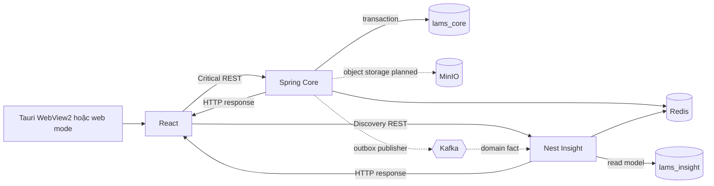
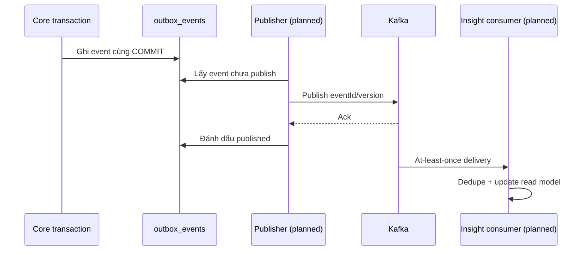

# Tổng quan system flow

## Mục đích

Phân biệt request đồng bộ và event bất đồng bộ planned.

Request ID đi từ client qua log; correlation ID sẽ nối command và event khi publisher/consumer được triển khai. Redis là tối ưu/coordination, không là source of truth. Outbox retry và việc không rollback Core khi Kafka/Insight lỗi là thiết kế mục tiêu, chưa có nghiệp vụ Loan để xác nhận bằng runtime. Desktop release gọi API loopback HTTP, không phải HTTPS production; xem [desktop Windows](desktop-windows.md).
