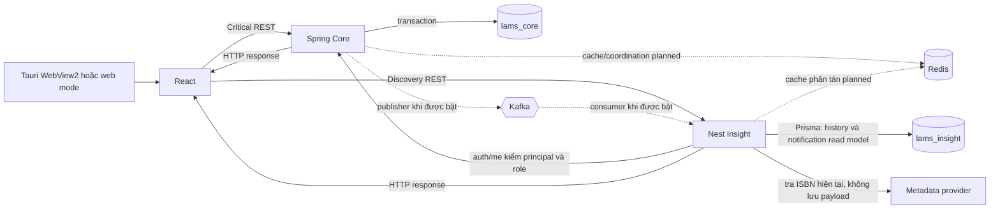
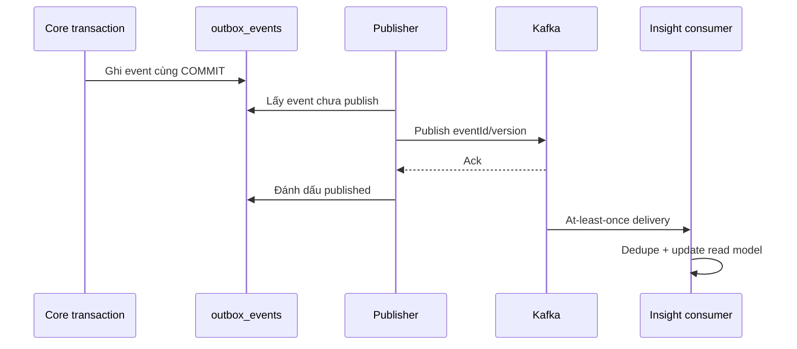

# Tổng quan system flow

## Mục đích

Phân biệt request đồng bộ với luồng event đã có mã nguồn nhưng mặc định chưa bật để vận hành chung.

Redis là tối ưu/coordination, không là source of truth. Giao dịch Loan/Hold ghi outbox ở Core; publisher và consumer có retry, dedupe và read model nhưng đều mặc định tắt. Test riêng của hai phía không thay thế nghiệm thu xuyên suốt từ HTTP Core đến thông báo Insight. MinIO tùy chọn và chưa được Core dùng để lưu ảnh. Desktop release gọi API loopback HTTP, chưa phải HTTPS production; xem [desktop Windows](desktop-windows.md).
